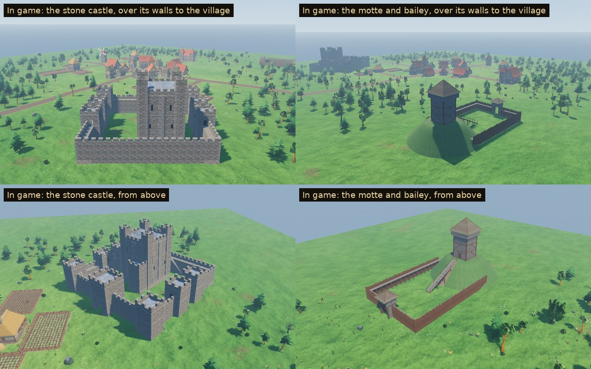

# Lord's Castle

Pieces for a lord's castle as it might stand in the 1180s. These are the game's own models (not to be confused with Kenney's Castle Kit in `3D/environments/castle-kit/`), built for Sovereign's Eye ahead of the castle phase. Nothing in the game builds a castle yet, and no system here does.

The pieces come in two tiers:

- **Timber (motte and bailey):** an earth mound with a timber tower on top and a flying bridge up to it, and a bailey closed by a palisade of pointed stakes with a gate tower.
- **Stone:** a curtain wall with a wall walk, square towers in line and at the corners, a gatehouse with a portcullis, and a great tower (keep) in the manner of Henry II's.

Two demo castles show the pieces put together beside a village (`tools/castle_demo.gd`, capture mode `castle`):



## Assets

| Model | What it is | Tris | Materials | Size (W × H × D) |
| --- | --- | ---: | ---: | --- |
| `SE_Curtain_Wall` | 4 m of curtain wall, 2.4 m thick. A battered foot, the wall walk at 6 m behind a crenellated parapet, a loop in each merlon and dressed sills in the crenels | 94 | 3 | 4.00 × 8.30 × 2.75 m |
| `SE_Curtain_Stair` | 8 m of curtain with a straight stair of twenty stone steps up its inner face to the walk, each with a dressed tread | 630 | 3 | 8.00 × 8.30 × 3.98 m |
| `SE_Curtain_Corner` | A plain angle: 3 m of curtain each way from the corner, the same as a corner tower, so the two swap. A merlon wraps the angle, with dressed quoins below | 180 | 3 | 4.55 × 8.30 × 4.55 m |
| `SE_Tower_Square` | A square mural tower, 6 m across and 10 m to its leads, standing astride the wall. It has a battered plinth, quoins and string courses, and loops on the faces that stand out of the wall. Doorways open onto the wall walk on both sides, a door and a window face the bailey, and a crenellated parapet surrounds a lead roof | 504 | 3 | 6.70 × 12.30 × 6.70 m |
| `SE_Tower_Corner` | The same tower for a corner: doorways onto both walls, and loops on its two outer faces | 486 | 3 | 6.70 × 12.30 × 6.70 m |
| `SE_Gatehouse` | A gate tower, 8 m square and 11 m to its leads. A round-arched passage 3.2 m wide with dressed voussoirs; the portcullis hangs half raised in its grooves, with a pair of oak gates standing open inward behind it. Loops over the gate, a window to the bailey, doorways onto the walls | 1,408 | 5 | 8.70 × 13.30 × 8.70 m |
| `SE_Keep` | A great tower, 14 m square and 18 m to its parapet, on a battered plinth. A pilaster buttress runs up each face and corner turrets rise 3 m higher. Round-headed windows grow larger floor by floor above slits at the bottom. Twin lead roofs sit behind the parapet, and a forebuilding covers the stone stair up to the raised entrance | 3,004 | 3 | 15.20 × 23.30 × 19.50 m |
| `SE_Palisade` | 4 m of pointed split-log stakes and two rails, with a plank fighting platform at 3 m on posts and brackets behind them | 704 | 2 | 4.02 × 5.00 × 1.38 m |
| `SE_Palisade_Corner` | The palisade turning a corner round a stout post, 2 m each way, the platform turning with it | 742 | 2 | 2.20 × 5.20 × 2.19 m |
| `SE_Palisade_Gate` | A timber gate tower on four posts. Its sides are boarded up to the fighting floor, which has a plank breastwork with loops. A shingled hip roof sits on the posts, open under its eaves; the plank gates stand open inward | 1,020 | 2 | 5.31 × 8.49 × 5.31 m |
| `SE_Timber_Tower` | The tower on the motte: a braced frame of posts and rails clad in planks, with an oak door under a lintel. At the top is a hoard (an overhanging fighting gallery) with loops in its breastwork, under a steep shingled roof with hip boards | 2,626 | 2 | 8.73 × 15.39 × 8.73 m |
| `SE_Motte` | An earth mound 28 m across and 7.2 m high under rough turf. It is uneven, not turned, with its top level for the tower and a trodden path up the flank under the bridge | 728 | 1 | 28.00 × 7.78 × 28.00 m |
| `SE_Motte_Bridge` | The flying bridge from the bailey up to the motte's top: a plank deck on stringers, carried on trestles standing on the ground and the flank, with rails and a sill at each end | 1,240 | 2 | 14.10 × 8.89 × 2.50 m |

**13 models.** The demo stone castle is about 10k triangles and the motte and bailey about 21k (two thirds of it its 20 lengths of palisade). Each piece is placed whole, so Godot's automatic LODs apply.

## The grid

The pieces join along a wall line running +X with the outside to −Y (Blender), so +Z is the outside in Godot.

- **Stone.** Every curtain piece is 2.4 m thick, with its wall walk at 6 m.
  - Lengths along the line: walls 4 m, the stair 8 m, the gatehouse 8 m, towers 6 m.
  - A corner (tower or plain angle) reaches 3 m along each of its two walls from its middle.
  - A side between two corners is therefore 6 m plus whole pieces; the demo's sides are 38 m.
  - A tower's doorways and the gatehouse's open onto the walk at 6 m.
  - Merlons keep a 2 m rhythm with half a crenel at each end of a piece, so lengths side by side keep it; the corners match it.
- **Timber.**
  - The palisade's stakes run 4 m per length, 0.25 m apart, and its platform is at 3 m.
  - A corner reaches 2 m along each side, so a side between corners is 4 m plus whole lengths.
  - The gate tower takes a length's place.
- **The motte, its tower and bridge.**
  - The motte and its bridge share an origin, the motte's middle; the bridge rises toward +X to land beside the tower's door.
  - The tower stands on the motte's top, 7.2 m up.

## In the game

Not yet. The castle phase will decide where castles stand and how they are built. Until then the pieces are shown by the capture tool:

- **The demo layouts.** `tools/castle_demo.gd` holds the two layouts. The stone castle has towers at the front corners, plain angles at the back, square towers on the sides, a stair at the back and the keep inside. The motte and bailey's palisade runs from the motte's flank round a 24 m wide bailey to the gate tower.
- **Placing them.** `find_spots` places both demo castles near the village, on the nearest ground where their footprints keep off buildings, fields, roads, yards and each other.
- **The capture.** `godot --path . res://tools/capture.tscn -- <seed> <dir> castle` levels the hills for the capture, since the pieces stand on flat ground. It clears the trees in and round the footprints and the scatter in them. It then shows each castle over its walls to the village, from the front, from above, inside, at its gate and with the heir before the gate.
- **Rendering paths.** Checked in all three of Godot's renderers on the stone castle's gate and the motte (`previews/_renderers_forward_mobile_compat.jpg`). All three draw them with no shader errors. Compatibility lights them differently, as it does the whole village: the meadow darker, the motte's turf paler.

## Construction

- **Scale and pivot.**
  - Real-world metres; characters are about 1.78 m.
  - The origin is at the ground in the middle of the piece (a corner's: where its two wall lines cross).
  - The front (the outside) is −Y in Blender and +Z in Godot.
  - Walls and towers go 0.3 m into the ground and stakes 0.4 m, so a gentle slope doesn't show their feet.
- **Research.**
  - **Mottes.** Mottes range from about 3 to 30 m high and 30 to 90 m across. In England and Wales, 24% of mottes stand 5–10 m high and 69% are lower, so a 7.2 m mound 28 m across is an ordinary one.
  - **The keep and its access.** The keep stood on the motte's top, reached by a flying bridge from the bailey or by steps cut in the mound. Both could be thrown down if the bailey fell.
  - **The keep's design.** It follows the great towers of Henry II's reign. Dover's, built 1180–89, has a central pilaster buttress on each face and a forebuilding over the stair to a raised entrance. Square towers along a curtain also come in at Dover in those years.
  - **Two tiers at once.** In 1187 many lords still held timber mottes while the king built in stone, so the family offers both.
- **Materials.**
  - Stone is the village kit's rubble (`MI_UnevenBrick`, the stone of the village's houses and the chapel tower), so a castle belongs to its village. Corners, courses, copings, voussoirs and treads are the kit's ashlar (`MI_RockTrim`).
  - Timber and iron use the kit's trim sheets (`MI_WoodTrim`, `MI_MetalOrnaments`). These are the Quaternius Medieval Village MegaKit sheets, referenced, not copied.
  - Shingles, turf, earth, the dark of loops and windows, lead, the gate leaves and the planks use this family's atlas: `MI_Castle`, `textures/T_Castle_BaseColor.png`, 512 × 512, painted by `source/paint_castle.py`, VRAM-compressed with mipmaps.
  - Planks and shingles repeat their atlas cell over a big surface (`boards`, `pyramid_roof`) so they keep their real size.
  - The motte's path and the bridge's feet are laid on the turf itself, found by ray (`motte_ground`).
- **Budgets.**
  - Pieces laid by the dozen (walls, palisade lengths, corners) stay under 1k triangles, a plain wall under 300.
  - Towers stay under 800, the gatehouse and gate tower under 2k, and the keep and the timber tower under 4k.
- **Build.** The build is deterministic: the same source gives byte-identical GLBs (see `3D/props/farm-field/README.md`).

## Rebuilding

```
python3 source/paint_castle.py                                          # the atlas
/root/bpy-venv/bin/python source/build_castle.py --export               # models + lords_castle.blend
/root/bpy-venv/bin/python source/build_castle.py --review DIR           # Cycles views per model
godot --headless --path . --import
godot --headless --path . --script res://tools/asset_check.gd -- res://3D/buildings/lords-castle/models/
godot --path . --resolution 1280x720 res://tools/capture.tscn -- 9 GAME_DIR castle   # the demo castles in game
python3 source/make_sheets.py DIR GAME_DIR previews stats.json           # contact sheets
python3 3D/tools/build_asset_manifest.py                                 # manifest + VALIDATION.json
```

`CASTLE_KINDS=stone` captures only that castle.

## Folder

| Path | Contents |
| --- | --- |
| `models/` | Runtime GLBs (geometry embedded, textures by relative path) |
| `textures/` | `T_Castle_BaseColor.png`, the family's atlas |
| `source/` | Blender source, build, paint and sheet scripts (ignored by Godot) |
| `previews/` | One contact sheet per model (Blender views beside a 1.78 m figure, the demo castles in game) and the overview (ignored by Godot) |

## Validation

- `tools/asset_check.gd` loads every model as the game does and checks triangle counts, materials, texture slots, LODs and size.
- `tests/test_castle.gd` checks that:
  - all 13 models load within budget with their textures;
  - each piece measures what the grid says where it meets its neighbours (cut through at 3.5 m): walls 4 m, the stair and gatehouse 8 m, towers 6 m, corners 3 m each way, palisade lengths 4 m, its corners 2 m each way;
  - every wall walk is at 6 m and clear, and every tower and the gatehouse has a doorway at that height toward each wall it joins;
  - the stone demo closes: four sides of whole pieces from corner to corner, neighbours meeting end to end with no gap and not standing in each other, and the keep 3 m clear of everything;
  - the motte's top is level under its tower, and the bridge comes down from beside the tower's door to the ground well inside the bailey;
  - both demo castles find room beside six villages, clear of buildings, fields, roads, yards and each other, the same each time.

## Limitations

- **Art only.** No castle can be built, garrisoned or lived in; the castle phase brings that.
- **Flat ground.** The pieces stand level; on a slope their feet sink or float. The demo levels the hills.
- **No interiors.** Doors and windows are dark, and the keep, towers and gatehouse have no floors inside. The passage through the gatehouse is open.
- **Fixed details.** The portcullis stays half raised and the gates open. The bridge is made for this motte. The parapets have merlons only on the outside, and the wall walk has no rail on the bailey side.
- **Not yet.** There are no ditches, moats, drawbridges, halls, chapels or stables in the bailey. A castle's lists (from the Training Yard family's plans) also come later.

## License

CC0 1.0 (see `LICENSE.txt`).
