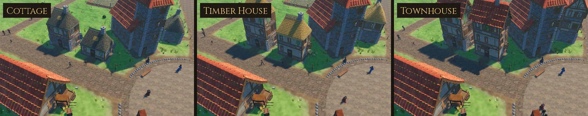

# Thatch & Repair

What a poor home is roofed and mended with, and what it is roofed with once
the family does better. These are the game's own models, built for
Sovereign's Eye to sit on the Quaternius village kit's walls.

Before this family every home had the kit's orange tiles, so a hamlet looked
like a small town. Now a home's roof and walls follow its level:

- **Cottage:** weathered grey-brown thatch with moss on the butt ends, a sagging ridge and a patch of new golden straw. Up to two ground-floor walls are patched: wattle showing where the daub has fallen away, a smear of new daub, or boards nailed over a hole. Plank shutters: one leaf hanging from a lost hinge, or shut with a board gone.
- **Timber House:** neat golden thatch with a block-cut ridge (points and scallops, liggers and crossed spars). The walls are mended and the kit's shutters are back.
- **Townhouse:** the kit's tiles, as before.
- **Farmhouse:** neat thatch at 6 × 8 m.



## Assets

| Model | Where | What it is | Tris | Materials | Size (W × H × D) |
| --- | --- | --- | ---: | ---: | --- |
| `SE_Thatch_4x6_Worn` | Cottage | Hipped thatch over 6 × 4 m walls, weathered: grey straw, moss, a sagging ridge, ragged eaves, a patch of new straw on the front | 2,951 | 3 | 5.05 × 3.77 × 6.62 m |
| `SE_Thatch_4x6` | Timber House | The same roof, neat and golden, a block-cut ridge with liggers and crossed spars | 2,782 | 2 | 4.97 × 3.86 × 6.57 m |
| `SE_Thatch_6x8` | Farmhouse | The neat roof over 8 × 6 m walls | 3,748 | 2 | 6.97 × 4.74 × 8.57 m |
| `SE_Patch_Wattle` | Cottage walls (plaster) | Daub fallen away: woven hazel behind a broken rim of limewash | 100 | 1 | 0.96 × 0.70 m |
| `SE_Patch_Daub` | Cottage walls (plaster, stone) | A smear of new clay daub over a crack, chopped straw in it | 66 | 1 | 0.72 × 0.63 m |
| `SE_Patch_Boards` | Cottage walls (plaster, stone) | Three grey boards nailed across a hole, the wattle showing between them | 208 | 1 | 0.87 × 0.63 m |
| `SE_Shutters_Plank_<Wide_Round, Thin_Round, Wide_Flat>_Open` | Cottage windows | Board-and-batten leaves swung open, the right one hanging from its lower hinge | 280–312 | 1 | up to 2.51 × 1.76 m |
| `SE_Shutters_Plank_<…>_Closed` | Cottage windows | Both leaves shut, Z-braced, the inner board gone (wide windows) or snapped off (the narrow window) | 280–296 | 1 | up to 1.34 × 1.64 m |

**12 models**, three of them roofs (sizes in the model's own frame: span across, ridge along the depth). Every piece fits the kit's own frame:
- the roofs sit where `Roof_RoundTiles_<span>x<length>` sits;
- the shutters fit the kit's three window shapes, in the wall module's frame;
- the patches go on the face of a wall.

## In the game

- **Roofs.**
  - A block whose roof is `thatch` or `thatch_worn` (`data/building_kit.json`) gets a hipped thatched roof (`VillageKit._add_thatched_roof`) in place of the tiles and the two brick gables.
  - The roof is hipped all round, so the attic needs no gable.
  - The chimney rises out of the ridge, as it did through the tiles.
  - A size the family has no roof for falls back to the tiles.
- **Levels.** Cottages are `thatch_worn`, farmhouses `thatch`. A home's level (`home_tiers`) re-roofs it: `thatch` at a Timber House, `tiles` at a Townhouse.
  - An upgrade keeps the floors the home already has (as before); the roof comes off and the new one goes on.
- **Repairs.**
  - A Cottage's recipe has `"repairs": 2` and `"shutters": "plank"`.
  - The first two plain ground-floor walls (the front first) are patched. The patches go down the wall set's list (`thatch` `patches`), so a home's two differ: wattle then boards on plaster, boards then daub on stone.
  - Each patch sits at a random height and offset along its wall (`patch_height`, `patch_offset`), and leans a little.
  - Patches are rolled on their own random stream, so the walls, windows and doors come out exactly as they did.
  - Plank shutters take the kit's place at the same windows, open or shut as the kit's would be.
  - A Timber House sets `repairs` to 0 and `shutters` to `kit`: an upgrade mends the walls.
- **Loading.** A module named `thatch:NAME` loads `NAME.glb` from this folder (`building_kit.json` `roots`, `VillageKit.module_path`).
  - Roofs are merged into the building's shell, one surface per material.
  - Patches and shutters join the details, hidden beyond `detail_range` like the kit's shutters.
- **Saving.** Nothing new is saved: the look follows the home's type, variant and level.
- **Rendering paths.** Checked in all three of Godot's renderers on a poor cottage (`previews/_renderers_forward_mobile_compat.jpg`); the thatch's normal map holds up in Compatibility.

## Construction

- **Roofs.**
  - Built from contour rings: the walls' rectangle moved in by a distance `d`, its corners rounded. Rings are lofted from the underside, round a thick eave and up to the ridge.
  - The hips come out rounded, and the courses of straw, which follow the rings, run level all round.
  - The hip ends are 1.7 times steeper than the long slopes, so the ridge is long (3.6 m on a cottage).
  - Pitch is 53.5° on a cottage and 51° on a farmhouse. The thatch is 0.26 m thick and the eaves overhang 0.45 m.
  - The underside is closed out past the wall tops, so the eaves look solid from below.
- **Ridges.**
  - A block-cut ridge stands 13 cm proud and wraps round the hip ends. Its lower edge is cut in points and scallops every 0.5 m.
  - The worn ridge is thin and ragged, and sags 16 cm between its ends.
  - The weathered roof wobbles (low noise), its eave line wanders, and its new-straw patch is a rounded oblong laid along the courses, feathered at the edge.
- **Shutters.** Boards cut to the window's arch with a small gap between them, two battens and a Z-brace, iron straps and nails.
- **Patches.** The wattle patch is the weave set back behind a raised, broken rim of plaster, so the hole reads as a hole.
- **Materials.**
  - `MI_Thatch` (`textures/T_Thatch_BaseColor.png`) and `MI_Thatch_Worn` (`T_ThatchWorn_BaseColor.png`) are 1024 × 1024 tiles, 1.6 m of roof each. They show straw laid in courses with ragged butt ends; the worn one is grey with rain streaks, rot and moss.
  - Both share `T_Thatch_Normal.png`: each course swells toward its butt end and drops under the next.
  - `MI_ThatchKit` (`T_ThatchKit_BaseColor.png`) is an atlas: ridge bands, eave butt ends, the underside between rafters, weathered boards, battens, iron, wattle, daub and broken limewash.
  - All four are painted by `source/paint_thatch.py`, VRAM-compressed with mipmaps (the normal map as a normal map).
- **Budgets.**
  - A cottage roof is under 3.2k triangles (the kit's tiled roof and its two gables come to 3.0k) and a farmhouse roof under 4k (the kit's, 4.5k).
  - Patches are under 300 and shutters under 400.
- **Build.** The same source gives byte-identical GLBs (see `3D/props/farm-field/README.md`).

## Rebuilding

```
python3 source/paint_thatch.py                                          # the four textures
/root/bpy-venv/bin/python source/build_thatch.py --export               # models + thatch_repair.blend
/root/bpy-venv/bin/python source/build_thatch.py --review DIR           # Cycles views per model
godot --headless --path . --import
godot --headless --path . --script res://tools/asset_check.gd -- res://3D/buildings/thatch-repair/models/
godot --path . --resolution 1280x720 res://tools/capture.tscn -- 9 GAME_DIR thatch   # in game
python3 source/make_sheets.py DIR GAME_DIR previews stats.json          # contact sheets
python3 3D/tools/build_asset_manifest.py                                # manifest + VALIDATION.json
```

## Folder

| Path | Contents |
| --- | --- |
| `models/` | Runtime GLBs (geometry embedded, textures by relative path) |
| `textures/` | The thatch tiles, their normal map and the kit atlas |
| `source/` | Blender source, build and paint scripts, sheet maker (ignored by Godot) |
| `previews/` | One contact sheet per model: Blender views above, the game below (ignored by Godot) |

## Validation

- `tools/asset_check.gd` loads every model as the game does and checks triangle counts, materials, texture slots, LODs and size.
- `tests/test_thatch.gd` checks that:
  - all 12 models load within budget, with their textures (and the thatch's relief);
  - a Cottage has weathered thatch, a Timber House neat thatch and a Townhouse the tiles with their gables; a farmhouse has neat thatch; every level keeps its chimney;
  - the roof sits on the walls, overhangs them, is about as tall as the tiles, and the chimney clears the ridge;
  - a poor home's patches suit its walls, sit on the ground floor outside a wall, are no more than its recipe allows, and its shutters are plank;
  - a Timber House is mended, with the kit's shutters at the same windows, open or shut as they were;
  - a size with no thatched roof falls back to the tiles;
  - the same home comes out the same every time.
- `tests/test_growth.gd` still checks that an upgrade keeps the walls a home already has.

## Limitations

- **Thatch by level, not by family or age.** A home's look follows its level. A cottage built today is weathered from the day it is finished, and a Cottage stays patched however long its family has lived there.
- **Homes only.** Workshops, storehouses and the other buildings keep their tiles in every charter.
- **Three looks per level.** Patches are rolled per cottage variant, not per house: every cottage of a variant is patched the same way, as every one already had the same windows. The weathered roof's patch of new straw is always in the same place.
- **Static.** The thatch doesn't move in the wind, and nothing is mended in front of you: an upgrade swaps the whole roof.
- **Hip seam.** The straw's texture meets itself down each hip; the courses line up, the strands don't.

## License

CC0 1.0 (see `LICENSE.txt`).
