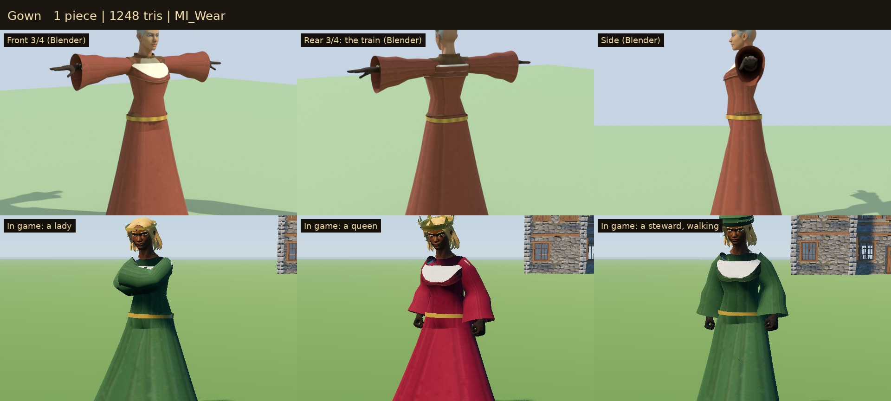

# Status Wear

Headwear, aprons and long garments that show at a glance what a villager
does and where they stand: the clothes read before the Eye does. These are the game's own
pieces, built for Sovereign's Eye. They are skinned to the outfit pack's rig
and merged with the villagers' outfits.

Every occupation in `data/occupations.json` already named its headwear (a
farmer's straw hat, a lord's circlet, a soldier's helmet...) and its outfit
(robe, gown, fine, apron), but the 3D villagers wore only the pack's hood,
and clergy and nobles wore the pack's peasant and ranger clothes. Now:

| Kind | Who wears it | Pieces | Tris | Material |
| --- | --- | --- | ---: | --- |
| Gold circlet with a ruby | Lord, Lady | short/long hair × man/woman | 212 | `MI_Wear_Metal` |
| Crown: a band with eight fleurons, rubies and sapphires | King, Queen | short/long hair × man/woman | 336 | `MI_Wear_Metal` |
| Nasal helmet: a dome with a raised crown, iron rim and nasal bar | Soldier, Captain, General | man, woman | 564 | `MI_Wear_Metal` |
| Straw hat, wide-brimmed, with a band | Farmer | short/long hair × man/woman | 696 | `MI_Wear` |
| Felt cap with a rolled brim, slouched; russet, woad, green or black | Merchant, Steward, Miller, Carpenter, Stonecutter | short/long hair × man/woman | 552 | `MI_Wear` |
| Baker's cap, tall and puffed | Baker | short/long hair × man/woman | 552 | `MI_Wear` |
| Linen veil, open at the face, falling to the shoulders | Dowager, Housekeeper (a man gets a cap) | woman | 564 | `MI_Wear` |
| Leather apron with a bib and neck straps | Blacksmith, Carpenter, Stonecutter | man, woman | 436 | `MI_Wear` |
| Linen waist apron | Miller, Baker, Innkeeper, Tavern Hand, Housekeeper | man, woman | 290 | `MI_Wear` |
| Robe: ankle-length wool, wide bell sleeves, a hemp girdle with a hanging end | Priest, Herbalist, Elder | man, woman | 1,178 | `MI_Wear` |
| Gown: a fitted bodice with a scooped neckline over a linen chemise, a floor-length A-line skirt with a short train, bell sleeves, a gold girdle, braid at the hem | Lady, Queen, Dowager; any noblewoman or well-to-do woman (a steward's, a merchant's "fine" look) | woman | 1,248 | `MI_Wear` |
| Coat: knee-length, sleeveless over the shirt, belted with a brass buckle, edged in gold braid | Lord, King, Steward, Merchant, Noble Scion (their menfolk) | man, woman | 588 | `MI_Wear`, `MI_Wear_Metal` |

**32 pieces** in `models/`, named `SE_<Kind>[_Short|_Long]_<M|F>`. The wool and the felt come in ten dyes: russet, woad blue, green, black, crimson, purple, royal blue, undyed cream, brown and grey.



## In the game

- **What each villager wears.** `OutfitKit.look_for` (data in `data/outfits.json`) adds:
  - the occupation's headwear (`headwear`);
  - an apron for an "apron" look (`aprons`, `apron_default`);
  - a long garment for a look that names one (`garment`: robe, gown, coat). It takes the place of the outfit's body (and, for a robe or gown, its trousers). The pack's sleeves and hands, and its shoes or boots, stay.
- **Hair.**
  - A hat that sits on the hair (`on_hair`) comes in two fits. One is fitted to short hair (the "Short" fit). The other is fitted to long hair (`long_hair`: long, braid, bun), the "Long" fit.
  - A bun is let down to long hair under a hat.
  - The helmet, the veil and the pack's hood hide the hair (`hides_hair`).
  - A man named for a veil wears a cap instead (`instead`).
- **Colour.**
  - The felt of a cap and the wool of a garment come in ten colorways (`sets` "wear": ten atlases that differ only in the dyed cloth).
  - The colorway is picked like the pack's: the one whose swatch is nearest the villager's clothing colour. A crimson noble wears a crimson gown and a woad merchant a woad cap, and the portrait says so.
  - A look can pin a set's colorway (`colorways`: the ranger boots under a gown stay brown leather).
  - Gold and steel (`MI_Wear_Metal`) keep their colour.
- **Drawing.** Each look is merged into the villager's one outfit mesh, one surface per material, shared by everyone in the same look.
- **Portraits.** `OutfitKit.describe` names the garment with its dye ("a floor-length crimson gown with wide sleeves and a gold girdle") and the apron. `PortraitPrompt` names the headwear the model shows.

## Construction

- **Rig.**
  - Every piece is skinned to the 65-bone rig of the Quaternius Modular Character Outfits, the one the game dresses villagers on, with the same bones in the same order.
  - `OutfitKit` also remaps bones by name, should a part ever differ.
- **Headwear.**
  - Headwear is weighted to the Head bone. A veil's drape blends into the neck and chest so the head can turn.
  - `build_wear.py` measures the base body's head and every hairstyle the game gives that gender, relative to the Head bone. The Head bone is 5 cm lower on the female rig, and the hair files come from either rig.
  - Each ring is fitted round the measured points with a small margin, smoothed so a stray strand doesn't dent it. Domes are elliptic above the fitted rings.
- **Aprons.**
  - Aprons are cast onto the front of the outfit body and legs. The bib follows the chest, and the skirt bridges the legs and stands a little off them.
  - The skirt is weighted from the hip down to each thigh by side, so a stride carries it instead of pushing through it.
  - The ties are cast round the waist, with neck straps on the bib.
- **Robes, gowns and coats.**
  - The garment is lofted from rings cast round the outfit body and legs. Each ring takes the outermost surface in every direction and is smoothed so it never dips between the legs.
  - The bodice runs from the neck to the hips, fitted. The neckline drops at the front (the gown's most), filled by a linen chemise up to the neck, since the outfit's own shirt comes off.
  - The skirt never narrows below the hips, so the garments are A-line, and flares to the hem. The gown is a little longer at the back.
  - Bell sleeves are cast round the pack's sleeves and widen to the wrist, the cuff hanging low. Belts, braid and the embroidered neckline are bands on top.
  - Skinning:
    - The bodice copies the outfit body's own weights, nearest vertex.
    - Sleeves blend from the clavicle and spine through the upper arm to the forearm at the elbow.
    - A skirt follows the pelvis, then each thigh by side from the hip down. Long skirts blend gently across the front and back so a stride doesn't split the hem. The short coat follows its legs closely, as an apron does.
- **Materials.**
  - `MI_Wear` covers cloth, wool, straw, felt and leather (double-sided, for the brim, the veil and the open sleeves). `MI_Wear_Metal` covers gold, gems, steel and the brass buckle (metallic 0.4, roughness 0.42).
  - Both use `textures/T_Wear_BaseColor.png` (and `T_Wear_2..10_BaseColor.png`, one per dye), 512 × 1024, painted by `source/paint_wear.py`, VRAM-compressed with mipmaps.
- **Budgets.**
  - Headwear is under 900 triangles, aprons under 700, the coat under 900 and the robe and gown under 1,300.
  - A noblewoman's gown and crown come to about 1,600 triangles, in place of the outfit's body and trousers; most villagers' headwear and aprons add 200–1,000.
- **Build.** The same source gives byte-identical GLBs (see `3D/props/farm-field/README.md`).

## Rebuilding

```
python3 source/paint_wear.py                                            # the atlas, one per colorway
/root/bpy-venv/bin/python source/build_wear.py --export                 # the 32 GLBs
/root/bpy-venv/bin/python source/build_wear.py --review DIR             # Cycles views on a stand-in villager
godot --headless --path . --import
godot --headless --path . --script res://tools/asset_check.gd -- res://3D/characters/status-wear/models/
godot --path . --resolution 1280x720 res://tools/prefab_gallery.tscn -- DIR wear           # in game, standing
WEAR_MODE=walk godot --path . --resolution 1280x720 res://tools/prefab_gallery.tscn -- DIR2 wear   # walking
python3 source/make_sheets.py CYCLES_DIR DIR DIR2 previews stats.json    # contact sheets
```

## Validation

`tests/test_wear.gd` checks that:

- all 32 pieces load within budget, skinned, with their atlas;
- every piece binds the rig's 65 bones in the pack's order;
- headwear follows the job, the gender and the hair (fits, a bun let down, hair hidden only under a hood, helmet or veil, a man's veil turned to a cap);
- every apron trade wears an apron (leather or linen);
- a built villager's outfit mesh carries the pieces, and a helmet hides the hair;
- a cap's colorway follows the clothes;
- clergy and elders wear robes, noblewomen gowns and their menfolk coats, in place of the outfit's body (and, under a robe or gown, its trousers);
- a crimson lady's gown is crimson, and her portrait says so.

## Limitations

- **No cloth simulation.** Skirts are skinned to the legs. In a stride a long skirt bends gently, and a coat's hem parts like a split riding coat. Sleeves and hems don't sway.
- **One cut per garment.** Every robe, gown and coat has the same cut in a different dye: no fur-trimmed royal robes or embroidered panels yet.
- **Hair under hats.** Hair is fitted for, not cut away: a very full style may show a strand through a cap's side from some angles.
- **Rigid hats.** Hats don't sway, and the straw hat's brim doesn't bend.
- **Children.** Children rarely have headwear; theirs scales with their larger heads.

## License

CC0 1.0 (see `LICENSE.txt`).
