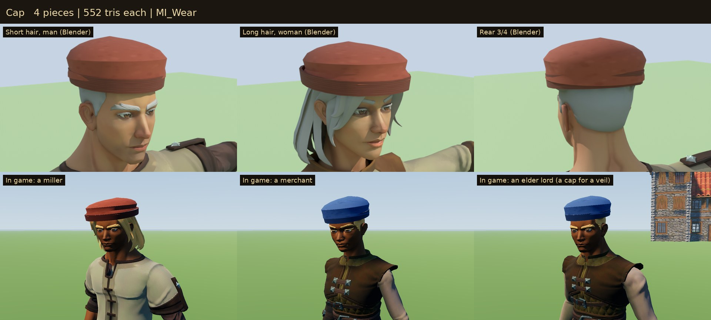

# Status Wear

Headwear and aprons that show at a glance what a villager does and where
they stand: the clothes read before the Eye does. These are the game's own
pieces, built for Sovereign's Eye. They are skinned to the outfit pack's rig
and merged with the villagers' outfits.

Every occupation in `data/occupations.json` already named its headwear (a
farmer's straw hat, a lord's circlet, a soldier's helmet...), and the "apron"
trades their apron, but the 3D villagers wore only the pack's hood. Now:

| Kind | Who wears it | Pieces | Tris | Material |
| --- | --- | --- | ---: | --- |
| Gold circlet with a ruby | Lord, Lady | short/long hair × man/woman | 212 | `MI_Wear_Metal` |
| Crown: a band with eight fleurons, rubies and sapphires | King, Queen | short/long hair × man/woman | 336 | `MI_Wear_Metal` |
| Nasal helmet: a dome with a raised crown, iron rim and nasal bar | Soldier, Captain, General | man, woman | 564 | `MI_Wear_Metal` |
| Straw hat, wide-brimmed, with a band | Farmer | short/long hair × man/woman | 696 | `MI_Wear` |
| Felt cap with a rolled brim, slouched; russet, woad, green or black | Merchant, Steward, Miller, Carpenter, Stonecutter | short/long hair × man/woman | 552 | `MI_Wear` |
| Baker's cap, tall and puffed | Baker | short/long hair × man/woman | 552 | `MI_Wear` |
| Linen veil, open at the face, falling to the shoulders | Dowager, Housekeeper (a man gets a cap) | woman | 564 | `MI_Wear` |
| Leather apron with a bib and neck straps | Blacksmith, Carpenter, Stonecutter | man, woman | 436 | `MI_Wear` |
| Linen waist apron | Miller, Baker, Innkeeper, Tavern Hand, Housekeeper | man, woman | 290 | `MI_Wear` |

**27 pieces** in `models/`, named `SE_<Kind>[_Short|_Long]_<M|F>`.



## In the game

- **What each villager wears.** `OutfitKit.look_for` (data in `data/outfits.json`) adds:
  - the occupation's headwear (`headwear`);
  - an apron for an "apron" look (`aprons`, `apron_default`).
- **Hair.**
  - A hat that sits on the hair (`on_hair`) comes in two fits. One is fitted to short hair (the "Short" fit). The other is fitted to long hair (`long_hair`: long, braid, bun), the "Long" fit.
  - A bun is let down to long hair under a hat.
  - The helmet, the veil and the pack's hood hide the hair (`hides_hair`).
  - A man named for a veil wears a cap instead (`instead`).
- **Colour.**
  - The cap's felt comes in four colorways (`sets` "wear": four textures that differ only in the felt).
  - The colorway is picked like the pack's: the one whose swatch is nearest the villager's clothing colour, so portraits and the model agree.
  - Gold and steel (`MI_Wear_Metal`) keep their colour.
- **Drawing.** Each look is merged into the villager's one outfit mesh, one surface per material, shared by everyone in the same look.
- **Portraits.** `PortraitPrompt` already describes the headwear, and an apron trade's "work clothes and a leather apron".

## Construction

- **Rig.**
  - Every piece is skinned to the 65-bone rig of the Quaternius Modular Character Outfits, the one the game dresses villagers on, with the same bones in the same order.
  - `OutfitKit` also remaps bones by name, should a part ever differ.
- **Headwear.**
  - Headwear is weighted to the Head bone. A veil's drape blends into the neck and chest so the head can turn.
  - `build_wear.py` measures the base body's head and every hairstyle the game gives that gender, relative to the Head bone. The Head bone is 5 cm lower on the female rig, and the hair files come from either rig.
  - Each ring is fitted round the measured points with a small margin, smoothed so a stray strand doesn't dent it. Domes are elliptic above the fitted rings.
- **Aprons.**
  - Aprons are cast onto the front of the outfit body and legs. The bib follows the chest, and the skirt bridges the legs and stands a little off them.
  - The skirt is weighted from the hip down to each thigh by side, so a stride carries it instead of pushing through it.
  - The ties are cast round the waist, with neck straps on the bib.
- **Materials.**
  - `MI_Wear` covers cloth, straw, felt and leather (double-sided, for the brim and the veil). `MI_Wear_Metal` covers gold, gems and steel (metallic 0.4, roughness 0.42).
  - Both use `textures/T_Wear_BaseColor.png`, 512 × 512, painted by `source/paint_wear.py`, VRAM-compressed with mipmaps.
- **Budgets.** Headwear is under 900 triangles and aprons under 700. A dressed villager gains 200–1,000.
- **Build.** The same source gives byte-identical GLBs (see `3D/props/farm-field/README.md`).

## Rebuilding

```
python3 source/paint_wear.py                                            # the atlas, one per colorway
/root/bpy-venv/bin/python source/build_wear.py --export                 # the 27 GLBs
/root/bpy-venv/bin/python source/build_wear.py --review DIR             # Cycles views on a stand-in villager
godot --headless --path . --import
godot --headless --path . --script res://tools/asset_check.gd -- res://3D/characters/status-wear/models/
godot --path . --resolution 1280x720 res://tools/prefab_gallery.tscn -- DIR wear           # in game, standing
WEAR_MODE=walk godot --path . --resolution 1280x720 res://tools/prefab_gallery.tscn -- DIR2 wear   # walking
python3 source/make_sheets.py CYCLES_DIR DIR DIR2 previews stats.json    # contact sheets
```

## Validation

`tests/test_wear.gd` checks that:

- all 27 pieces load within budget, skinned, with their atlas;
- every piece binds the rig's 65 bones in the pack's order;
- headwear follows the job, the gender and the hair (fits, a bun let down, hair hidden only under a hood, helmet or veil, a man's veil turned to a cap);
- every apron trade wears an apron (leather or linen);
- a built villager's outfit mesh carries the pieces, and a helmet hides the hair;
- a cap's colorway follows the clothes.

## Limitations

- **Robes, gowns and fine coats are next.** Clergy, nobles and merchants still wear the pack's Peasant and Ranger clothes under their headwear; long garments come in the next part of the People pass (`3D/BACKLOG.md`).
- **Hair under hats.** Hair is fitted for, not cut away: a very full style may show a strand through a cap's side from some angles.
- **Rigid hats.** Hats don't sway, and the straw hat's brim doesn't bend.
- **Children.** Children rarely have headwear; theirs scales with their larger heads.

## License

CC0 1.0 (see `LICENSE.txt`).
