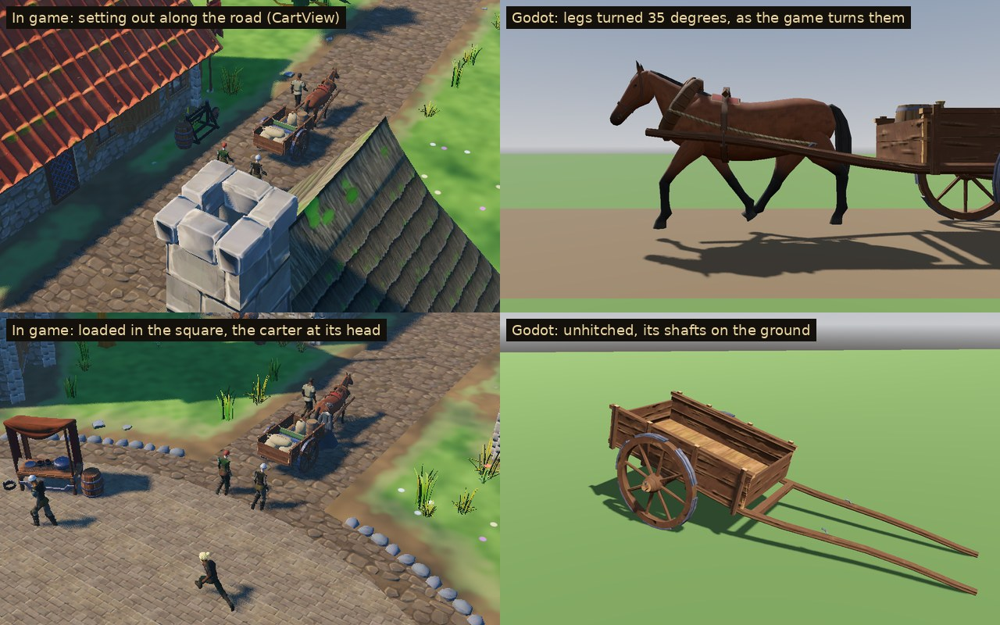

# Carts & Transport

A carrying cart of the 1180s and the horse that draws it. These are the game's own models, built for Sovereign's Eye for the carts the house sends to the noble houses' seats (Phase 6.2). In the village, `CartView` draws the cart rolling out along the road with its carter at the horse's head:



The family has three models:

- **The cart and its horse:** a plank-sided cart on two spoked wheels in a single pair of shafts, with a small bay cart horse harnessed in them. Its wheels, legs, neck, head and tail are separate rigid parts in a node tree, which the game turns (see [the node contract](#the-node-contract)).
- **The load:** a trader's load for the bed, roped down. It sits where the cart's `Load_Anchor` is.
- **The cart unhitched:** the same cart out of the shafts, tipped forward with its shafts on the ground, for dressing farmyards.

## Assets

| Model | What it is | Tris | Materials | Size (W × H × D) |
| --- | --- | ---: | ---: | --- |
| `SE_Cart_Horse` | The cart in its shafts and the horse harnessed in them. The cart: plank sides on stakes with a rail on top, a floor of boards across the frame, a head board and a lower tail board, the axle-tree under it with its arms through the naves, held by linchpins. Its wheels are 1.2 m, each with a turned nave, eight spokes and six felloes shod with six iron strakes. The horse is a bay of about 13.3 hands (1.41 m at the withers) in a padded collar with hames, rope traces to iron hooks on the shafts, and a cart saddle on a felt pad. A back band carries the shafts in tugs, a belly band runs under it, and it wears a bridle with a noseband and a bit. 15 meshes in 16 nodes: the cart 648 triangles, each wheel 636, the horse and its harness 2,950 | 4,870 | 3 | 5.00 × 1.82 × 1.88 m |
| `SE_Cart_Load` | A trader's load for the bed. Three sacks lie at the tail and a fourth stands at the head. Three bolts of cloth (woad blue, madder red, Lincoln green) lie across the middle, beside a small cask with four iron hoops and a corded bundle of iron bars. Two ropes run over the top from rail to rail | 1,016 | 2 | 1.93 × 0.57 × 1.13 m |
| `SE_Cart` | The same cart unhitched, tipped 16° forward about its axle until the shafts' ends rest on the ground; one mesh | 1,920 | 2 | 4.46 × 1.47 × 1.88 m |

**3 models.** A laden cart and its horse come to 5,886 triangles. Each is placed whole, and Godot generates automatic LODs for all but a few small parts.

## The node contract

`SE_Cart_Horse` is not skinned. The game moves it by turning named nodes, so their names, parents and pivots are a contract (`scripts/world/cart_view.gd` relies on it):

- **The frame.** The scene's root is on the ground at the middle of the axle, between the wheels. Ahead (the horse's way) is Blender +X, which is Godot +X; up is Blender +Z, which is Godot +Y. Blender +Y, Godot −Z, is the cart's left (L) as it faces ahead.
- **Rest pose.** Every node has an identity rotation and unit scale, and only a translation, so each part turns about its own axes. At rest the horse stands square with all four hooves' soles on the ground (y 0), and the wheels touch it (y 0).
- **The tree,** with each pivot in Godot coordinates in the root's frame:

| Node (path from the root) | Pivot (origin) | Godot position (m) | Turns about |
| --- | --- | --- | --- |
| `Cart` | the root (the body, frame, shafts, axle) | (0, 0, 0) | — |
| `Wheel_L` | the left hub | (0, 0.600, −0.740) | its Z (Blender Y): the axle |
| `Wheel_R` | the right hub | (0, 0.600, +0.740) | its Z |
| `Horse` | on the ground under the horse's body centre (its barrel, collar, saddle, harness) | (2.600, 0, 0) | — |
| `Horse/Leg_FL`, `Horse/Leg_FR` | the shoulder joint (fore leg) | (3.100, 1.000, ∓0.150) | its Z: swings fore and aft |
| `Horse/Leg_FL/Leg_FL_Lower`, `…/Leg_FR_Lower` | the knee | (3.110, 0.440, ∓0.150) | its Z |
| `Horse/Leg_HL`, `Horse/Leg_HR` | the hip joint (hind leg) | (2.100, 1.020, ∓0.160) | its Z |
| `Horse/Leg_HL/Leg_HL_Lower`, `…/Leg_HR_Lower` | the hock | (2.000, 0.500, ∓0.160) | its Z |
| `Horse/Neck` | the withers (with the mane) | (3.020, 1.408, 0) | its Z: nods |
| `Horse/Neck/Head` | the poll, behind the ears (with the ears, eyes, forelock, bridle) | (3.620, 1.700, 0) | its Z |
| `Horse/Tail` | the dock | (1.800, 1.280, 0) | its X: swings aside |
| `Load_Anchor` | an empty (`Node3D`): the middle of the bed floor's top | (0.100, 0.800, 0) | — |

- **The scene in Godot.** Godot names the root after the file (`SE_Cart_Horse`) and keeps these nodes under it: every part is a `MeshInstance3D`, and `Load_Anchor` is a `Node3D`.
- **Signs, about each node's +Z.** A positive turn brings a hoof forward (+X). A negative turn of a `_Lower` node folds the fore knee back, and a positive one bends the hock forward. Rolling toward +X, a wheel turns by a negative angle about its Z.
- **The wheels.** The strakes' radius is 0.600 m, the hub's height, so `Wheel_L.position.y` is the rolling radius. The wheels' middle planes stand 0.74 m either side of the centre line.
- **The horse.** Its body's centre is 2.60 m ahead of the axle, its withers 1.41 m and its poll 1.70 m above the ground. Its fore hooves are 3.16 m and its hind hooves 2.05 m ahead of the axle; the muzzle is 4.0 m ahead.
- **The bed and the load.** Inside, the bed is 2.00 m long, 1.14 m wide and 0.38 m deep to the top of its sides (the head board 0.34 m, the tail board 0.30 m). Its floor's top is 0.80 m above the ground. `Load_Anchor` is the centre of that floor, so a load parented to it sits in the bed. `SE_Cart_Load` is built in that frame (+X ahead) and stays inside it: x −0.98 to 0.95, z ±0.57, up to 0.57 m.
- **Joints.** At the knee and hock, the upper segment ends in a half sphere about the pivot, and the lower one begins with a slightly larger one. Turned either way, the two stay closed like a capsule joint. At the shoulder and hip, the upper segment's top lies inside the body, so a swing of ±35° opens no gap. The test poses are in `build_carts.py` (`--poses`, Blender) and `godot_review.gd` (Godot, turned as the game turns them).
- **The harness.** It is static and belongs to `Horse`: the collar, hames, traces, saddle, back and belly bands, and the tugs round the shafts. The shafts, the axle and the traces' hooks belong to `Cart`.

## In the game

- **CartView** (`scripts/world/cart_view.gd`) loads `SE_Cart_Horse` and parents `SE_Cart_Load` to `Load_Anchor` when the cart is laden. It finds the parts with `find_child`, turns the wheels by the distance covered, swings the legs in a walk, nods the neck and flicks the tail. The carter walks at the horse's head and the escort behind.
- **The capture.** `godot --path . --resolution 1600x900 res://tools/capture.tscn -- 12345 <dir> carts` shows a cart loaded in the square, rolling out along the road, from the strategy camera, and coming home at dusk.
- **The cart unhitched** isn't placed by the game yet: it is there for farmyards and yards.
- **Godot review.** `source/godot_review.gd` draws the family in Godot's own renderer. It shows the laden rig and the unhitched cart from a strategy camera 30 m off, the legs at ±35° side on, the joints from below, the load at `Load_Anchor`, and the cart unhitched.

## Construction

- **Scale and pivot.** Real-world metres; the review figure is 1.78 m.
  - `SE_Cart_Horse` and `SE_Cart` have their origin on the ground at the axle's middle.
  - `SE_Cart_Load` has its origin at the bed floor's top centre.
- **The cart.**
  - **The shafts** are one timber each side. They run along the bed's sides as its frame, then rise and close in, from 0.71 m at the bed to 1.0 m at the horse's shoulder and from 0.55 m to 0.37 m off the centre line.
  - **The bed** is boards across the frame, two-plank sides on four stakes a side, a rail on top, and a head and a lower tail board. The axle-tree is squared under the frame, its round arms through the naves.
  - **The wheels** carry iron strakes, plates nailed over each felloe's joint with the wood showing between them. One strake is at the bottom, so the wheel stands on iron.
- **The horse** is lofted from sections (`build_carts.py`).
  - **The barrel** is a superellipse section at 15 stations: the withers, a dipped back, the croup, the tail set, the girth and the belly's line up to the flank.
  - **The neck** runs between a crest line and a throat line, the mane falling to the off (right) side.
  - **The head** runs from the poll down the face to the muzzle, deep at the jowl and narrow at the nose.
  - **The legs** are two tubes each, shaped through the forearm or gaskin, knee or hock, cannon, fetlock, pastern and hoof.
  - **The coat** is mapped by height on the legs, so the bay's black points run from the coronet to the knees and hocks, shading into bay above. The muzzle darkens the same way, and the hooves are horn.
- **The harness.**
  - **The collar** is a stuffed leather roll round the neck's section, lying back against the shoulders. The hames are light wooden bars on its front, tied over the top, with iron hooks at the points of the shoulders.
  - **The traces** are rope, running from the hame hooks back to iron hooks on the shafts at the horse's flank.
  - **The cart saddle** is a wooden tree on a red felt pad behind the withers. Its back band goes down to leather tugs round the shafts, with a belly band from tug to tug.
  - **The bridle** has a headstall, a browband, a noseband and iron bit rings.
- **The load** is built in the bed's frame.
  - **The sacks** are lumpy cushions of sacking with gathered, tied necks.
  - **The bolts of cloth** are flattened rolls with the turns of cloth on their ends.
  - **The cask** has oak staves and iron hoops.
  - **The iron bars** are wrought bars in a corded bundle.
  - **Two ropes** go over the top to the rails.
- **Research.**
  - **Horse hauling.** Two-wheeled carts drawn by horses spread in England through the twelfth and thirteenth centuries, taking over much of the carrying from ox-drawn wains, while oxen kept most of the ploughing (John Langdon, "Horse Hauling: A Revolution in Vehicle Transport in Twelfth- and Thirteenth-Century England?", *Past & Present* 103, 1984; and *Horses, Oxen and Technological Innovation: The Use of Draught Animals in English Farming from 1066 to 1500*, Cambridge University Press, 1986). This cart has one horse in shafts.
  - **The harness.** A horse in shafts pulls from its shoulders through a padded collar and hames, with traces to the shafts. A saddle and back band carry the shafts' weight, and tugs hold them.
  - **The tumbrel.** It was a two-wheeled cart for a single horse or ox, often tipping to unload (<https://en.wikipedia.org/wiki/Tumbrel>). This cart is the plainer carrying kind, its tail board dropping out.
  - **The pictures.** The Luttrell Psalter (c. 1325–1340, British Library Add MS 42130) shows horse-drawn harvest carts, two-wheeled, their spoked wheels studded with iron. It is later than 1187, so this cart keeps to the plainer forms.
  - **Wheels.** Medieval English cart wheels were shod with strakes, separate iron plates nailed across the felloes' joints, rather than the one-piece tyre of later carts.
  - **The horse.** Working horses of the time were small by modern standards. This is a cart horse of about 13.3 hands, not a modern heavy draught breed, and a bay: a brown coat with black mane, tail and lower legs.
  - **The load.** Woad (blue) and madder (red) were the common dyes. The green is named after Lincoln, a great cloth town of the time. Iron travelled to the smiths in bars.
- **Materials.**
  - Wood and iron are the village kit's trim sheets (`MI_WoodTrim`, `MI_MetalOrnaments`). These are referenced, not copied.
  - The family's atlas is `MI_Carts`, `textures/T_Carts_BaseColor.png`, 512 × 512 RGB, painted by `source/paint_carts.py`, VRAM-compressed with mipmaps. It holds:
    - the bay's coat and its points (horn, black, bay);
    - black hair;
    - harness leather, rope and the collar's stuffed roll;
    - sacking, three dyed cloths and their rolled ends;
    - oak staves and a cask head;
    - red saddle felt, an eye, a sack's neck.
- **Budgets.**
  - A cart and its horse are one rig placed whole: under 6k triangles, the horse and its harness under 3k (2,950).
  - The cart unhitched, dressing, stays under 2.5k, and a load under 1.5k.
- **Build.** The build is deterministic: the same source gives byte-identical GLBs (see `3D/props/farm-field/README.md`). The rig's nodes are joined from their parts with their origins at the pivots, parented, and exported in one glTF with their hierarchy.

## Rebuilding

```
python3 source/paint_carts.py                                           # the atlas
/root/bpy-venv/bin/python source/build_carts.py --export                # models + carts_transport.blend
/root/bpy-venv/bin/python source/build_carts.py --review DIR --poses POSE_DIR   # Cycles views, the laden cart, the joints at 35 degrees
godot --headless --path . --import
godot --headless --path . --script res://tools/asset_check.gd -- res://3D/props/carts-transport/models/ stats.json
godot --path . --resolution 1600x900 res://tools/capture.tscn -- 12345 GAME_DIR carts      # the cart in the village (CartView)
godot --path . --resolution 1280x800 --script res://3D/props/carts-transport/source/godot_review.gd -- GAME_DIR   # Godot: poses, joints, load, unhitched
python3 source/make_sheets.py DIR GAME_DIR previews stats.json          # contact sheets
python3 3D/tools/build_asset_manifest.py                                # manifest + VALIDATION.json
```

## Folder

| Path | Contents |
| --- | --- |
| `models/` | Runtime GLBs (geometry embedded, textures by relative path) |
| `textures/` | `T_Carts_BaseColor.png`, the family's atlas |
| `source/` | Blender source, the build, paint and sheet scripts, and the Godot review script (ignored by Godot) |
| `previews/` | One contact sheet per model (Blender views beside a 1.78 m figure; the cart in the village and in Godot) and the overview (ignored by Godot) |

## Validation

- `tools/asset_check.gd` loads every model as the game does and checks triangles, materials, texture slots, LODs and size. It reports no problems.
- The rig was checked headless in Godot by loading `SE_Cart_Horse.glb` as the game does:
  - every contract node is found by name under the right parent, its rest basis identity and its scale one;
  - the pivots are as in the table above;
  - each wheel's lowest point and each hoof's sole is on the ground, and the wheels' radius equals the hub height;
  - `SE_Cart_Load` fits inside the bed, and `SE_Cart` stands on the ground.
- The joints were rendered with every leg segment turned 35° both ways: in Blender (`--poses`) and in Godot as `CartView` turns them (`godot_review.gd`). No gaps open.
- `CartView` was captured drawing the cart in the village (`carts`).

## Limitations

- **Rigid parts.**
  - A leg bends only at the shoulder or hip and at the knee or hock: the fetlock and pastern don't flex, and the hoof doesn't roll over its toe.
  - Swung past about 30°, the top of a forearm or thigh shows as a bulge at the chest or flank. The game swings 18°.
- **The harness is fixed to the horse.**
  - If the game moves the horse against the cart, the tugs and traces part from the shafts a little.
  - The collar doesn't follow the neck, so a large nod shows the neck turning inside it. The game nods 3°.
  - A tail swung aside more than about 15° passes into the quarters.
- **Draw calls.** Each moving part is its own mesh: the rig has 15 meshes and 21 surfaces (draw calls), fine for the few carts on the road at once.
- **Detail.** The strakes have no nail heads and the felloes' joints aren't cut. The load is one fixed set of goods, and the unhitched cart is one mesh with no wheel nodes.

## License

CC0 1.0 (see `LICENSE.txt`).
