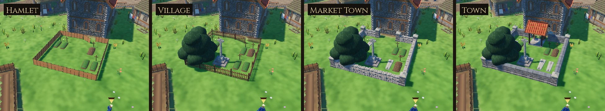

# Chapel & Churchyard

The chapel's bells and crosses, and the churchyard at its east end. These are
the game's own models, built for Sovereign's Eye. Before this family the
chapel was a stone tower and nave like any other building, with glazed
windows all the way up and nothing round it. Now its tower shows its bells,
its spire and east gable carry crosses, and behind it a churchyard grows with
the settlement:

- **Hamlet:** a few graves grassed over, oak crosses at their heads, a fresh grave, inside wattle hurdles with a hurdle gate.
- **Village:** a paled fence and a field gate, the wheel-head churchyard cross at the end of the path, a yew.
- **Market Town:** a drystone wall between ashlar piers, stone cross-slabs over the better-off's graves.
- **Town:** a coped wall, a lychgate in the gateway, a knight's slab with his sword carved beside the cross.



## Assets

| Model | Where | What it is | Tris | Materials | Size (W × H × D) |
| --- | --- | --- | ---: | ---: | --- |
| `SE_Belfry` | the chapel's tower | The top stage's plank floor and two bells (a tenor and a treble), each hung from an oak headstock on two A-trestles, swung by a lever with its rope hanging down | 2,312 | 3 | 3.36 × 2.61 × 3.37 m |
| `SE_Cross_Tower` | the spire's tip | A wrought-iron cross on the spire's rod: a collar, a square shaft, a ring round the crossing, balls at the ends of the arms | 240 | 1 | 0.90 × 1.47 × 0.14 m |
| `SE_Cross_Gable` | the east gable | A ringed stone cross on a saddle stone that rides the ridge | 188 | 1 | 0.62 × 1.03 × 0.40 m |
| `SE_Grave_Mound` | all | A grave grassed over: a low loaf of grazed turf, the cut edge of the sods round it | 224 | 1 | 0.84 × 0.26 × 1.95 m |
| `SE_Grave_Fresh` | all | A new grave: a heap of dug earth, clods tumbling off it | 308 | 1 | 1.07 × 0.35 × 2.00 m |
| `SE_Grave_Cross` | all | An oak grave cross with a little cap, weathered and leaning | 132 | 1 | 0.50 × 1.24 × 0.17 m |
| `SE_Grave_Slab` | Market Town, Town | A coffin-shaped stone grave cover, faintly ridged, carved with a ringed cross on a stepped base | 58 | 1 | 0.66 × 0.19 × 1.90 m |
| `SE_Grave_Slab_Knight` | Town | The same cover, a little larger, with a sword carved beside the cross | 58 | 1 | 0.74 × 0.20 × 2.00 m |
| `SE_Churchyard_Cross` | Village and up | Two square steps, a socket stone with its top broached to an octagon, a chamfered shaft narrowing upward, a wheel head | 244 | 2 | 1.70 × 3.62 × 1.70 m |
| `SE_Yew` | Village and up | A short, fluted red-brown trunk under a dark, dense crown, broad and low | 2,988 | 1 | 4.93 × 4.63 × 4.72 m |
| `SE_Wall_Rubble` | Market Town | 2 m of drystone wall, battered, rough coping stones set on edge along its top | 132 | 1 | 2.00 × 1.04 × 0.60 m |
| `SE_Wall_Coped` | Town | 2 m of mortared wall on a plinth under a saddleback coping | 48 | 1 | 2.00 × 1.21 × 0.54 m |
| `SE_Wall_Pier` | Market Town, Town | An ashlar pier at a corner or the gateway, its pyramid cap topped with a ball | 68 | 2 | 0.72 × 1.78 × 0.72 m |
| `SE_Lychgate` | Town | A tiled roof on four oak posts over the gateway, arch-braced, paved underfoot, a pair of boarded gates standing open inward | 1,784 | 3 | 3.17 × 3.60 × 3.02 m |

**14 models**: three pieces of the chapel and eleven churchyard pieces, laid out as eight sets (four charters × a full churchyard of 9.2 × 9.2 m and a shallow one of 9.2 × 5.2 m). The hurdles, paled fence and gates are the Farm & Field family's.

## In the game

- **The chapel itself.**
  - The kit recipe's tower block names a `belfry` (`data/building_kit.json`): its top story's walls become the kit's wide arched windows left open, with no glazing and no shutters, and the bells hang inside.
  - The two bells are in opposite corners, so one hangs behind an opening on every side of the tower.
  - The tower's `finial` stands on the spire's tip and the nave's `gable_cross` rides its ridge at the east end (`VillageKit`).
- **Where.**
  - The generator gives each chapel a churchyard at its east end, the end away from the tower (`VillageLayoutGenerator.churchyard`). It tries 1, 2 and 3.2 m from the wall, then beside the nave, full size first, then a shallow one.
  - It is laid out as soon as the chapels stand on the square, so the farms' fields and the houses along the roads keep out of it. Across 42 test villages every chapel gets a full churchyard behind it.
  - It always faces the way the chapel's back does: its graves lie east-west, as the chapel does, heads to the west where their crosses stand. Its gateway is on its west side, toward the chapel.
- **What.**
  - The layout prop `churchyard` (or `churchyard_small`) is drawn by charter (`data/props.json` `by_charter`) as a set of models, merged with the props. A charter rising redraws it.
  - The sets are laid out by `source/make_sets.py` (`--write` puts them in `data/props.json`): walls on exact 2 m runs between piers, fences meeting at the corners, graves clear of each other and of the walls.
- **A chapel the player builds** gets its churchyard when it is finished, clear of buildings still going up and of standing trees (`TerritorySystem.add_churchyard`).
- **Building near it.**
  - A new building may not stand on any part of a yard, nor may its lane to the road cross one (`data/territory.json` `placement` `yard_names`): the churchyard, and the forge and training yards too.
  - Before this, only a yard's middle was checked.
- **Walking.**
  - The heir comes in by the gateway, or under the lychgate, and walks round the graves, crosses, the churchyard cross and the yew. Walls and fences stop them (`data/controls.json` `dressing`).
  - A piece can now block with several circles in its own frame, not just one: a wall's length, a grave's two ends, a lychgate's four posts.
  - Nothing else is set down in the churchyard.
- **Ground.** The churchyard is grazed grass: no tufts, flowers or bushes come up through its graves and walls (`data/nature.json` `keep_clear`).
- **Saving.**
  - The churchyard's spot is in the layout (save v12).
  - Older saves get theirs where a new village would put it (`SaveManager.migrate`), clear of buildings going up, with barrels and crates moved out.
- **Rendering paths.** Checked in all three of Godot's renderers on a Town churchyard and the belfry (`previews/_renderers_forward_mobile_compat.jpg`). All three draw it with no shader errors; Compatibility is brighter all over, as it is for the meadow and the kit.

## Construction

- **Scale and pivot.**
  - Real-world metres; characters are about 1.78 m.
  - Origin at the ground; front is −Y in Blender (+Z in Godot). A grave's head, where its cross stands, is +Y in Blender (west in the churchyard).
  - The belfry's origin is the tower's top-story floor, the crosses' their seat on the roof.
  - In a churchyard set, +Z is east, away from the chapel.
- **Research.**
  - **Graves.** Most medieval graves were unmarked mounds, or had a wooden cross that has long since rotted; the lord's family lay inside the church. Stone grave covers carved with a cross on a stepped base (a calvary), some with a sword or a shield beside it, date from the 12th and 13th centuries. Upright headstones only spread among ordinary people after about 1600, so there are none here.
  - **The churchyard cross.** The usual form is a shaft in a socket stone on a flight of steps, current from the 11th–12th century until the Reformation. It is square and ringed here, unlike the octagonal market cross on the square.
  - **The lychgate** is where the bier waited for the priest. Most surviving English lychgates are 15th century or later; the oldest, at Beckenham, is listed as 13th century. In a game set in 1187 it is a little ahead of its time, so it comes only with a Town's charter.
  - **The bells.** Medieval bells were swung by a lever on the headstock; half wheels came late in the Middle Ages and full wheels around 1600–1700. A small church often had its bells in a timber frame in the tower.
  - **The yew.** Yews are the churchyard tree; some are older than the churches beside them, and a statute of 1307 forbade rectors to fell churchyard trees. Why they were planted is still argued.
- **Materials.**
  - Wood, iron, rubble, ashlar and roof tiles are UV-mapped onto the Quaternius Medieval Village MegaKit trim sheets (`MI_WoodTrim`, `MI_MetalOrnaments`, `MI_RockTrim`, `MI_RoundTiles`).
  - Turf, fresh earth, the carved slabs, limestone, bell bronze, yew bark and foliage and the bell rope use this family's atlas: `MI_Chapel`, `textures/T_Chapel_BaseColor.png`, 512 × 512, painted by `source/paint_chapel.py`, VRAM-compressed with mipmaps.
- **Budgets.**
  - Pieces laid by the dozen (walls, piers, graves, grave crosses) stay under 300 triangles.
  - The churchyard cross and the lychgate stay under 2k, the yew 3k, and the bell frame 2.5k.
  - A whole churchyard is 7k to 10k, merged with the props; the Farm & Field hurdles round a hamlet's and the yew are most of it.
- **Build.** The build is deterministic: the same source gives byte-identical GLBs (see `3D/props/farm-field/README.md`).

## Rebuilding

```
python3 source/paint_chapel.py                                         # the atlas
/root/bpy-venv/bin/python source/build_chapel.py --export              # models + chapel_grounds.blend
/root/bpy-venv/bin/python source/build_chapel.py --review DIR          # Cycles views per model
python3 source/make_sets.py --write                                    # the churchyard sets into data/props.json
godot --headless --path . --import
godot --headless --path . --script res://tools/asset_check.gd -- res://3D/props/chapel-grounds/models/
godot --path . --resolution 1280x720 res://tools/capture.tscn -- 9 GAME_DIR chapel   # in game, each charter, and close views
python3 source/make_sheets.py DIR GAME_DIR previews stats.json          # contact sheets
python3 3D/tools/build_asset_manifest.py                                # manifest + VALIDATION.json
```

`CHAPEL_CHARTERS=0,3` captures only those charters; `CHAPEL_SIZE=small` shows the shallow churchyard instead.

## Folder

| Path | Contents |
| --- | --- |
| `models/` | Runtime GLBs (geometry embedded, textures by relative path) |
| `textures/` | `T_Chapel_BaseColor.png`, the family's atlas |
| `source/` | Blender source, build, paint and set scripts, sheet maker (ignored by Godot) |
| `previews/` | One contact sheet per model: Blender views beside a 1.78 m figure, plus the chapel and churchyard in game (ignored by Godot) |

## Validation

- `tools/asset_check.gd` loads every model as the game does and checks triangle counts, materials, texture slots, LODs and size.
- `tests/test_chapel.gd` checks that:
  - all 14 models load within budget with their textures;
  - the chapel hangs one belfry in its tower's top story, whose eight walls are open arches with no glazing or shutters, a cross on the spire's tip and one on the east gable;
  - every chapel in ten villages has its churchyard behind it or beside it, lying east-west, its whole footprint clear of buildings, fields, other yards, props and trees, the same each time;
  - the churchyard grows with the charter (each charter's is different; no yew or stone cross in a hamlet's, no slabs before Market Town, the lychgate only at Town);
  - every set fits its yard, its graves lie east-west with their crosses at their heads, nothing stands in anything else or in the walls, and the gateway is open;
  - the heir comes in under the lychgate but not over the wall or the graves, nothing else is set down in the churchyard, and no scatter grows in it;
  - a chapel the player builds gets its churchyard, and a save keeps it;
  - no new building stands over a yard's edge;
  - an older save gets its churchyard where a new village would have it, and a current save is left alone.

## Limitations

- **No interior.** The chapel has no inside to see, so it has no altar or candles; the priest and the devout go in and out of sight.
- **Still.** The bells don't swing or ring, and nobody is buried or visits a grave: the churchyard is set dressing, like the market cross.
- **The same graves.** Each charter's churchyard is laid out the same in every village; the dead of the village's own story don't get graves of their own.
- **Where none fits** (none of the 42 test villages), a chapel has no churchyard. A chapel the player builds in a crowded spot may get the shallow one, or none.

## License

CC0 1.0 (see `LICENSE.txt`).
