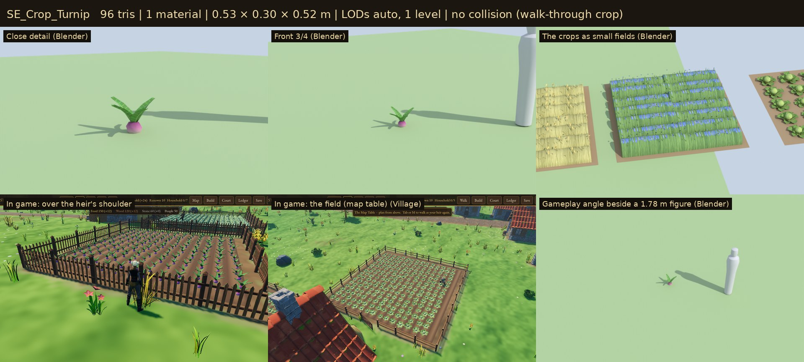
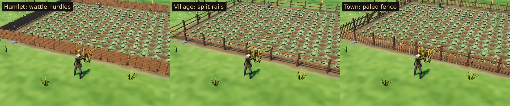

# Farm & Field

The fields and farmyards of the village: five crops, field fences and gates
that **grow finer with the settlement's charter** (wattle hurdles in a
Hamlet, split rails in a Village or Market Town, paled fencing in a Town),
three kinds of haystack, a log pile and a scarecrow. These are the game's
own models, built for Sovereign's Eye. Fields are the largest surfaces in a
village. They used to be boxes and balls on a brown slab; now they read as
crops from the map table and up close.



## Assets

| Model | Used for | What it is | Tris | Materials | Size (W × H × D) |
| --- | --- | --- | ---: | ---: | --- |
| `SE_Crop_Wheat` | Wheat fields | A 2 m row segment: a tufted ridge of golden stalks, thin bent stems with ears on their tips | 394 | 1 | 2.00 × 0.69 × 0.69 m |
| `SE_Crop_Barley` | Barley fields | Paler and lower, with nodding heads and fine awns | 401 | 1 | 2.07 × 0.54 × 0.72 m |
| `SE_Crop_Flax` | Flax fields | Slender green stalks, a little taller, with blue flowers on top | 259 | 1 | 2.00 × 0.67 × 0.62 m |
| `SE_Crop_Cabbage` | Cabbage fields | A round, pale heart in four cupped inner leaves and six broad outer leaves | 168 | 1 | 0.75 × 0.25 × 0.71 m |
| `SE_Crop_Turnip` | Turnip fields | A purple-shouldered root half out of the soil, four upright leaves | 96 | 1 | 0.53 × 0.30 × 0.52 m |
| `SE_Fence_Wattle` | Hamlet fields | A 2 m woven hurdle between five rough stakes | 416 | 1 | 1.96 × 1.09 × 0.07 m |
| `SE_Fence_Rail` | Village and Market Town fields | A square post and two sagging split rails | 96 | 1 | 2.11 × 1.13 × 0.13 m |
| `SE_Fence_Paled` | Town fields | A capped post, two rails, nine pointed pales | 292 | 1 | 2.13 × 1.31 × 0.18 m |
| `SE_Gate_Wattle` | Hamlet field gate | A hurdle on its own stake, swung half open and tied | 494 | 1 | 1.39 × 1.07 × 0.88 m |
| `SE_Gate_Rail` | Village field gate | A five-bar gate with a brace, hung on its post, ajar | 420 | 2 | 1.88 × 1.28 × 0.76 m |
| `SE_Gate_Paled` | Town field gate | A framed paled gate on a capped post, closed, with iron hinges | 360 | 2 | 2.04 × 1.42 × 0.18 m |
| `SE_Haycock` | Haystack | A round haycock on a stake, roped over the top with stone weights | 532 | 3 | 2.08 × 2.44 × 2.08 m |
| `SE_Hayrick` | Haystack | A rectangular rick with a thatched ridge top, roped and pegged | 444 | 2 | 1.90 × 1.94 × 1.58 m |
| `SE_Stooks` | Haystack | Three stooks of sheaves stood together in the stubble to dry | 1,980 | 1 | 1.85 × 1.18 × 1.71 m |
| `SE_LogPile` | Lumber | Seasoning logs between stakes, a chopping block with an axe, split wood | 596 | 2 | 2.47 × 1.11 × 1.75 m |
| `SE_Scarecrow` | In some fields | A pole and arms, a stuffed sacking head under a straw hat, a ragged coat, straw at the cuffs | 498 | 3 | 1.55 × 2.24 × 0.71 m |



**16 models.**

- **Fences and gates:** three charter tiers each. They are new silhouettes and craft, not recolours. The tier table is in `data/farm.json` (`fence.by_charter`, `fence.gates`).
- **Haystacks:** three kinds, chosen by position, so neighbouring yards differ (`data/props.json` `variants`).

## How a field is drawn

`scripts/world/farm_kit.gd` (`FarmKit.build_field`) turns each layout field into:

- **The bed:**
  - one raised soil mesh with sloped edges and furrows between the rows;
  - vertex colours, no texture; one draw call.
- **The crop:**
  - one MultiMesh per field:
    - grain as 2 m row segments with neighbours touching, so the field reads as one crop;
    - heads (cabbage, turnip) on a jittered grid;
  - each plant gets a random turn, size and a small darkening;
  - crops cast no shadows and fade out beyond `crop_visibility_range` (170 m).
- **The fence:**
  - one MultiMesh of 2 m segments, stretched a little to fit each side;
  - every piece faces outward (pales, the hurdle's good side and the gate leaves toward the road);
  - the gate stands on the side facing the farmhouse.
- **Sometimes a scarecrow**, on a crop row (`scarecrow.chance`).

Placement is seeded from the field's position (`Seeds.rng`), so the same field always plants the same way. When a charter is granted, `refresh_fields()` swaps the fences.

Haystacks and log piles are merged into the props' chunk meshes like the other small props.

- **Yard spots.** The layout generator gives each one a spot of its own, beside or behind the farmhouse (never on the door side) or beside the workshop. Each spot is clear of walls, fields and roads, and reserved so trees and dressing keep off it.
- **Older saves.** Their stacks were placed for the old, smaller haystack. On load (save v8), any whose footing reaches into a building is dropped, so nothing clips through a wall or blocks the path invisibly (`SaveManager.migrate`).

## Construction

- **Scale and pivot.**
  - Real-world metres; characters are about 1.78 m.
  - The origin is at the ground. Front is −Y in Blender (+Z in Godot).
  - Fence segments and crop rows run along +X, with the post at x = 0.
  - Fences stand 1.1–1.3 m tall (waist to chest height on the heir); the gates match.
- **Materials.**
  - Wood, stone and iron are UV-mapped onto the **Quaternius Medieval Village MegaKit trim sheets** (`MI_WoodTrim`, `MI_RockTrim`, `MI_MetalOrnaments`). The exported materials are the kit's exact definitions, with images referenced by relative path, so Godot loads each texture once for buildings, commons and farms.
  - Crops, straw, sacking and the scarecrow's hat use the family's one atlas (`MI_Farm`).
- **Own texture.** One 1024 × 1024 atlas, `textures/T_Farm_BaseColor.png`: 816 KB on disk, about 0.7 MB in VRAM (compressed like the kit's textures: S3TC on desktop, ETC2 on mobile, with mipmaps). It holds:
  - straw;
  - wheat and barley stalks with their heads;
  - a cabbage leaf (pale at the base, darker at the edge);
  - a turnip leaf and root;
  - flax with blue flowers;
  - burlap;
  - grain ears.

  It is painted by `source/paint_farm.py`.
- **The hurdle's shading.** The woven panel has two faces about 2.4 cm apart (a hurdle has body), and its normals are tilted up, as round rods are. Its shaded side then picks up sky light in Godot instead of going black. Cycles hides that problem, so it only shows in game.
- **Budgets.**
  - Crops are instanced by the hundred: under 450 triangles per row segment or plant.
  - Fence segments: under 450. Gates: under 500.
  - Yard one-offs: under 700, except the three-stook group (1,980), which stands in for three stacks.
- **Draw calls.**
  - A field costs four to six draw calls: the bed, crops, fence and gate (one or two materials), plus a scarecrow if it has one; shadow passes come on top for all but the crops.
  - Haystacks and log piles are merged with the props, one surface per material.
- **Collision.**
  - Fences, gates, haystacks, the log pile and the scarecrow each carry a simple convex proxy (node suffix `-convcolonly`).
  - Crops have none.
  - Walking collision in game is analytic (`WorldGeometry`, radii in `data/controls.json`). `tests/test_farm.gd` checks that those radii cover every haystack's and the log pile's footing.
- **LOD.**
  - Godot generates LODs on import (1–4 levels per surface).
  - A MultiMesh picks one LOD for all its instances, so each field is its own MultiMesh; this is the per-chunk split Godot's maintainers recommend.
  - At the far map-table zoom the fields add about 34k triangles and 70 draw calls to a 3.3M-triangle frame (Forward+, 1280 × 720):

    | Village overview (seed 9) | Triangles | Draw calls |
    | --- | ---: | ---: |
    | With fields | 3.284M | 1,649 |
    | Without fields | 3.250M | 1,579 |

## Rebuilding

Everything is generated from code. Edit `source/build_farm.py`, which uses the commons modelling helpers in `../village-commons/source/commons_lib.py`, then run:

```
python3 source/paint_farm.py                                       # farm atlas
/root/bpy-venv/bin/python source/build_farm.py --export             # models + farm_field.blend
/root/bpy-venv/bin/python source/build_farm.py --review DIR         # Cycles views per asset
/root/bpy-venv/bin/python source/build_farm.py --patches DIR/crops  # each crop as a small field
/root/bpy-venv/bin/python source/build_farm.py --fences DIR/fences  # each fence tier as it stands
godot --headless --path . --import
godot --headless --path . --script res://tools/asset_check.gd -- res://3D/props/farm-field/models/
godot --path . --resolution 1280x720 res://tools/capture.tscn -- 9 DIR farm   # in-game shots per fence tier
python3 source/make_sheets.py CYCLES_DIR GAME_DIR previews stats.json PATCH_DIR  # contact sheets (PATCH_DIR from --patches)
python3 3D/tools/build_asset_manifest.py                                      # manifest + VALIDATION.json
```

`source/farm_field.blend` holds every asset, editable. The build is deterministic: the same source gives byte-identical GLBs (the script pins Python's hash seed, which otherwise changes the triangle order of some exports from run to run).

## Folder

| Path | Contents |
| --- | --- |
| `models/` | Runtime GLBs (geometry embedded, textures by relative path) |
| `textures/` | `T_Farm_BaseColor.png` |
| `source/` | Blender source, build script, atlas painter, sheet maker (ignored by Godot) |
| `previews/` | One contact sheet per model: Blender views beside a 1.78 m figure, plus in-game views (ignored by Godot) |

## Validation

- `tools/asset_check.gd` loads every model as the game does and checks:
  - triangle counts;
  - that every material is named and every texture slot resolves;
  - LODs, collision shapes and size.
- `tests/test_farm.gd` checks that:
  - all 16 models load within budget with their textures;
  - a field is bed, crops, fence and gate, and the fence closes the field all the way round;
  - fences follow the charter and the gate faces the farmhouse;
  - planting is deterministic;
  - haystacks and log piles keep off walls, fields and roads, and older saves drop the ones that don't;
  - the village uses the farm models for fields, haystacks and lumber;
  - collision covers the haystacks and log pile.
- `3D/tools/build_asset_manifest.py` records the files, checksums and external dependencies in `3D/ASSET_MANIFEST.csv` and `3D/VALIDATION.json`.

## Limitations

- **Grain rows up close.** Wheat, barley and flax are row segments, a tufted ridge with stems on top, not single plants. Below about 3 m the rounded ridges read as rows of bundles rather than stalks. At the gameplay camera and above they read as a field.
- **One season.** Crops are shown mid-summer. They don't grow, ripen or get harvested yet, and winter fields look the same.
- **Shaded fences.** A fence seen from its shaded side is dark, like the kit's own shaded timber. The wattle hurdle shows this most, being solid.
- **Fences don't stop anyone.** Walking collision (`WorldGeometry`) covers buildings, trees and props, not fields, so the heir and farmhands step over fences and through crops, and gates don't open. Making fences solid needs gate-aware paths for the farmhands, a gameplay change for a later phase.
- **No hay cart.** It moves to a later carts & transport family (`3D/BACKLOG.md`).
- **Coarsest LODs** drop thin parts (stakes, pales), but only at distances where they are a pixel or two.
- **Rendering paths.** Checked in all three of Godot's renderers on the hamlet and town fields (`previews/_renderers_forward_mobile_compat.jpg`).
  - Forward+ (desktop) and Mobile (the Android build) look the same; Mobile issues fewer draw calls (about 600 against 1,500 for the same on-foot view).
  - Compatibility (OpenGL) drew everything with no shader errors, but the whole scene comes out brighter there (deeper grass, paler soil and crops). That is the renderer's colour handling, the same on the meadow and buildings, not something in these models.

## License

CC0 1.0 (see `LICENSE.txt`). The referenced trim-sheet textures are Quaternius CC0.
