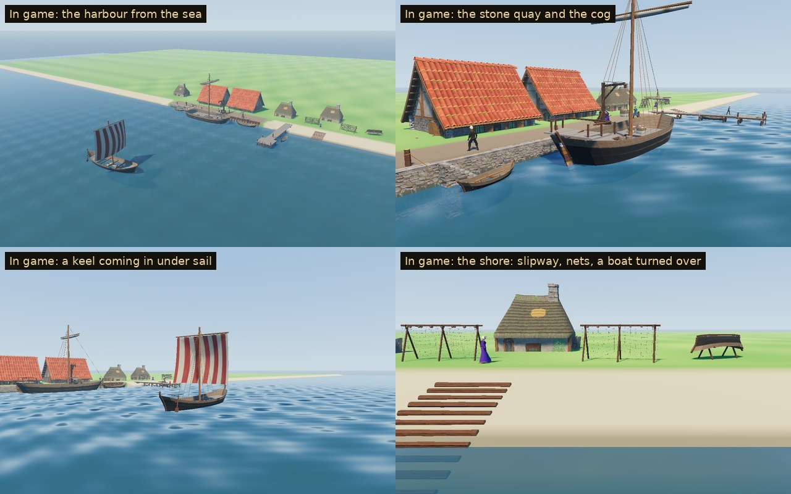

# Harbour & Ships

A small harbour as it might have been in the 1180s, and the craft that use it. These are the game's own models, built for Sovereign's Eye ahead of the coast phase. The game has no sea yet, so nothing in it places them. A demo harbour in the capture tool shows them together, with its own shore and water (`tools/harbour_demo.gd`, capture mode `harbour`):



The family has three groups:

- **The waterfront:** a timber revetment quay, a stone quay and one with water stairs, a jetty and its head, a log slipway, a mooring post and a hoist.
- **The craft:** a rowing boat, a fishing boat, a trading ship in the Scandinavian clinker tradition (a "keel") under sail, and a cog.
- **The shore:** nets drying on a rack, and a boat turned over on trestles.

## Assets

| Model | What it is | Tris | Materials | Size (W × H × D) |
| --- | --- | ---: | ---: | --- |
| `SE_Quay_Timber` | 4 m of timber revetment. Squared posts stand on the face every metre with planks laid edge on edge behind them to hold back the fill, and raking braces in front run down to the bed. A capping plate sits on top, with weed at the tide line and the trodden top behind | 1,036 | 3 | 4.00 × 3.96 × 5.52 m |
| `SE_Quay_Stone` | 4 m of stone quay: a rubble wall battered back from the bed under a coping of dressed stones, an iron mooring ring, weed at the tide line, the trodden top behind | 226 | 5 | 4.00 × 3.70 × 4.35 m |
| `SE_Quay_Steps` | The stone quay with water stairs down its face: twelve steps with dressed treads falling from the quay's top to below the water | 514 | 5 | 4.00 × 3.72 × 4.99 m |
| `SE_Jetty` | 4 m of jetty: plank decking laid across three stringers on a braced bent of two piles, weed on the piles | 476 | 3 | 4.00 × 4.00 × 2.50 m |
| `SE_Jetty_End` | The jetty's head, 4.4 m across. Two bents of three piles carry the deck, with mooring posts at three corners, a rope made fast and its end coiled on the deck, and a ladder down the end to the water | 1,922 | 3 | 4.10 × 4.75 × 4.40 m |
| `SE_Slipway` | Logs laid across two runners, 8 m from the ground down into the water, for hauling boats up | 1,360 | 1 | 3.10 × 2.34 × 8.65 m |
| `SE_Mooring_Post` | A stout oak post with a mooring rope turned round it | 282 | 1 | 0.83 × 1.60 × 1.61 m |
| `SE_Hoist` | A post on crossed sole beams with raking struts, carrying a jib braced out from its head. A block hangs at the jib's end, with a bale of wool in slings on the hook. The rope runs back along the jib to a windlass with two cranks at the post's foot | 1,224 | 3 | 2.60 × 5.44 × 4.90 m |
| `SE_Boat_Rowing` | A clinker rowing boat, 4.6 m: four strakes a side, two thwarts, tholes on the gunwale, a pair of oars stowed | 1,420 | 2 | 4.77 × 1.16 × 1.51 m |
| `SE_Boat_Fishing` | A clinker fishing boat, 7.5 m: six strakes a side and three thwarts. A mast carries the sail furled on its yard, a steering oar sits on the starboard quarter, and the net is heaped amidships | 2,372 | 3 | 7.77 × 6.31 × 4.20 m |
| `SE_Ship_Keel` | A trading ship, 16 m, in the Scandinavian clinker tradition: nine strakes a side, the stems curling up. Half decks fore and aft cover an open hold of wool and casks. A striped square sail is filled from astern, and a side rudder sits on the starboard quarter | 4,892 | 3 | 16.49 × 12.36 × 9.53 m |
| `SE_Ship_Cog` | A cog, 20 m: a flat bottom, high clinker sides tarred to an oak top strake, and straight raked posts. Beams run out through its sides, a deck has a hatch over the hold, and a railed deck sits aft. The sail is furled, and the new stern rudder hangs on the sternpost | 5,580 | 3 | 20.77 × 18.01 × 11.50 m |
| `SE_Net_Rack` | Three crossed-pole trestles and a ridge pole, the nets hung down both sides to dry, cork floats along their head rope | 1,596 | 3 | 4.60 × 2.23 × 1.59 m |
| `SE_Boat_Ashore` | The rowing boat turned over on two trestles, its bottom up to be tarred | 1,196 | 2 | 4.77 × 1.54 × 1.47 m |

**14 models.** The demo harbour's waterfront (ten lengths of quay, the jetty and the shore) is about 17k triangles, and its five craft about 16k. Every piece is placed whole, so Godot's automatic LODs apply.

## The grid and the water

- **Frame.** The waterfront joins along +X, the sea to −Y in Blender (+Z in Godot), on a 4 m grid.
- **Heights.** Every waterfront piece has its origin at the water line on its face. The quay's top is 1.4 m above the water, the jetty's deck 1.2 m, and the bed at the face 2 m below.
- **Jetty.** The jetty runs along its own +X like the quays, so it is turned to run out to sea.
- **Slipway.** The slipway falls 1.85 m over 8 m; its origin is where it meets the water.
- **Craft** have their origin at the water line amidships, the bow to +X. They draw water as their size needs: the rowing boat 0.22 m, the cog 1.6 m.
- **Shore pieces** stand on the ground at their origin.

## In the game

Not yet. The coast phase will bring the sea and decide where harbours go. Until then the pieces are shown by the capture tool:

- **The demo harbour.** `tools/harbour_demo.gd` builds a shore and sea bed (a mesh shaded by height), the water (`tools/harbour_water.gdshader`, a tool-only shader) and the pieces. Along the waterfront, a stone quay with water stairs runs into a timber quay, then a beach with a jetty, the slipway, nets and an upturned boat. The village kit's storehouses and cottages stand behind.
- **What's happening in it.** The cog lies alongside while the hoist swings a bale of wool down into it. The fishing boat is at the timber quay, rowing boats at the stairs and the jetty, and a keel comes in under sail. Villagers stand on the quays for scale.
- **The capture.** `godot --path . res://tools/capture.tscn -- <seed> <dir> harbour` takes it from the sea, along each quay, at the jetty, on the shore and out to the ship under sail.
- **Rendering paths.** Checked in all three of Godot's renderers on the stone quay with the cog, and on the shore (`previews/_renderers_forward_mobile_compat.jpg`). All three draw them with no shader errors, the cut-out nets and weed included; Compatibility is brighter all over, as it is for the meadow and the village kit.

## Construction

- **Scale and pivot.** Real-world metres; characters are about 1.78 m. The waterfront's origin is at the water line on its face, the craft's at the water line amidships.
- **The hulls** are built from their main dimensions (`Hull` in `source/build_harbour.py`):
  - Each strake is its own strip of planking, its lower edge lapped out over the strake below. The lap is closed by its own narrow face, the way clinker planking overlaps.
  - The inside of the planking is oak, the gunwale caps it, and the keel and stem and stern posts are swept along the hull's lines.
  - The Scandinavian hulls have a sharp floor and a firm bilge, their stems curving up. The cog has a flat bottom and near-upright sides, its posts straight lines raked out.
- **Research.**
  - **The cog.** The earliest cog found, from Kollerup, is tree-ring dated to the 1150s, and the Kolding cog to 1188–89, so a cog is in the haven in 1187. The earliest cogs lacked the double posts of later ones.
  - **The stern rudder.** The stern rudder on the cog was new: the ship on Winchester Cathedral's font (c. 1150–1180) is among the earliest pictures of one in northern Europe. The older Scandinavian-tradition keel steers with a side rudder.
  - **Cranes.** Harbour treadwheel cranes are first recorded in 1244 (Utrecht) and in England only in 1331, so this harbour loads with a post-and-jib hoist and a windlass.
  - **The waterfront.** London's 12th-century waterfronts were timber revetments and jetties of posts and planking, rebuilt again and again further out into the river.
  - **The cargo.** Wool, England's great export, is what the cog is loading.
- **Materials.**
  - Wood and iron are the village kit's trim sheets (`MI_WoodTrim`, `MI_MetalOrnaments`), dressed stone its ashlar (`MI_RockTrim`), and the stone quay its rubble (`MI_UnevenBrick`, as on the village's houses). These are referenced, not copied.
  - This family's atlas is `MI_Harbour`, `textures/T_Harbour_BaseColor.png`, 512 × 512 RGBA, painted by `source/paint_harbour.py`, VRAM-compressed with mipmaps. It holds:
    - tarred and oak strakes with their clench nails and laps;
    - plain and striped sailcloth;
    - the quays' trodden earth;
    - the weed at the tide line;
    - deck planks, a fishing net, a coil of rope and a furled sail.
  - The nets and the weed are cut out of it (`MI_Harbour_Cut`, alpha mask, two-sided). The weed's top edge is ragged, so the tide line isn't a painted band. Sails are thin and two-sided (`MI_Harbour_Sail`).
- **Budgets.**
  - Waterfront lengths laid by the dozen stay under 1.2k triangles (a stone quay under 400).
  - The jetty's head, hoist, slipway and net rack stay under 2.2k, and boats under 2.6k.
  - The two ships, which are one-offs, stay under 6k with LODs.
- **Build.** The build is deterministic: the same source gives byte-identical GLBs (see `3D/props/farm-field/README.md`).

## Rebuilding

```
python3 source/paint_harbour.py                                         # the atlas
/root/bpy-venv/bin/python source/build_harbour.py --export              # models + harbour.blend
/root/bpy-venv/bin/python source/build_harbour.py --review DIR          # Cycles views per model
godot --headless --path . --import
godot --headless --path . --script res://tools/asset_check.gd -- res://3D/props/harbour/models/
godot --path . --resolution 1280x720 res://tools/capture.tscn -- 9 GAME_DIR harbour   # the demo harbour in game
python3 source/make_sheets.py DIR GAME_DIR previews stats.json          # contact sheets
python3 3D/tools/build_asset_manifest.py                                # manifest + VALIDATION.json
```

## Folder

| Path | Contents |
| --- | --- |
| `models/` | Runtime GLBs (geometry embedded, textures by relative path) |
| `textures/` | `T_Harbour_BaseColor.png`, the family's atlas |
| `source/` | Blender source, build, paint and sheet scripts (ignored by Godot) |
| `previews/` | One contact sheet per model (Blender views beside a 1.78 m figure, the demo harbour in game) and the overview (ignored by Godot) |

## Validation

- `tools/asset_check.gd` loads every model as the game does and checks triangle counts, materials, texture slots, LODs and size.
- `tests/test_harbour.gd` checks that:
  - all 14 models load within budget with their textures, the nets and weed cut out and the nets and sails two-sided;
  - each quay is 4 m along the waterfront, its top level at 1.4 m the whole way, nothing of it above that, its face down to the bed;
  - the jetty's deck is 4 m along, 2.4 m across (its head 4.4 m), and its top at 1.2 m;
  - every craft draws water and stands out of it, its length and beam at the water line right for its size, upright;
  - the cog's rudder hangs in the water behind its sternpost and the keel's side rudder on its starboard quarter;
  - in the demo harbour, the quays run unbroken and the jetty starts where the beach is as high as its deck;
  - the slipway falls as the beach does, and what stands on the shore stands on the ground;
  - no craft runs into another or into the waterfront at the water;
  - the demo harbour builds with every piece.

## Limitations

- **Art only.** No ship sails, trades or carries anyone; the coast phase brings that. The sail doesn't move and the water in the demo is the demo's own.
- **Fixed scenes.** The hoist always holds a bale, the keel is always under sail, and the cog and fishing boat always have theirs furled.
- **The waterfront ends.** The quays have no end pieces: where one stops, the ground beside it has to meet it.
- **No interiors** below the decks. The hold of the cog is a dark opening, and the keel's is open, with its cargo in it.

## License

CC0 1.0 (see `LICENSE.txt`).
