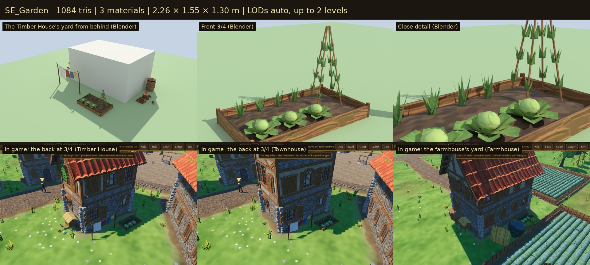

# Home Yard

What stands round a home and shows how its family lives: a bench by the
door, a kitchen garden, the washing, the chopping block, a water butt and
hens. These are the game's own models, built for Sovereign's Eye. A home's
yard grows as the family moves up:

- **Cottage:** a split log on two stumps by the door, a dug bed edged with stones, the chopping block, the washing.
- **Timber House:** a plank bench, a raised bed with bean canes, a water butt beside the chopping block, a hen house.
- **Townhouse:** a bench painted green with a cushion, flower pots across the door, the water butt; no more hens or wood to split.

Farmhouses keep a Timber House's yard (bench, raised bed, chores, washing, hens) among their haystacks and fields. Before this family a cottage had a kit bucket, a stool and a barrel.



## Assets

| Model | Level | What it is | Tris | Materials | Size (W × H × D) |
| --- | --- | --- | ---: | ---: | --- |
| `SE_Bench_Log` | Cottage | A split log laid on two stumps | 312 | 1 | 1.44 × 0.48 × 0.32 m |
| `SE_Bench` | Timber House, farmhouse | A plank bench with a back rail on splayed, braced legs | 440 | 1 | 1.44 × 0.80 × 0.35 m |
| `SE_Bench_Painted` | Townhouse | The plank bench painted green, worn through at the edges, a madder-red cushion | 484 | 1 | 1.44 × 0.80 × 0.35 m |
| `SE_Garden_Poor` | Cottage | A dug bed in two furrows, cabbages and turnips, edged with field stones | 1,056 | 3 | 2.24 × 0.33 × 1.20 m |
| `SE_Garden` | Timber House and up, farmhouse | A plank-edged raised bed: cabbages, herbs, and a wigwam of bean canes with leaves climbing it | 1,084 | 3 | 2.26 × 1.55 × 1.30 m |
| `SE_ChoppingBlock` | Cottage, Timber House, farmhouse | A stump with the axe in it, split logs about and a stack of them | 360 | 2 | 1.44 × 0.96 × 1.23 m |
| `SE_WaterButt` | Timber House and up, farmhouse | A coopered butt on two flat stones, its lid pushed aside, a dipper on the rim | 824 | 4 | 0.90 × 0.96 × 0.74 m |
| `SE_LaundryLine` | all | Two forked poles and a sagging line: a linen sheet and a madder, a woad and a weld-yellow cloth, pegged | 870 | 2 | 2.87 × 2.04 × 0.09 m |
| `SE_ChickenCoop` | Timber House, farmhouse | A boarded hen house on legs under a straw roof, a cleated ramp to its door, three hens | 1,543 | 4 | 1.36 × 1.38 × 1.97 m |
| `SE_FlowerPots` | Townhouse | Three terracotta pots of red, yellow and white flowers | 1,182 | 1 | 0.93 × 0.47 × 0.42 m |

**10 models**, laid out as yard sets by level (`data/props.json` sets `home_door_*`, `home_pots_2`, `home_garden_*`, `home_laundry_0`, `home_chores_*`, `home_coop_*`).

## In the game

- **Placement.**
  - A cottage's dressing (`data/props.json` "dressing": cottage) puts:
    - the bench by the door, with the pots across it at a Townhouse;
    - the garden and the washing behind;
    - the chores on one side and the hens on the other.
  - Each set backs onto the house and faces out.
  - A set is drawn only where its whole footprint (`yard_half`) is clear (`VillageLayoutGenerator.dressing_clear`). That means clear of:
    - other buildings and new building sites, the square, roads, fields and trees;
    - the farm's haystacks and log piles, and the forge yards;
    - the yards already placed.
  - A farmhouse lists a second spot for each set, used when the first doesn't fit: its front is often its road, its back a field.
  - Chances are rolled per building, so a village always looks the same.
  - Across five test villages, every cottage gets its bench, and nearly all get the garden, chores, washing and (as a Timber House) hens.
- **Levels.**
  - An entry `home_door@tier` draws the set for the home's level: `home_door_<t>` for the highest `t` up to the home's tier (`PropKit.dressing_set`).
  - An empty set (`home_coop_2`) means none at that level.
  - When an upgrade finishes, the props are redrawn, so the new bench appears where the old one stood.
  - The yard is worked out from the layout, so nothing new is saved and older saves get it as they load.
- **Walking.**
  - The heir walks round the hen house, the water butt and the chopping block (`data/controls.json` "dressing").
  - These are worked out with the dressing (`VillageLayout.dressing_obstacles`, not saved).
  - Benches, beds and the washing can be walked through.
- **Drawing.** Every piece is merged with the props, one surface per material per chunk.
- **Rendering paths.** Checked in all three of Godot's renderers (`previews/_renderers_forward_mobile_compat.jpg`).

## Construction

- **Scale and pivot.**
  - Real-world metres; characters are about 1.78 m.
  - Origin at the ground; front is −Y in Blender (+Z in Godot).
  - A bench's back is to the house wall (+Y).
  - Seats are at 0.36–0.47 m.
- **Materials.**
  - Wood, stone and iron are UV-mapped onto the **Quaternius Medieval Village MegaKit trim sheets** (`MI_WoodTrim`, `MI_RockTrim`, `MI_MetalOrnaments`).
  - Garden crops and the coop's straw roof use the Farm & Field atlas (`MI_Farm`).
  - Cloth, blossoms, leaves, hens, terracotta, dug soil and paint use this family's own small atlas: `MI_Home`, `textures/T_Home_BaseColor.png`, 512 × 512, painted by `source/paint_home.py`, VRAM-compressed with mipmaps like the kits.
  - The butt's water is a flat material (`MI_Home_Water`).
- **Budgets.**
  - Every model is under 2k triangles; the benches under 500.
  - A whole Timber House yard is about 5.1k triangles, merged.
- **Collision.**
  - The benches, chopping block, water butt and hen house carry a simple convex proxy (`-convcolonly`).
  - In the game, the hen house, butt and block are analytic circles.
  - `tests/test_home.gd` checks every set fits its footprint.
- **Build.** The build is deterministic: the same source gives byte-identical GLBs (see `farm-field/README.md`).

## Rebuilding

```
python3 source/paint_home.py                                           # the atlas
/root/bpy-venv/bin/python source/build_home.py --export                # models + home_yard.blend
/root/bpy-venv/bin/python source/build_home.py --review DIR            # Cycles views per model
/root/bpy-venv/bin/python source/build_home.py --yards DIR/yard        # each level's yard round a stand-in cottage
godot --headless --path . --import
godot --headless --path . --script res://tools/asset_check.gd -- res://3D/props/home-yard/models/
godot --path . --resolution 1280x720 res://tools/capture.tscn -- 9 DIR home   # in-game shots by level
python3 source/make_sheets.py CYCLES_DIR GAME_DIR previews stats.json            # contact sheets
python3 3D/tools/build_asset_manifest.py                                          # manifest + VALIDATION.json
```

## Folder

| Path | Contents |
| --- | --- |
| `models/` | Runtime GLBs (geometry embedded, textures by relative path) |
| `textures/` | `T_Home_BaseColor.png`, the family's atlas |
| `source/` | Blender source, build and paint scripts, sheet maker (ignored by Godot) |
| `previews/` | One contact sheet per model: Blender views beside a 1.78 m figure, plus in-game views (ignored by Godot) |

## Validation

- `tools/asset_check.gd` loads every model as the game does and checks triangle counts, materials, texture slots, LODs, collision and size.
- `tests/test_home.gd` checks that:
  - all 10 models load within budget with their textures;
  - each level gets its own pieces, and a Townhouse keeps no hens;
  - every yard keeps clear of buildings (its own included), the other yards, fields, farm and forge yards, roads and trees, and faces away from its house;
  - every set fits its footprint;
  - an upgrade swaps the bench in place and adds the pots;
  - the heir walks round the hen house, and nothing new is saved;
  - the kit bucket and stool are gone.

## Limitations

- **Set dressing only.** Nobody yet sits on the bench, splits wood, hangs washing or feeds the hens. The hens don't move, and the washing doesn't stir in the wind.
- **Only the solid pieces block walking.** The beds, benches and washing can be walked through.
- **Crowded farms.** Farmhouses often have no room for the hens or the washing between their haystacks, log piles and fields.
- **Manor and barracks.** These are not homes in this sense and keep their own dressing.

## License

CC0 1.0 (see `LICENSE.txt`). The referenced trim-sheet textures are Quaternius CC0; the farm atlas is this game's own (CC0).
