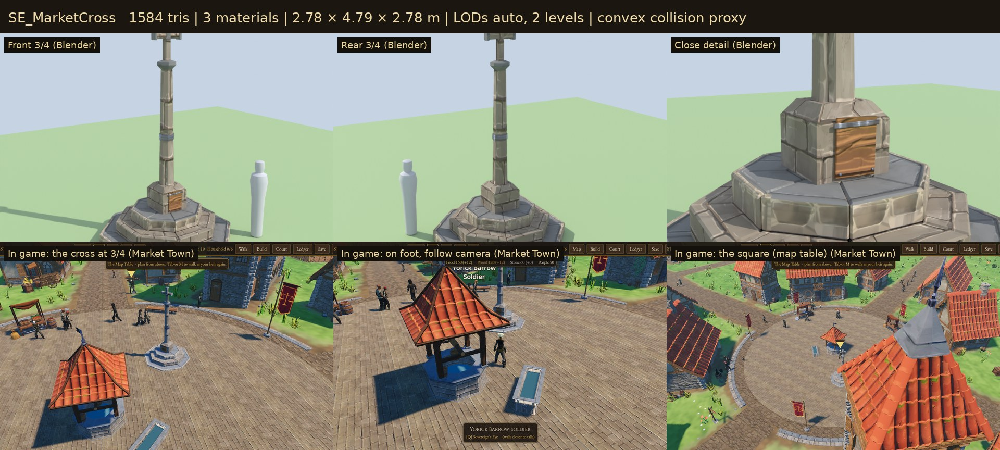

# Market Square

The square's edge and what stands on it: the kerb round the rim, the market
cross, and the trough beside the well. These are the game's own models, built
for Sovereign's Eye. They **grow with the settlement's charter**:

- **Hamlet:** field stones edge the square, and a hollowed log serves as the trough.
- **Village:** a dressed kerb rings the square.
- **Market Town:** the edge becomes two stone steps, a carved trough replaces the log, and the market cross goes up. The cross is the sign of the market right the charter grants.
- **Town:** a taller lantern cross with a gilt finial replaces it.

The square's rim used to be a flat grey band.



## Assets

| Model | Charter | What it is | Tris | Materials | Size (W × H × D) |
| --- | --- | --- | ---: | ---: | --- |
| `SE_Kerb_Rubble` | Hamlet | A 1.5 m run of half-sunk field stones | 240 | 1 | 1.47 × 0.31 × 0.48 m |
| `SE_Kerb_Stone` | Village | Two dressed kerbstones, their tops a hand above the paving | 88 | 1 | 1.48 × 0.34 × 0.31 m |
| `SE_Kerb_Step` | Market Town, Town | Two shallow steps: a slate coping flush with the paving, then a dressed step down to the grass; joints staggered | 220 | 1 | 1.48 × 0.30 × 0.74 m |
| `SE_MarketCross` | Market Town | Three octagonal steps, a broached socket with the charter posted on it (board, iron strap, nails), an octagonal shaft with an iron band, a stone cross | 1,584 | 3 | 2.78 × 4.79 × 2.78 m |
| `SE_MarketCross_Town` | Town | A lantern cross: four steps, a moulded socket with iron shields, a tall shaft with two iron bands, a lantern head (niches, gablets, pinnacles, a stone spirelet) and a gilt cross | 2,160 | 3 | 2.96 × 6.04 × 2.96 m |
| `SE_Trough_Log` | Hamlet, Village | A hollowed half-log on two chocks, full of water | 338 | 2 | 1.90 × 0.44 × 0.56 m |
| `SE_Trough_Stone` | Market Town, Town | A carved stone trough on a plinth, with a moulded rim, an iron tethering ring and water | 630 | 3 | 1.99 × 0.74 × 0.82 m |

**7 models**: 3 kerb tiers, 2 crosses and 2 troughs. They are meaningful variants (new forms and craft, not recolours). The charter → model tables are in `data/props.json` (`square_edge`, `by_charter`).

## In the game

- **The kerb.**
  - It is laid round the square's rim as one MultiMesh of 1.5 m pieces (`VillageBuilder.square_edge_transforms`).
  - Each piece's inner edge sits on the paving's rim, stretched to the chord between its ends.
  - Where a road comes in, the pieces on either side are cut short to stop just clear of it (`road_gap`), so each opening is the road's width.
  - Granting a charter relays it (`refresh_square`).
- **The market cross and the trough.**
  - They are layout props whose spots the generator reserves from the start (`VillageLayoutGenerator.square_furniture`).
  - Each spot is the angle that keeps furthest from the stalls, benches, banners and the walk in from each road. The cross stands at 42% of the radius, facing the well; the trough stands 2.7 m from the well.
  - There is no randomness, so loading an older save (save v9) adds them the same way.
  - The cross's `by_charter` entry is empty until Market Town. Until then its spot is kept, but nothing is drawn or walked into there (`PropKit.present`).
  - The cross is placed whole, keeping its LODs, like the well. The trough merges with the props.

## Construction

- **Scale and pivot.**
  - Real-world metres; characters are about 1.78 m.
  - Origin at the ground; front is −Y in Blender (+Z in Godot).
  - A kerb piece runs along +X from 0 to 1.5 m, with the square's edge on y = 0 and the kerb reaching out to −Y.
  - The square's paving surface is 0.15 m above the grass. The village kerb stands 6 cm above it, and the steps come down in two 8–9 cm risers.
- **Materials.**
  - Stone, wood and iron are UV-mapped onto the **Quaternius Medieval Village MegaKit trim sheets** (`MI_RockTrim`, `MI_WoodTrim`, `MI_MetalOrnaments`). The kit's material definitions are used, with images by relative path, so no texture is loaded twice.
  - The Town cross's gilt cross uses the Village Commons banner gold (`MI_Commons_Banner`), the same gilding as the banner finials.
  - The troughs have their own untextured water (`MI_Square_Water`). It is darker and less glossy than the well's, because a trough is open to the sky.
  - **No new textures.**
- **Budgets.**
  - Kerb pieces are laid by the dozen: under 300 triangles each. A full ring is about 50 pieces, 4–12k triangles in one draw call.
  - Crosses stay under 3k with automatic LODs; troughs under 800.
- **Collision.**
  - The crosses and troughs carry simple convex proxies (`-convcolonly`). Kerbs have none; people step over them.
  - Walking collision in the game is analytic (`WorldGeometry`, radii in `data/controls.json`: `market_cross` 1.5 m, `trough` 0.95 m). `tests/test_square.gd` checks that they cover each footing.
- **Build.** The build is deterministic: the script pins Python's hash seed (see `farm-field/README.md`).

## Rebuilding

Everything is generated from code. Edit `source/build_square.py`, which uses the commons modelling helpers in `../village-commons/source/`, then run:

```
/root/bpy-venv/bin/python source/build_square.py --export             # models + market_square.blend
/root/bpy-venv/bin/python source/build_square.py --review DIR         # Cycles views per cross and trough
/root/bpy-venv/bin/python source/build_square.py --kerbs DIR/arc      # each kerb laid round a paved disc
godot --headless --path . --import
godot --headless --path . --script res://tools/asset_check.gd -- res://3D/props/market-square/models/
godot --path . --resolution 1280x720 res://tools/capture.tscn -- 9 DIR square   # in-game shots per charter
python3 source/make_sheets.py CYCLES_DIR GAME_DIR previews stats.json            # contact sheets
python3 3D/tools/build_asset_manifest.py                                          # manifest + VALIDATION.json
```

## Folder

| Path | Contents |
| --- | --- |
| `models/` | Runtime GLBs (geometry embedded, textures by relative path) |
| `source/` | Blender source, build script, sheet maker (ignored by Godot) |
| `previews/` | One contact sheet per model: Blender views beside a 1.78 m figure, plus in-game views (ignored by Godot) |

## Validation

- `tools/asset_check.gd` loads every model as the game does and checks:
  - triangle counts;
  - that every material is named and every texture slot resolves;
  - LODs, collision shapes and size.
- `tests/test_square.gd` checks that:
  - all 7 models load within budget with their textures;
  - the kerb follows the charter, lies on the rim facing out, and runs all round except the road mouths;
  - the market cross stands from Market Town on, and nothing blocks its spot before then;
  - the cross and trough keep clear of the well, stalls, benches, each other and the walk in from each road;
  - older saves get both;
  - collision covers each footing.

## Limitations

- **Kerb joints.** The kerb is a ring of straight pieces (about 50 for a 13 m square). On the outer side, a narrow wedge opens between neighbours; it reads as a mortar joint.
- **Rubble pieces.** Rubble pieces next to a road are shortened by stretching, so their stones come out a little squashed there.
- **The steps.** They are a two-course edge, not a raised plaza: people walk over them at ground height, so their feet dip a few centimetres into the coping.
- **The market cross** is set dressing. It doesn't yet host anything (proclamations, market-day crowds).
