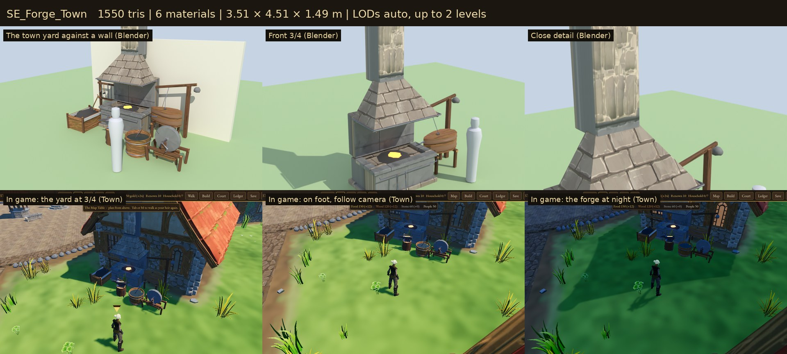

# Smithy

The smith's forge yard, set against the smithy's side wall so a smithy reads
as one before the UI says so. These are the game's own models, built for
Sovereign's Eye. The yard grows with the settlement's charter:

- **Hamlet and Village:** a field-stone hearth under a timber hood, with a heap of charcoal.
- **Market Town and Town:** a dressed-stone forge with a tall chimney and double bellows, a coal bin and a grindstone.

The fire glows, by day and at night. Before this family a smithy was a brick building with a kit anvil out front.



## Assets

| Model | Yard | What it is | Tris | Materials | Size (W × H × D) |
| --- | --- | --- | ---: | ---: | --- |
| `SE_Forge_Village` | Hamlet, Village | A waist-high hearth of field stone with a stone rim and the fire in its firepot, a stone breast, a timber-framed hood narrowing to a short stone flue, leather bellows on a trestle with a strapped handle, tongs and a poker | 1,452 | 6 | 2.72 × 3.41 × 1.29 m |
| `SE_Forge_Town` | Market Town, Town | A dressed-stone forge on a slate plinth with a coped rim and an iron tool rail, a stone hood banded in iron, a tall chimney with a moulded cap, double bellows on a frame worked by a lever (chained to an iron eye) with a stone counterweight | 1,550 | 6 | 3.51 × 4.51 × 1.49 m |
| `SE_Anvil` | both | A horned anvil on an oak stump, a hammer on its face, a bar glowing from the fire, tongs leaning on the stump | 512 | 3 | 0.87 × 0.88 × 0.71 m |
| `SE_SlackTub` | both | The quench tub: half a barrel of sooty water with two iron hoops, tongs left in it | 566 | 3 | 0.81 × 0.96 × 0.80 m |
| `SE_CoalHeap` | Hamlet, Village | Charcoal heaped on the ground, a shovel in it | 320 | 3 | 1.42 × 1.19 × 1.20 m |
| `SE_CoalBin` | Market Town, Town | A plank bin heaped with charcoal, a shovel in it | 562 | 3 | 1.23 × 1.28 × 0.99 m |
| `SE_ToolRack` | both | Two posts and two rails against the wall: hammers, tongs, a file and a string of horseshoes | 756 | 2 | 1.24 × 1.60 × 0.23 m |
| `SE_Grindstone` | Market Town, Town | A grinding wheel on a timber frame with a crank, a water trough under the stone | 762 | 4 | 1.10 × 1.12 × 0.76 m |

**8 models**, laid out as two yards (`data/props.json` sets `forge_yard_village`, `forge_yard_town`).

## In the game

- **Placement.**
  - Each smithy gets the yard against its right wall, else its left, else its back: the first side clear of other buildings, the square, roads, fields, props and trees (`VillageLayoutGenerator.smithy_yard`).
  - The yard is 4.8 × 2.7 m, and its forge backs onto the wall.
  - There is no randomness, so loading an older save (save v10) adds it the same way and moves the smithy's barrels and crates out of it.
  - All 60 smithies across 60 test villages got their yard.
- **Charter tiers.**
  - The yard is a layout prop, `forge`, whose `by_charter` entry is a set of models (`set:forge_yard_*`). Its models are placed together and merged with the props, so a whole yard costs one surface per material in its chunk.
  - A charter swaps the yard (`refresh_props`).
- **What it replaced.** The kit anvil left the smithy's dressing, and so did the kit building's crate, which stood where the yard goes.
- **Walking.** The yard is one walking obstacle (`data/controls.json` props `forge`: 2.0 m).
- **Rendering paths.** Checked in all three of Godot's renderers on the Town yard (`previews/_renderers_forward_mobile_compat.jpg`).

## Construction

- **Scale and pivot.**
  - Real-world metres; characters are about 1.78 m.
  - Origin at the ground; front is −Y in Blender (+Z in Godot).
  - A forge's back (the wall side) is +Y, and its bellows are on +X.
  - Hearths stand at working height (0.76–0.82 m); the anvil's face is at 0.79 m.
- **Materials.**
  - Wood, stone and iron are UV-mapped onto the **Quaternius Medieval Village MegaKit trim sheets** (`MI_WoodTrim`, `MI_RockTrim`, `MI_MetalOrnaments`), with images by relative path.
  - Leather, charcoal and sooty water are the family's own flat materials (`MI_Smithy_Leather`, `MI_Smithy_Coal`, `MI_Smithy_Water`).
  - The fire's heart and the hot bar on the anvil are emissive (`MI_Smithy_Embers`). `gltf_pack.py` writes `emissiveFactor` and `KHR_materials_emissive_strength` (2.5), which Godot imports as emission energy 2.5, so they glow at dusk and night.
  - **No new textures.**
- **Budgets.**
  - Forges stay under 2.5k triangles; the other pieces under 1k.
  - A whole village yard is about 3.6k triangles and a town yard about 4.7k, merged.
- **Collision.**
  - Each GLB carries a simple convex proxy (`-convcolonly`).
  - In the game, the yard is one analytic circle. `tests/test_smithy.gd` checks that every piece of both yards stays inside the yard's footprint.
- **Build.** The build is deterministic: the same source gives byte-identical GLBs.

## Rebuilding

```
/root/bpy-venv/bin/python source/build_smithy.py --export             # models + smithy.blend
/root/bpy-venv/bin/python source/build_smithy.py --review DIR         # Cycles views per model
/root/bpy-venv/bin/python source/build_smithy.py --yards DIR/yard     # both yards against a wall
godot --headless --path . --import
godot --headless --path . --script res://tools/asset_check.gd -- res://3D/props/smithy/models/
godot --path . --resolution 1280x720 res://tools/capture.tscn -- 9 DIR smithy   # in-game shots, day and night
python3 source/make_sheets.py CYCLES_DIR GAME_DIR previews stats.json            # contact sheets
python3 3D/tools/build_asset_manifest.py                                          # manifest + VALIDATION.json
```

## Folder

| Path | Contents |
| --- | --- |
| `models/` | Runtime GLBs (geometry embedded, textures by relative path) |
| `source/` | Blender source, build script, sheet maker (ignored by Godot) |
| `previews/` | One contact sheet per model: Blender views beside a 1.78 m figure, plus in-game views (ignored by Godot) |

## Validation

- `tools/asset_check.gd` loads every model as the game does and checks triangle counts, materials, texture slots, LODs, collision and size.
- `tests/test_smithy.gd` checks that:
  - all 8 models load within budget, and the embers glow;
  - every smithy has its yard against a wall, facing out, clear of buildings, fields, props and trees;
  - the forge follows the charter, is merged with the props, and keeps the heir out;
  - both yards fit their footprint;
  - older saves get the yard;
  - the kit anvil is gone.

## Limitations

- **Set dressing only.** The smith doesn't yet work at the forge (no hammering animation, sparks or forge sound), and the bellows don't move.
- **Even glow.** The embers glow at a steady level, by day too; they don't flicker or light the ground. A small flickering light would cost a light per smithy.
- **One obstacle.** The yard's walking obstacle is a circle, so its two front corners (the coal heap or bin, and the grindstone) can be brushed through.
- **No castle forge yet.** That comes with the castle kit (`3D/BACKLOG.md`).

## License

CC0 1.0 (see `LICENSE.txt`). The referenced trim-sheet textures are Quaternius CC0.
