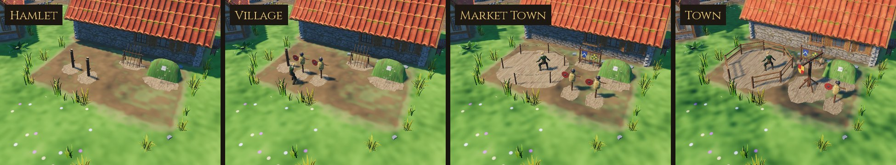

# Training Yard

Where a village's men muster and a town's guard trains, behind the
barracks. These are the game's own models, built for Sovereign's Eye.
Before this family the barracks had three kit dummies standing on the road
in front of it. Now it has a yard that grows with the settlement:

- **Hamlet (the muster):** two pells (practice posts), a rack of quarterstaves and wooden wasters, a turf archery butt.
- **Village:** a pell, two straw dummies, the staves and the butt.
- **Market Town (the town guard):** a sparring ring of stakes and rope, two straw dummies, a rack of spears, wasters and shields, the butt.
- **Town:** a railed ring, a quintain, a straw dummy, the weapons rack and the butt.

Soldiers drill at the pells, dummies and quintain and spar in the ring. The yard's ground is trodden bare.



## Assets

| Model | Charters | What it is | Tris | Materials | Size (W × H × D) |
| --- | --- | --- | ---: | ---: | --- |
| `SE_Pell` | Hamlet, Village | A knotted oak post about a man's height (as in Vegetius), hacked where the blades bite, a rope round its head, the ground trodden bare | 420 | 2 | 1.62 × 1.89 × 1.78 m |
| `SE_Dummy_Straw` | Village and up | A post and crossbar, a body of straw bound with rope, a sacking head under a dented pot of a helmet, a battered round shield on its arm | 905 | 4 | 1.53 × 2.02 × 1.66 m |
| `SE_Quintain` | Town | A braced post with an arm turning on an iron pin: a painted shield on one end, a sandbag on a rope at the other (strike the shield and the bag comes round) | 816 | 4 | 3.09 × 2.57 × 3.65 m |
| `SE_ArcheryButt` | all | A turf-clad earth bank, rounded on top so the rain runs off, a square of white linen (the clout) pegged to its face, arrows in it and round it | 442 | 2 | 2.84 × 1.45 × 2.85 m |
| `SE_Rack_Staves` | Hamlet, Village | Two crossed trestles and a pole, quarterstaves leaning on it, two wooden wasters | 592 | 2 | 2.37 × 1.68 × 1.39 m |
| `SE_Rack_Weapons` | Market Town, Town | Two posts and two rails, spears standing in it, wasters below, a heater and a round shield on pegs | 1,008 | 3 | 2.44 × 2.56 × 1.38 m |
| `SE_Ring_Rope` | Market Town | Six stakes, rope sagging between them, one side open to step in, the floor trodden | 648 | 2 | 5.95 × 1.18 × 5.85 m |
| `SE_Ring_Rail` | Town | Eight posts and two rails round a sanded floor, a gap to step in | 996 | 2 | 6.01 × 1.20 × 6.21 m |

**8 models**, laid out as eight yard sets: four charters × a full yard (11 × 6.5 m) and a small one (7 × 4 m) for a cramped barracks.

## In the game

- **Where.**
  - The generator finds each barracks a yard (`VillageLayoutGenerator.training_yard`): behind it first, then beside it, never on the door side, which faces its road.
  - It tries a full yard at 1.2, 2.5 and 4 m from the wall, then a small one, wherever the whole footprint is clear of buildings, the square, roads, fields, props and trees.
  - Across ten test villages every barracks gets a yard; one (seed 42) gets a small one.
  - The barracks' banner moves to the front corner the yard leaves clear.
- **What.**
  - The layout prop `training` (or `training_small`) is drawn by charter (`data/props.json` `by_charter`) as a set of models, merged with the props like the forge yard.
  - A charter rising redraws it.
- **Drilling.**
  - Soldiers whose work is "drill" go to the yard (`PropKit.drill_spots`, from `data/props.json` `drill`, per model), each to their own spot by worker slot. They strike a pell, dummy or quintain from its front, or spar face to face in the ring.
  - Where no yard fits, they keep to the old kit dummies.
- **Walking.**
  - The heir walks round the pells, dummies, quintain, butt and racks (`data/controls.json` `dressing`: radii per model).
  - The heir can step into a ring and cross the yard's open ground. The yard prop itself has radius 0, so only its pieces block.
  - Nothing else is set down in the yard: home yards and the barracks' own barrels and racks keep out (`VillageBuilder.dressing_items`).
- **Ground.** The whole yard is worn to trodden earth in the meadow's wear mask (`data/art_style.json` `wear` `yards`), so no grass grows in it and the ground reads as a drill ground.
- **Saving.**
  - The yard's spot is in the layout (save v11).
  - Older saves get theirs where a new village would put it, in place of the kit dummies (`SaveManager.migrate`), with barrels and crates moved out.
- **Rendering paths.**
  - Checked in all three of Godot's renderers on a Town yard, from outside and on foot (`previews/_renderers_forward_mobile_compat.jpg`). All three draw it with no shader errors; the models, shields and worn ground look the same in each.
  - Compatibility is brighter all over (deeper grass, paler trodden earth), as it is for the meadow and the kit.

## Construction

- **Scale and pivot.**
  - Real-world metres; characters are about 1.78 m.
  - Origin at the ground; front is −Y in Blender (+Z in Godot). A soldier striking a pell stands in front of it.
  - In a yard set, +Z points away from the barracks wall. The butts back onto the barracks.
- **Research.**
  - The pell is a man-height post, about six feet, after Vegetius and the medieval manuscripts that copy him.
  - The quintain is a turning arm with a shield on one end and a weight or sandbag on the other.
  - Village butts were turf-clad earth mounds on common ground, kept because the law required archery practice on Sundays and holidays.
  - They were marked with a white cloth, the clout, not the painted rings of later target archery.
- **Materials.**
  - Wood and iron are UV-mapped onto the Quaternius Medieval Village MegaKit trim sheets (`MI_WoodTrim`, `MI_MetalOrnaments`).
  - The dummies' straw and the sacking of their heads and the sandbag come from the Farm & Field atlas (`MI_Farm`).
  - Painted shields, turf, trodden earth, the linen clout, fletching, rope and fresh-cut oak use this family's atlas: `MI_Training`, `textures/T_Training_BaseColor.png`, 512 × 512, painted by `source/paint_training.py`, VRAM-compressed with mipmaps.
- **Budgets.**
  - Every piece is under 1,100 triangles.
  - A Town yard (ring, quintain, dummy, rack, butt) is about 4.2k, merged with the props.
- **Build.** The build is deterministic: the same source gives byte-identical GLBs (see `3D/props/farm-field/README.md`).

## Rebuilding

```
python3 source/paint_training.py                                       # the atlas
/root/bpy-venv/bin/python source/build_training.py --export            # models + training_yard.blend
/root/bpy-venv/bin/python source/build_training.py --review DIR        # Cycles views per model
godot --headless --path . --import
godot --headless --path . --script res://tools/asset_check.gd -- res://3D/props/training-yard/models/
godot --path . --resolution 1280x720 res://tools/capture.tscn -- 9 GAME_DIR training   # in game, each charter
python3 source/make_sheets.py DIR GAME_DIR previews stats.json          # contact sheets
python3 3D/tools/build_asset_manifest.py                                # manifest + VALIDATION.json
```

## Folder

| Path | Contents |
| --- | --- |
| `models/` | Runtime GLBs (geometry embedded, textures by relative path) |
| `textures/` | `T_Training_BaseColor.png`, the family's atlas |
| `source/` | Blender source, build and paint scripts, sheet maker (ignored by Godot) |
| `previews/` | One contact sheet per model: Blender views beside a 1.78 m figure, plus the yard in game (ignored by Godot) |

## Validation

- `tools/asset_check.gd` loads every model as the game does and checks triangle counts, materials, texture slots, LODs and size.
- `tests/test_training.gd` checks that:
  - all 8 models load within budget with their textures;
  - every barracks in ten villages has one yard: not on its door side, facing away from its wall, clear of everything else, the same each time;
  - the yard grows with the charter (each charter's yard is different; a hamlet's muster has no ring, a small yard no butt);
  - every set fits its yard, with room to walk between the solid pieces;
  - soldiers drill inside the yard, facing what they strike, never inside a piece;
  - the heir is kept out of the butt but can step into the ring and cross the yard;
  - no dressing or home yard stands in it, and its ground is trodden bare;
  - an older save gets its yard in place of the kit dummies, and a current save is left alone.

## Limitations

- **Drill, not a fight.** Soldiers play their work animation at a target. Nobody shoots at the butts, rides at the quintain, or truly spars: two soldiers in a ring each strike the air before them.
- **Static.** The quintain's arm doesn't turn and the sandbag doesn't swing.
- **No lists yet.** A castle's tilting lists belong to the castle phase (backlog #10).
- **Where no yard fits** (none of the ten test villages), the barracks keeps the kit dummies in front of it.

## License

CC0 1.0 (see `LICENSE.txt`).
