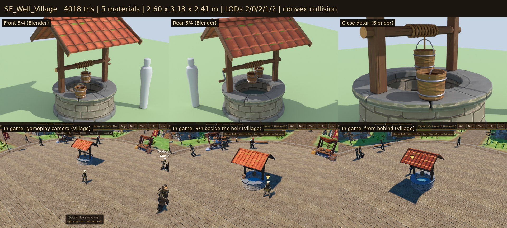

# Village Commons

The civic furniture of the square: the well, the charter banners and the
signposts at the road ends. These are the game's own models, built for
Sovereign's Eye, and they **grow finer with the settlement's charter**
(Hamlet → Village → Market Town → Town). When the Crown grants a charter, the
square visibly changes.



## Assets

| Model | Charter | Gameplay purpose | Tris | Materials | Size (W × H × D) |
| --- | --- | --- | ---: | ---: | --- |
| `SE_Well_Hamlet` | Hamlet | Centre of the square where the heir starts. Rubble ring, forked log posts, log windlass, peg handle, a patched plank lid, a bucket waiting on it | 2,536 | 4 | 2.22 × 1.89 × 2.21 m |
| `SE_Well_Village` | Village | Dressed ashlar ring on a footing, slate capstones, timber frame with knee braces, red-tile gable roof (the houses' tiles), iron crank, raised bucket | 4,018 | 5 | 2.60 × 3.18 × 2.41 m |
| `SE_Well_Town` | Market Town, Town | Octagonal carved wellhead on a plinth, four chamfered posts on stone shoes, a flared hipped roof with an iron finial and weathervane, a spoked winch wheel | 5,392 | 5 | 2.77 × 4.95 × 2.78 m |
| `SE_Banner_Village` | Hamlet, Village | Charter banner: plain pole with stone wedges, lashed side arm, guy rope, swallowtail with the **wheat sheaf** | 910 | 4 | 1.18 × 4.54 × 0.30 m |
| `SE_Banner_MarketTown` | Market Town | Octagonal stone foot, turned pole, gilt finial, iron-braced arm, pointed banner with the **balance scales**, gold fringe, tassel | 1,046 | 4 | 1.53 × 5.06 × 0.50 m |
| `SE_Banner_Town` | Town | Stepped stone plinth, tall turned pole with a gilt crown and orb, braced arm, long banner with the **crowned castle**, fringe, tassels | 1,420 | 4 | 1.72 × 5.59 × 0.62 m |
| `SE_Signpost_Rough` | Hamlet | A crooked post wedged with stones, two rough boards (one lashed back on) | 510 | 2 | 1.18 × 2.15 × 0.43 m |
| `SE_Signpost_Village` | Village | A squared post with a pyramid cap and three arrow boards | 308 | 2 | 1.39 × 2.49 × 0.82 m |
| `SE_Signpost_Town` | Market Town, Town | A dressed stone footing, a turned post with an iron collar and finial, three framed boards | 580 | 3 | 1.55 × 2.67 × 0.88 m |

**9 models** in 3 families, with 3 tiers each. The tiers are meaningful variants (new silhouettes, materials and craftsmanship), not recolours. The charter → model table is in `data/props.json` (`by_charter`).

## Construction

- **Scale and pivot.** Real-world metres; characters are about 1.78 m.
  - The origin is at the ground centre of the base.
  - Front is −Y in Blender, which is +Z in Godot.
  - A banner's arm reaches along +X.
  - Well rims are at waist height (0.83–0.99 m), eaves are above head height (2.4–2.7 m), and banner hems hang at 2.1–2.6 m, so people walk under them.
- **Materials.** These are shared with the village buildings. The wood, stone, roof-tile and iron surfaces are UV-mapped straight onto the **Quaternius Medieval Village MegaKit trim sheets**: `MI_WoodTrim`, `MI_RockTrim`, `MI_RoundTiles` and `MI_MetalOrnaments`. The exported materials are the kit's exact definitions, and their images point to the kit's PNGs by relative path (`../../../environments/quaternius-medieval-village-standard/models/...`).
  - Godot loads each texture once for buildings and commons alike.
  - 11 of the 12 textures the family uses are the kit's.
- **Own textures.** One 1024 × 1024 atlas, `textures/T_Commons_Banner_BaseColor.png` (about 0.7 MB in VRAM: compressed like the kit's textures, with mipmaps). It holds:
  - three crimson banner faces with gold embroidered borders and charges;
  - gold fringe, cord and gilding, used by tassels and gilt finials.
  - It is painted by `source/paint_banner.py`.
  - The well water is a flat material with no texture (`MI_Commons_Water`).
- **Draw calls.**
  - Wells: 4–5 surfaces each.
  - Banners and signposts are merged with the other props into chunk meshes (one surface per material), so all banners on a map together cost about 4 draw calls.
- **Wind.** Banner cloth, fringe and tassels sway (`shaders/banner_wind.gdshader`). The sway weight is baked into the second UV channel: 0 where the cloth wraps the arm, 1 at the hem, 0 on gilt fittings. Nothing else moves, and banners don't flap in lockstep.
- **Collision.** Each GLB contains a simple convex proxy (a 10-sided cylinder, node suffix `-convcolonly`) that Godot imports as a `StaticBody3D`. Walking collision in the game is analytic (`WorldGeometry`, radii in `data/controls.json`). `tests/test_commons.gd` checks that those radii cover every model's footing.
- **LOD.**
  - The well is placed whole, so it keeps Godot's automatic import LODs (1–4 levels per surface).
  - Banners and signposts are merged with the props (LODs are dropped by merging). They are cheap (under 1.5k triangles) and few: about 3 signposts, and 3–9 banners per map.
- **Placement.**
  - The well stands at the square's centre.
  - Banners stand by the manor, chapel and barracks, and around the square (2 more per charter).
  - A banner whose arm would reach into a building is mirrored to reach the other way.
  - Signposts stand where roads leave the village.

## Rebuilding

Everything is generated from code. Edit `source/build_commons.py` (assets) or `source/commons_lib.py` (modelling helpers), then run:

```
python3 source/paint_banner.py                                   # banner atlas
/root/bpy-venv/bin/python source/build_commons.py --export        # models + village_commons.blend
/root/bpy-venv/bin/python source/build_commons.py --review DIR    # Cycles views per asset
/root/bpy-venv/bin/python source/build_commons.py --lineup DIR/x  # all assets side by side
godot --headless --path . --import
godot --headless --path . --script res://tools/asset_check.gd -- res://3D/props/village-commons/models/
godot --path . --resolution 1280x720 res://tools/capture.tscn -- 9 DIR commons   # in-game shots per charter
python3 source/make_sheets.py CYCLES_DIR GAME_DIR previews stats.json            # contact sheets
python3 3D/tools/build_asset_manifest.py                                          # manifest + VALIDATION.json
```

Blender 4.2 runs headless here as the `bpy` module (`pip install bpy==4.2.0` under Python 3.11). `source/village_commons.blend` holds every asset, editable.

`source/gltf_pack.py` turns Blender's glTF export into the runtime GLB. It swaps in the kit's material definitions, points images at the shared PNGs, and embeds the geometry.

## Folder

| Path | Contents |
| --- | --- |
| `models/` | Runtime GLBs (geometry embedded, textures by relative path) |
| `textures/` | `T_Commons_Banner_BaseColor.png` |
| `source/` | Blender source, build scripts, banner painter, GLB packer, sheet maker (ignored by Godot) |
| `previews/` | One contact sheet per model: Blender front ¾, rear ¾ and detail, plus in-game views (ignored by Godot) |

## Validation

- `tools/asset_check.gd` loads every model as the game does and checks:
  - triangle counts;
  - that every material is named and every texture slot resolves;
  - automatic LODs, collision shapes and size.
- `tests/test_commons.gd` checks that:
  - every charter tier has a loadable model with its textures, within budget;
  - the well follows the charter;
  - banners reach away from walls and use the wind shader;
  - collision covers each footing.
- `3D/tools/build_asset_manifest.py` records the files, checksums and external dependencies in `3D/ASSET_MANIFEST.csv` and `3D/VALIDATION.json`.

## Limitations

- **Signpost boards** point in fixed directions; they are not yet aligned to the roads at each junction.
- **Hand-painted look.** Everything is texture-mapped onto shared trim sheets; there are no unique bakes (AO or curvature), to stay consistent with the kit.
- **Banner tiers.** Banners use the Village design in a Hamlet: the starting banners by the manor show the wheat sheaf before any charter.
- **Rendering paths.** Checked in all three of Godot's renderers:
  - Forward+ (desktop): every contact sheet.
  - Mobile (the Android build).
  - Compatibility (OpenGL).
  - Both extra runs drew everything with no shader errors. See `previews/_renderers_town_mobile_vs_compat.jpg` (Mobile left, Compatibility right). The Compatibility renderer shows banners a little brighter, because it handles cloth translucency more simply.

## License

CC0 1.0 (see `LICENSE.txt`). The referenced trim-sheet textures are Quaternius CC0.
