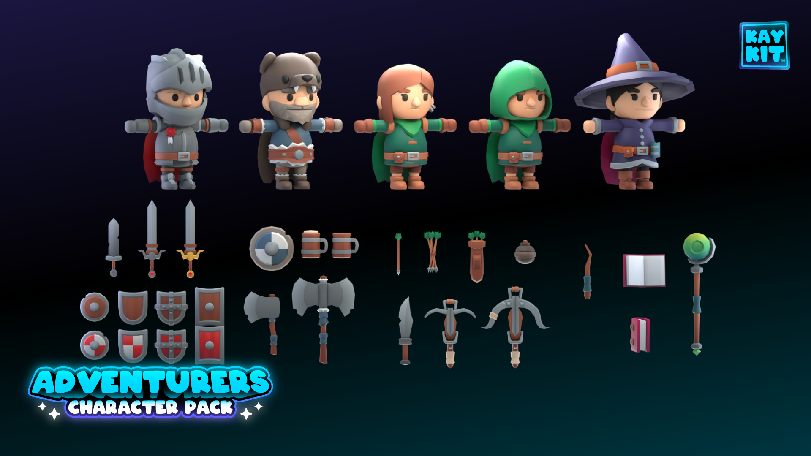
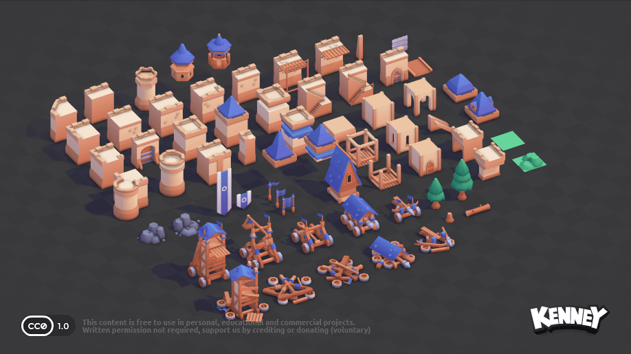
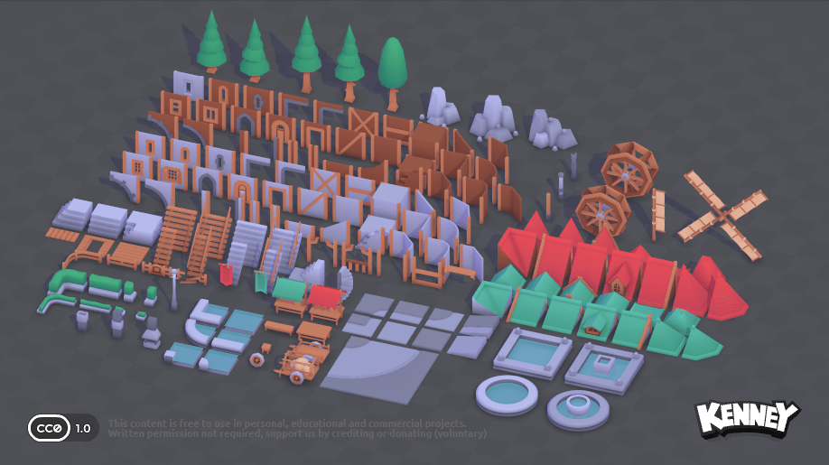

# Sovereign's Eye

A stylized 3D medieval dynasty simulator built around one power: **Appraisal**.
You can see what no one else can — every person's current ability *and* their
hidden maximum potential. Somewhere in your village is a 14-year-old farmhand
with S+ Leadership. Find them.

> **Status: Phase 1 prototype** (internal codename "Project Appraisal").
> Godot 4.7 · GDScript · placeholder art built from primitives.


---

## 1. Run it on your Mac (5 minutes)

1. **Install Godot 4.7** (free) from <https://godotengine.org/download/macos/>
   and drag `Godot.app` into Applications. Use the standard build (not .NET).
2. **Get the code**: in GitHub Desktop choose *File → Clone repository →
   Sovereigns-Eye*, or in Terminal:
   `git clone https://github.com/pbelfand-dot/Sovereigns-Eye.git`
3. **Open Godot → Import** → pick the `project.godot` file in the folder →
   *Import & Edit*. The first import takes a few seconds.
4. Press the **▶ Play** button (top-right of the editor) or **Cmd+B**.

Apple Silicon Macs run it natively; Godot 4.7 uses Metal by default.

## 2. What to try

| # | Phase 1 goal | How |
|---|---|---|
| 1-2 | Launch & start a new game | Main menu → **New Game** → leave the seed blank (random) or type one → **Begin** |
| 3 | Explore the village | Drag with the mouse, WASD, pinch/scroll to zoom, Q/E to rotate |
| 4 | NPCs walking around | Speed up time with **2**, **3**, **4**: people go to work, the tavern, the chapel and home to bed |
| 5-7 | Click an NPC → character card | Left-click anyone. That **appraises** them and opens their card |
| 8 | Find exceptional talent | Press **L** for the Village Ledger, sort by *Greatest talent*. Read *History* tabs for "Rumor has it…" clues |
| 9 | Happiness, loyalty, personality | Card → **Personality** tab, including *why* they feel that way |
| 10 | Save / load | **F5** quicksave, **F9** quickload, or **Esc → Save Game / Load Game**. Quit, relaunch, **Continue** |

The same seed always creates the same village and the same people.

### Controls

| Action | Mouse / trackpad | Keys |
|---|---|---|
| Select & appraise | Left-click a villager | — |
| Pan | Left-drag or right-drag · two-finger scroll | WASD / arrows (Shift = fast) |
| Zoom | Scroll wheel · pinch | R / F, + / − |
| Rotate | Middle-drag · Option + left-drag | Q / E |
| Follow selected | — | C |
| Pause / speed | Top bar buttons | Space · 1 2 3 4 |
| Village ledger | Top bar | L |
| Quicksave / quickload | — | F5 / F9 |
| Close / menu | — | Esc |
| Help overlay | — | H |
| Debug: appraise everyone | — | F2 |

## 3. How the talent system works

Each of the six attributes — Leadership, Combat, Intelligence, Politics,
Administration, Ambition — has two numbers: **current / potential**.

| Rank | F | D | C | B | A | S | S+ | SS |
|---|---|---|---|---|---|---|---|---|
| Potential | 0–19 | 20–49 | 50–64 | 65–79 | 80–99 | 100–119 | 120–149 | 150+ |
| Base odds | 14% | 48.9% | 20.5% | 11% | 4.5% | 0.9% | 0.25% | 0.05% |

* **D is the most common rank.** Measured over 100 seeds, a village of 50 has
  about 4 people (usually 2–6) with an S-rank or better talent; roughly two in
  three villages hide an S+, and about one in six an SS.
* **Background shifts the odds, never guarantees.** Military families roll
  Combat/Leadership with better odds, merchant families Politics/Administration.
  Children of gifted parents get a modest boost too.
* **Current ability reflects opportunity.** Age, social station and job decide
  how much of their potential someone has developed. That is why a peasant
  child can read *Leadership: 12 / 126 (S+)*.
* **Wasted talent makes people restless.** Gifted, ambitious commoners lose
  happiness ("Talents go unused"), the hook for recruiting them in Phase 2.

All of these numbers live in `data/*.json`, so you can rebalance without code.

## 4. Project layout

```text
project.godot          Godot project (main scene = scenes/main/main.tscn)
data/                  Design data (JSON): ranks, occupations, traits, names,
                       families, buildings, schedules, appearance palettes
scenes/main, world/    Main menu and the playable world (built from code)
scripts/core/          Game autoload, world state, seeds, calendar, data loader
scripts/characters/    CharacterData, generator, 3D model builder, NPC body
scripts/appraisal/     Appraisal skill + talent roller (potential/current)
scripts/ai/            NPC daily-routine brain + mood (happiness/loyalty/stress)
scripts/world/         Layout generator, village builder, roads, camera, sky
scripts/persistence/   Save/load (JSON in user://saves)
scripts/ui/            Theme, HUD, character card, ledger, menus
assets/                Drop real models here (see assets/*/README.md)
tests/                 Headless test suite
tools/                 run_tests.sh, village census, screenshot capture
docs/ARCHITECTURE.md   How the systems fit together
```

## 5. The 3D asset library (`3D/`)

The [`3D/`](3D/) folder holds a cartoony medieval starter library of 540 GLB
models: five non-voxel style alternatives (279 models), the original 18
animated blocky characters (kept as a legacy option), the Castle Kit (76) and
the Fantasy Town Kit (167), with a preview image, license and checksum for
every file. The packs are released under CC0, so they can be used and modified
in commercial games without an attribution requirement. Start with the
[`3D/alternatives/`](3D/alternatives/) comparison to choose a visual direction,
then see [`3D/README.md`](3D/README.md) for the complete catalog.

The final models are still being chosen, so `3D/.gdignore` tells Godot to skip
this folder for now; the game uses its built-in placeholder art. To use a model
in game, delete `3D/.gdignore` (or copy the chosen `.glb` plus its `Textures/`
folder into `assets/`) and point the building type at it as described below.








## 6. Swapping in real art

Every building type in `data/buildings.json` has a `"model"` field. Put a
`.glb` file in `assets/buildings/` and set the field, for example
`"model": "res://assets/buildings/cottage.glb"`. The game falls back to the
primitive version when no model is set. Characters store appearance as data
(colors, hair, height…), so a future character-model pipeline reads the same
values. Portraits on the cards are rendered live from the 3D model, so they
upgrade automatically.

### One consistent look from any source (experimental)

`StyleUnifier` (`scripts/world/style_unifier.gd` + `shaders/unified_toon.gdshader`)
repaints any model, whether from asset packs, AI generators like Higgsfield,
or the built-in placeholders, toward one master palette in
`data/art_style.json`, with shared toon lighting. Call `StyleUnifier.apply(node)`
on an imported model. Edit the palette to restyle everything at once. It is not
switched on in the game yet.


To re-render that comparison: remove `3D/.gdignore`, then run
`godot --path . res://tools/style_demo.tscn -- out.png`.

## 7. Tests & tools

```bash
tools/run_tests.sh                       # 17 headless tests (generation, determinism,
                                         # rank odds, relationships, save/load, live world)
godot --headless --path . --script res://tools/print_village.gd -- 12345   # census of a seed
```

Saves live in `~/Library/Application Support/Godot/app_userdata/Sovereign's Eye/saves/`
as readable JSON.

## 8. Known limitations (Phase 1)

* Placeholder art: buildings and people are built from simple shapes.
* NPCs walk along roads and can clip through each other or props; there is
  no navmesh yet.
* People don't age, train or have children yet. The APIs exist
  (`CharacterData.train()`, `raise_potential()`, talent inheritance), but no
  system calls them during play yet.
* You can appraise everyone. Appraisal levels and hidden information are
  supported in code (`Appraisal.appraise(c, level)`) but not used yet.
* There is no player avatar yet; the manor's family is the ruling house.
