# Sovereign's Eye

A stylized 3D medieval dynasty simulator built around one power: **Appraisal**.
You can see what no one else can — every person's current ability *and* their
hidden maximum potential. Somewhere in your village is a 14-year-old farmhand
with S+ Leadership. Find them.

> **Status: Phase 3 in progress: your village builds, grows and attracts settlers** (internal codename "Project Appraisal").
> Godot 4.7 · GDScript · Quaternius village kit and characters (see [docs/ART_PLAN.md](docs/ART_PLAN.md)).

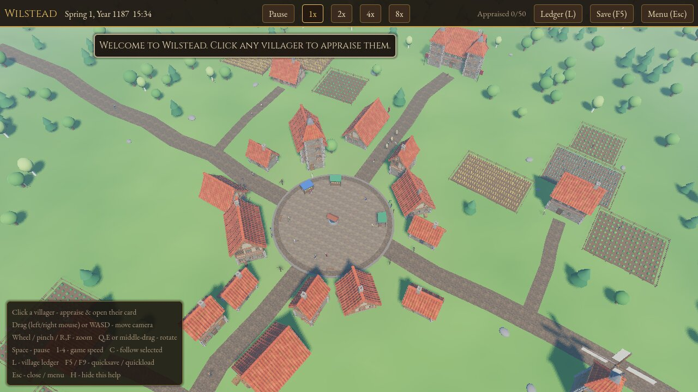
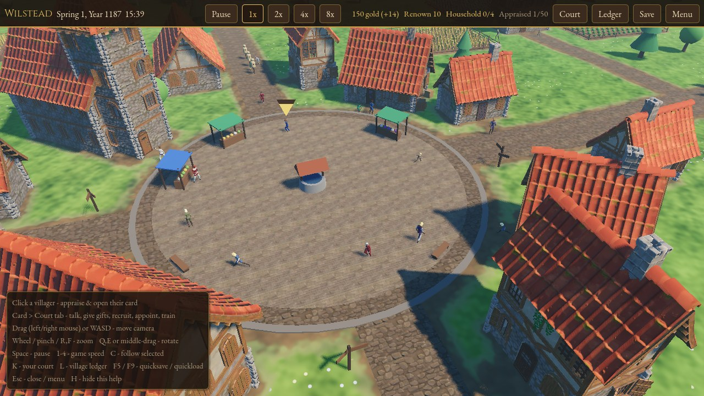
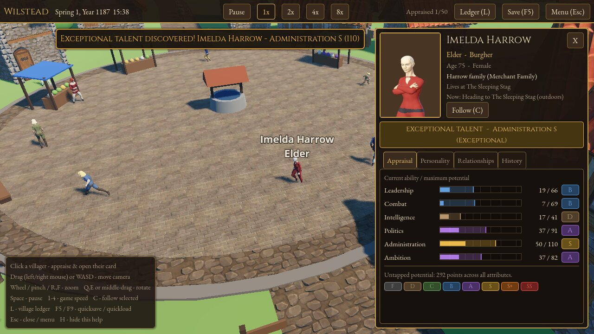

---

## ⬇️ Download & play

Every update is built automatically for every platform. Pick yours:

| Device | Download |
|---|---|
| **Windows** (most PCs) | [SovereignsEye-Windows.zip](https://github.com/pbelfand-dot/Sovereigns-Eye/releases/download/latest/SovereignsEye-Windows.zip) |
| **Windows on ARM** (Snapdragon laptops) | [SovereignsEye-Windows-ARM64.zip](https://github.com/pbelfand-dot/Sovereigns-Eye/releases/download/latest/SovereignsEye-Windows-ARM64.zip) |
| **Mac** (Apple Silicon and Intel) | [SovereignsEye-Mac.zip](https://github.com/pbelfand-dot/Sovereigns-Eye/releases/download/latest/SovereignsEye-Mac.zip) |
| **Linux / Chromebook Linux mode** (Intel/AMD) | [SovereignsEye-Linux.zip](https://github.com/pbelfand-dot/Sovereigns-Eye/releases/download/latest/SovereignsEye-Linux.zip) |
| **Linux / Chromebook Linux mode** (ARM) | [SovereignsEye-Linux-ARM64.zip](https://github.com/pbelfand-dot/Sovereigns-Eye/releases/download/latest/SovereignsEye-Linux-ARM64.zip) |
| **Android** (phones, tablets, Chromebooks with Play Store) | [SovereignsEye-Android.apk](https://github.com/pbelfand-dot/Sovereigns-Eye/releases/download/latest/SovereignsEye-Android.apk) |

These links always point to the newest build of `main`. Work that hasn't been
merged yet is on the [preview release](https://github.com/pbelfand-dot/Sovereigns-Eye/releases/tag/preview).

**First launch:** the apps aren't code-signed yet, so your system will warn you once.
- **Mac:** unzip, double-click *Sovereign's Eye*; when macOS blocks it, open
  *System Settings → Privacy & Security* and click **Open Anyway**.
- **Windows:** unzip, run `SovereignsEye.exe`; on the blue SmartScreen box click
  **More info → Run anyway**.
- **Linux:** unzip, then run `./SovereignsEye.x86_64` (or double-click it).
- **Chromebook:** turn on *Settings → Advanced → Developers → Linux development
  environment*, move the Linux zip into *Linux files*, unzip it, and run it from the
  Terminal (`./SovereignsEye.x86_64`, or `.arm64` on ARM Chromebooks).
- **Android:** open the `.apk` and allow installing from your browser/files app.

Your saves stay on your device.

## 1. Run it from source in Godot (for development)

1. **Install Godot 4.7** (free) from <https://godotengine.org/download/macos/>
   and drag `Godot.app` into Applications. Use the standard build (not .NET).
2. **Get the code**: in GitHub Desktop choose *File → Clone repository →
   Sovereigns-Eye*, or in Terminal:
   `git clone https://github.com/pbelfand-dot/Sovereigns-Eye.git`
3. **Open Godot → Import** → pick the `project.godot` file in the folder →
   *Import & Edit*. The first import takes a few seconds.
4. Press the **▶ Play** button (top-right of the editor) or **Cmd+B**.

Apple Silicon Macs run it natively; Godot 4.7 uses Metal by default.

## 2. What to try

| # | Goal | How |
|---|---|---|
| 1-2 | Launch & start a new game | Main menu → **New Game** → leave the seed blank (random) or type one → **Begin** |
| 3 | Walk the village as your heir | **WASD** (or the left stick) to walk, **Shift** to run; drag with the mouse (or the right stick, or the arrow keys) to turn the camera, scroll to zoom. Buildings block your way and your view |
| 4 | NPCs walking around | Speed up time with **2**, **3**, **4**: people go to work, the tavern, the chapel and home to bed |
| 5 | Look at someone with the Sovereign's Eye | Get near someone and face them: their name shows at the bottom. Press **Q** (controller **Y**). No talk needed, but they must be close (about 10 paces) and in plain sight, so you can't read a whole town from a menu. The reveal grows grander the rarer the person (Ordinary → Skilled → Exceptional → Legendary). See [docs/ROADMAP.md](docs/ROADMAP.md) |
| 6 | Talk to the promising ones | Walk up and press **E** (controller **A**). Their talk may hint at a gift. **Ask about their life** to learn what they want, in their own words |
| 7 | Win them over | **Make an offer**: a daily wage, a home (a free one, rooms at the manor, or a promise), a place (household, training, an office, a workplace with tools, a squire's place) and an appeal to their duty. They accept, name their terms, or refuse, and say why. A refusal never closes the door: change the offer and propose again. Your own retainers can be offered new terms (a raise, an office) the same way. Different people want different things |
| 8 | Keep your word | Wages are paid from the treasury every day, families really move into the homes you give, jobs need a real workplace, and a broken promise costs trust, your house's standing, and sometimes the person |
| 9 | Happiness, loyalty, personality | Click anyone for their card → **Personality** tab, including *why* they feel that way |
| 10 | Your household | Card → **Court**: what you've learned they want, gifts, offices and training. Children aged 10–15 can join as pages; a parent decides |
| 11 | Develop retainers | Choose a training focus, appoint a Steward, Marshal, Chancellor, or Court Scholar, and knight proven servants |
| 12 | Run your court | Press **K** to see gold, daily income and wages, renown, offices, retainers, loyalty, and the house chronicle |
| 13 | Save / load | **F5** quicksave, **F9** quickload, or **Esc → Save Game / Load Game**. Quit, relaunch, **Continue** |
| 14 | Watch the stores | The bar under the top bar shows **food, wood and stone** and their change per day. Farmers grow food, woodcutters fell timber, everyone eats and burns firewood. Winter fields yield less |
| 15 | Order a building | Press **Tab** (or **M**) for the map table, then **B** → pick a building → click beside a road (choosing a building takes you to the map table on its own). It turns to face the road, a lane is laid to its door, and trees in the way are felled for wood. **T** turns it, **Shift+click** places another, **Esc** cancels |
| 16 | Watch it go up | A crew (carpenters first) stakes out the ground, then the walls rise inside a scaffold and the roof goes on. When it's finished, villagers take the new jobs |
| 17 | Build faster | Appraise villagers for a hidden **Administration** talent, recruit them and appoint them **Master of Works** (Court tab). Every site speeds up with their Administration |
| 18 | Watch it grow | Keep food in store and people happy. The **settler bar** (Build panel) fills, and new families walk in from the edge of the map. Appraise them: newcomers can hide great talent too |
| 19 | Homes build themselves | When every home is full, villagers build a new cottage beside a road. Cottages near the square gain floors (**Timber House**, then **Townhouse**) once their needs are met, and pay rent |
| 20 | Inspect a building | Click any building: who lives and works there, what it makes, and for homes a checklist of what the next level needs |
| 21 | Earn a charter | Build panel (**B**) → **Charter**: a checklist for the next charter (Hamlet → Village → Market Town → Town) and **Petition the Crown** when it's met. Each charter makes room for more people, unlocks buildings (another tavern and chapel, then the **Market Hall**) and brings in dues. In a Market Town, Townhouses take in lodgers |

The same seed always creates the same village and the same people.

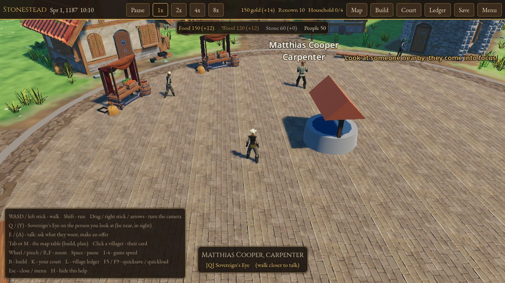
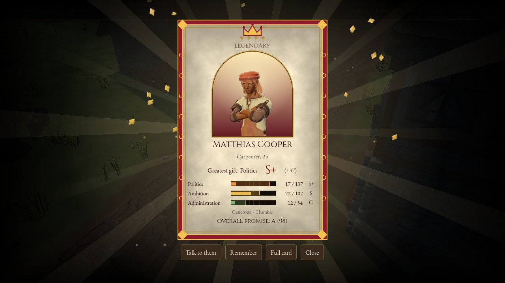
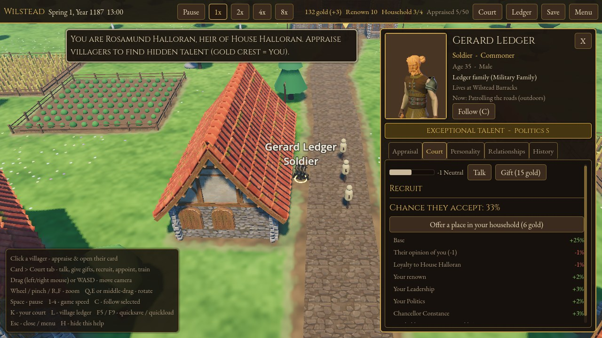
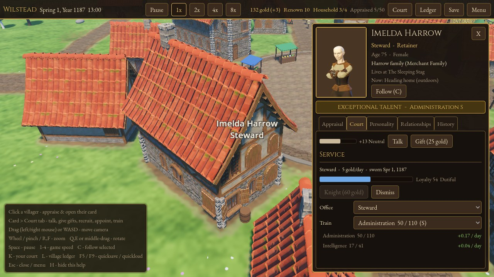
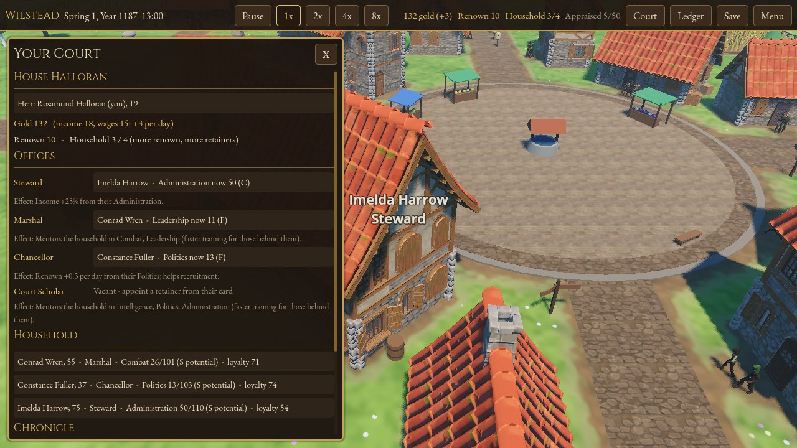

### Building and growth (Phase 3, steps 1–2)

You decide **what** goes up and **where**, and the village builds it. Homes
build and upgrade themselves; town charters come next.

| Building | Cost | What it adds |
|---|---|---|
| Stonecutter's Yard | 40 wood, 20 gold | 2 stonecutters: the only source of **stone** |
| Woodcutters' Lodge | 30 wood, 10 stone, 20 gold | 2 more woodcutters |
| Farmstead | 50 wood, 15 stone, 30 gold | a farmer, a farmhand and 2–3 new fields |
| Granary | 60 wood, 30 stone, 30 gold | +300 storage for food, wood and stone |
| Bakery | 40 wood, 25 stone, 30 gold | a baker |

New jobs are filled by farmhands, tavern hands and older apprentices, so building
moves people around: a new farm promotes a farmhand to farmer, and a quarry takes
hands away from the fields. Builders don't do their normal work while they build.
All costs, rates and limits are in `data/territory.json`.

**Growth.** Appeal (food in store, happiness, renown, open jobs) fills a settler
bar each day. When it's full and a home stands empty, a family arrives. Their
names, looks, traits, talents and life stories are generated the same way as the
founding villagers'. Adults without a trade work as **laborers** in the fields and
on building crews, and are first in line for new jobs. When every home is full,
the village builds a cottage on its own. Settlers waiting for a home come before
upgrades, and these automatic jobs always leave 60 wood and 25 stone for your own
orders. You can switch them off in the Build panel.

| Home level | Needs | Gives |
|---|---|---|
| Cottage | – | – |
| Timber House (+1 floor, 30 wood, 15 stone) | lived there 3 days, 5 days of food, happiness 45+, chapel or tavern within 60 m | 1 gold rent a day, +4 happiness |
| Townhouse (+2 floors and a balcony, 40 wood, 30 stone, 10 gold) | 8 days as a Timber House, 10 days of food, happiness 55+, chapel **and** tavern within 75 m, bakery within 80 m, market square within 60 m | 2 gold rent a day, +8 happiness |

An upgrade keeps the house's existing floors exactly. The roof comes off and the
new floors rise inside scaffolding.

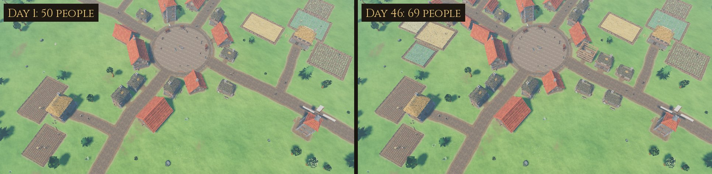
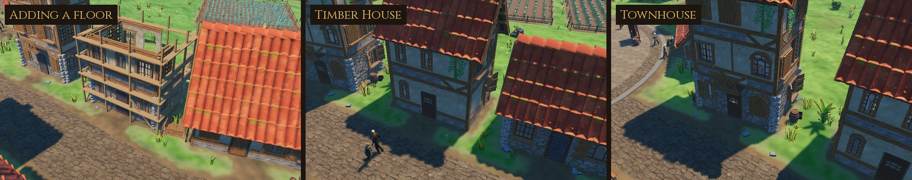
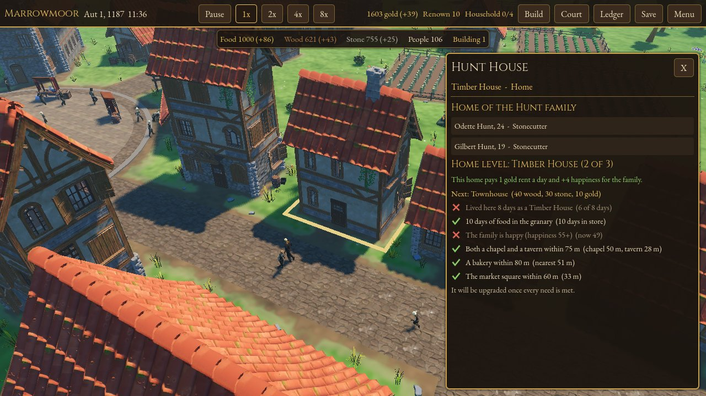
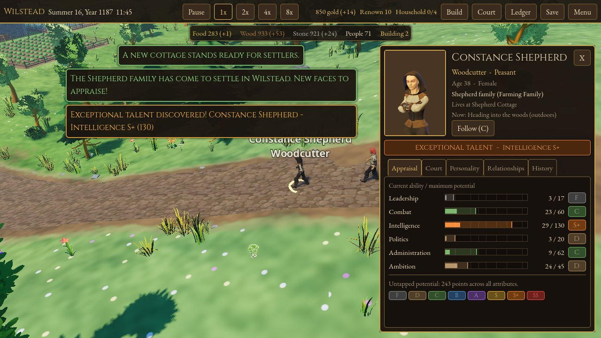

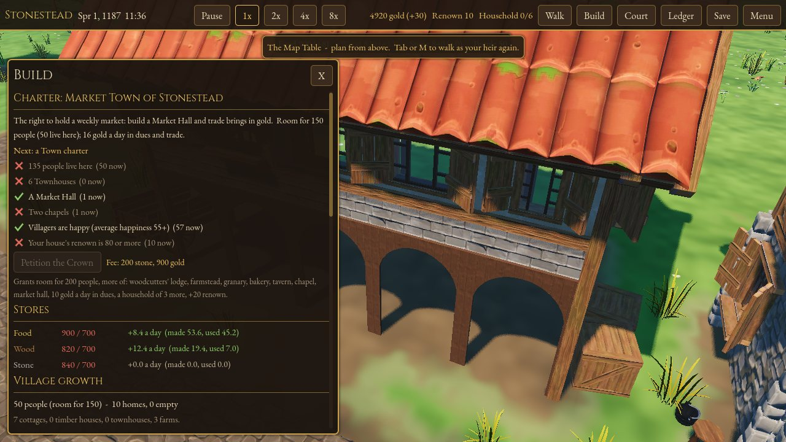
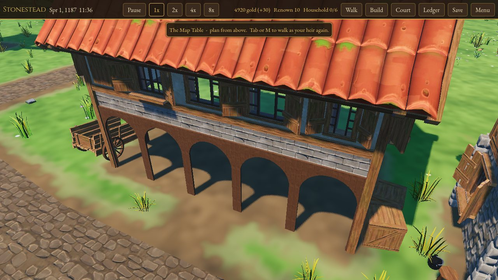
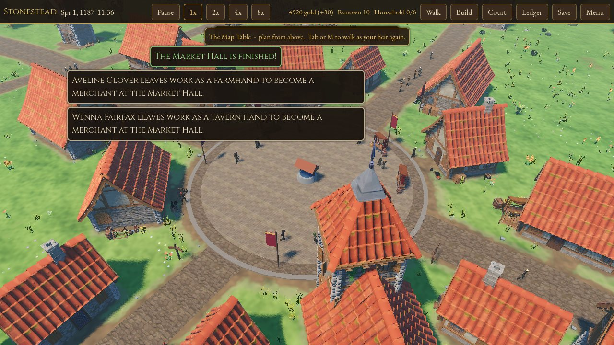
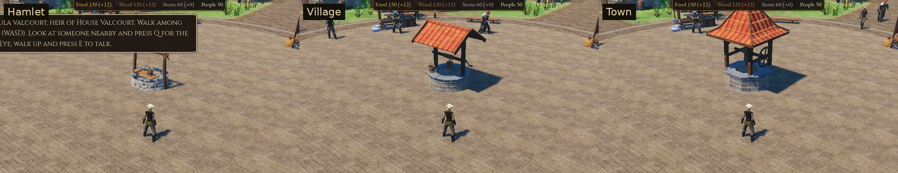

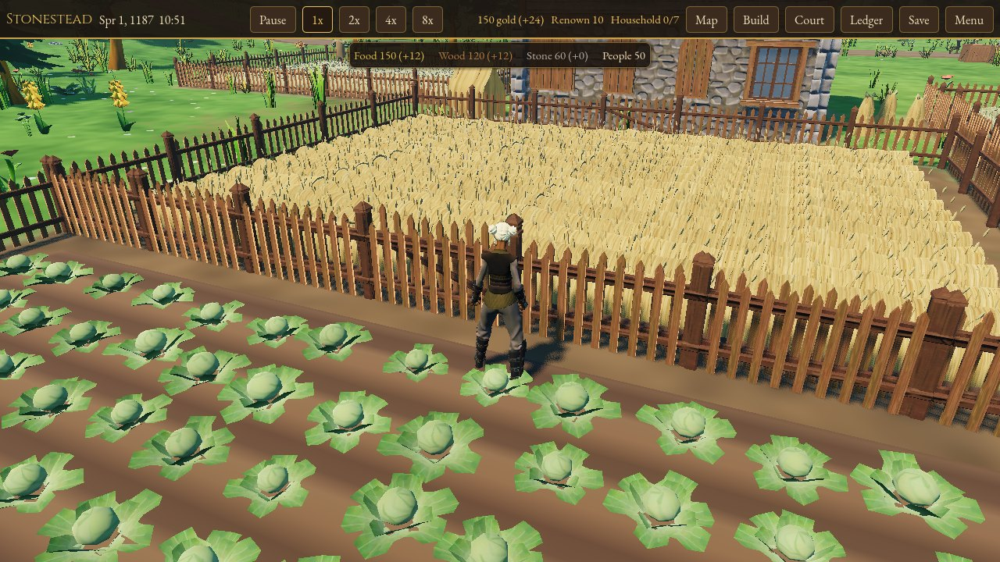
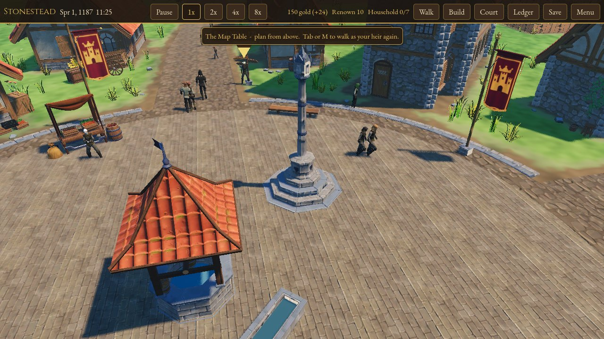
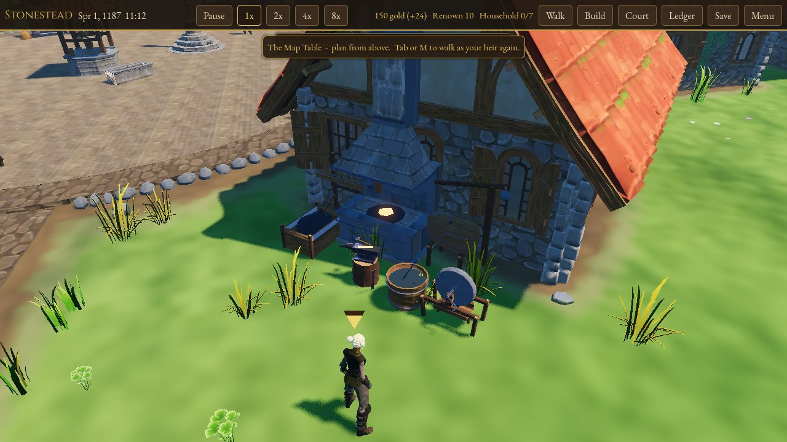
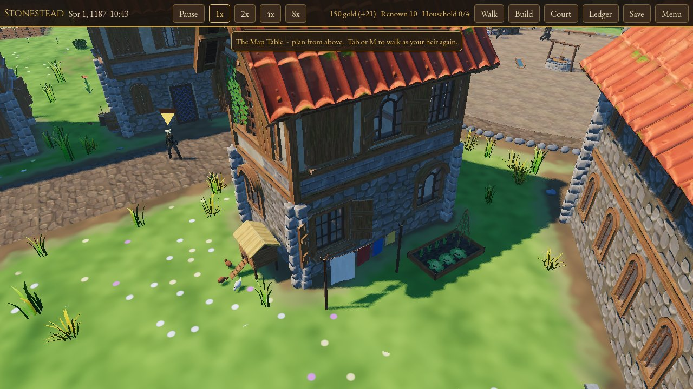

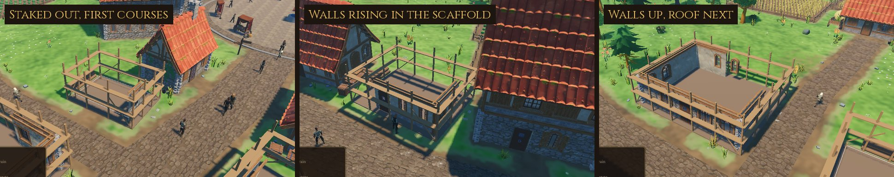
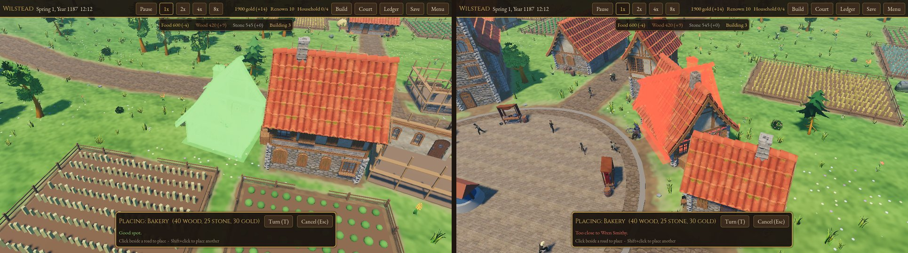
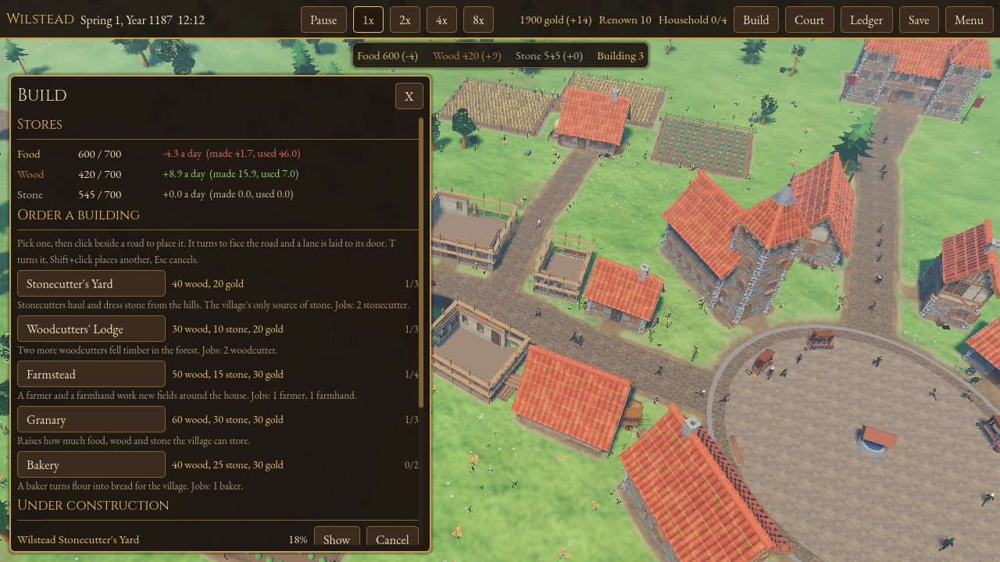
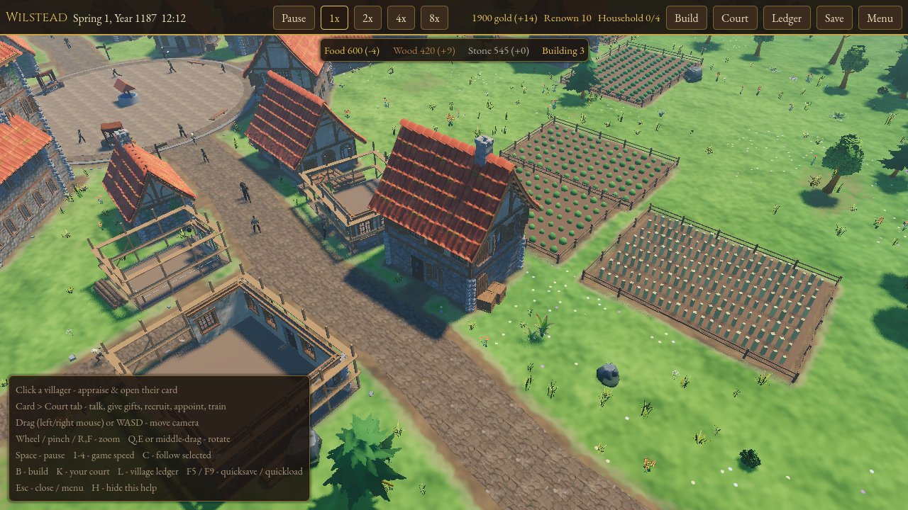

### Controls

**On foot (as the heir)**

| Action | Keyboard & mouse | Controller | Touch |
|---|---|---|---|
| Walk / run | WASD / Shift | Left stick / left trigger | Stick (bottom left) |
| Turn the camera | Drag with any mouse button · ← → | Right stick | Drag with a second finger (or anywhere off the controls) |
| Zoom | Scroll wheel · pinch · R / F · ↑ ↓ | Bumpers | Pinch |
| Sovereign's Eye on the person you face | Q | Y | **Eye** button |
| Talk (when beside them) | E | A | **Talk** button |
| The map table (build, plan) and back | Tab or M | View | **Map** button |
| Select a villager (their card) | Left-click | — | Tap |
| Click to move (optional: Esc menu → Accessibility) | Right-click the ground or a person | — | — |

**On the map table**

| Action | Mouse / trackpad | Keys |
|---|---|---|
| Select a villager (their card) | Left-click | — |
| Pan | Left-drag or right-drag · two-finger scroll | WASD / arrows (Shift = fast) |
| Zoom | Scroll wheel · pinch | R / F, + / − |
| Rotate | Middle-drag · Option + left-drag | Q / E |
| Find selected | — | C |
| Pause / speed | Top bar buttons | Space · 1 2 3 4 |
| Village ledger | Top bar | L |
| Your court | Top bar | K |
| Build menu / stores | Top bar | B |
| Inspect a building | Left-click it | — |
| Turn building being placed | — | T |
| Place another of the same | Shift + left-click | — |
| Quicksave / quickload | — | F5 / F9 |
| Close / menu | — | Esc |
| Help overlay | — | H |
| Debug: appraise everyone | — | F2 |

## 3. How the talent system works

Each of the six attributes — Leadership, Combat, Intelligence, Politics,
Administration, Ambition — has two numbers: **current / potential**.

| Rank | F | D | C | B | A | S | S+ | SS |
|---|---|---|---|---|---|---|---|---|
| Potential | 0–19 | 20–49 | 50–64 | 65–79 | 80–99 | 100–119 | 120–149 | 150+ |
| Base odds | 14% | 48.9% | 20.5% | 11% | 4.5% | 0.9% | 0.25% | 0.05% |

* **D is the most common rank.** Measured over 100 seeds, a village of 50 has
  about 4 people (usually 2–6) with an S-rank or better talent; roughly two in
  three villages hide an S+, and about one in six an SS.
* **Background shifts the odds, never guarantees.** Military families roll
  Combat/Leadership with better odds, merchant families Politics/Administration.
  Children of gifted parents get a modest boost too.
* **Current ability reflects opportunity.** Age, social station and job decide
  how much of their potential someone has developed. That is why a peasant
  child can read *Leadership: 12 / 126 (S+)*.
* **Wasted talent makes people restless.** Gifted, ambitious commoners lose
  happiness ("Talents go unused"), the hook for recruiting them in Phase 2.

All of these numbers live in `data/*.json`, so you can rebalance without code.

## 4. Project layout

```text
project.godot          Godot project (main scene = scenes/main/main.tscn)
data/                  Design data (JSON): ranks, occupations, traits, names,
                       families, buildings, building_kit recipes, animations,
                       schedules, appearance palettes, art style
scenes/main, world/    Main menu and the playable world (built from code)
scripts/core/          Game autoload, world state, seeds, calendar, data loader
scripts/characters/    CharacterData, generator, Quaternius HumanModel (+ primitive
                       fallback), NPC body, AI portrait prompts
scripts/appraisal/     Appraisal skill + talent roller (potential/current)
scripts/court/         Noble-house rules: recruitment, offices, training, wages,
                       loyalty, knighthood, treasury and renown
scripts/territory/     Village stores, building orders, construction sites, hiring
scripts/ai/            NPC daily-routine brain + mood (happiness/loyalty/stress)
scripts/world/         Layout generator, village builder, VillageKit prefabs, roads,
                       camera, sky
scripts/persistence/   Save/load (JSON in user://saves)
scripts/ui/            Theme, HUD, character card, ledger, menus
3D/                    Asset library (Quaternius used; reference packs .gdignore'd)
audio/                 CC0 music, ambience and SFX with licenses and checksums
shaders/               Villager skin/clothing/hair, experimental toon unifier
assets/                Fonts and extra models (see assets/*/README.md)
ai-art/                Local AI portrait painter (ComfyUI + FLUX.2 klein); not shipped
tests/                 Headless test suite
tools/                 run_tests.sh, village census, screenshot capture, prefab gallery
docs/ARCHITECTURE.md   How the systems fit together
docs/ART_PLAN.md       Art direction, assets used, missing models, scaling plan
```

## 5. The 3D asset library (`3D/`)

The [`3D/`](3D/) folder holds the game's model library: 1,404 cataloged glTF 2.0
files with previews, licenses, checksums and validation records (all CC0).

**Chosen direction: Quaternius.** A sleek, textured, stylized fantasy look:
- [`3D/environments/quaternius-medieval-village-standard/`](3D/environments/quaternius-medieval-village-standard/):
  176 modular village pieces sharing 22 textures (keep the `models/` folder together)
- [`3D/character-tests/quaternius-universal-base-standard/`](3D/character-tests/quaternius-universal-base-standard/):
  rigged base characters, hairstyles, beard and eyebrows (a technical test set)
- [`3D/animations/`](3D/animations/): both Quaternius Universal Animation Libraries,
  86 clips, in-place and root-motion versions
- [`3D/characters/quaternius-modular-outfits-fantasy-standard/`](3D/characters/quaternius-modular-outfits-fantasy-standard/):
  the free Peasant/Ranger sampler with four complete outfits, 20 modular pieces,
  and alternate color maps
- [`3D/environments/quaternius-stylized-nature-standard/`](3D/environments/quaternius-stylized-nature-standard/):
  68 matching trees, plants, rocks, and path pieces from the free Standard pack
- [`3D/props/quaternius-fantasy-props-standard/`](3D/props/quaternius-fantasy-props-standard/):
  94 matching market, workshop, tavern, home, alchemy, furniture, and utility props
- [`3D/research/SCALABILITY_ROADMAP.md`](3D/research/SCALABILITY_ROADMAP.md): what is
  ready from hamlet to kingdom scale, and what is still missing

The Kenney and blocky packs are kept for reference only and are not the art direction.
See [`3D/README.md`](3D/README.md) for the full catalog and
[`docs/ART_PLAN.md`](docs/ART_PLAN.md) for how the game uses these assets.

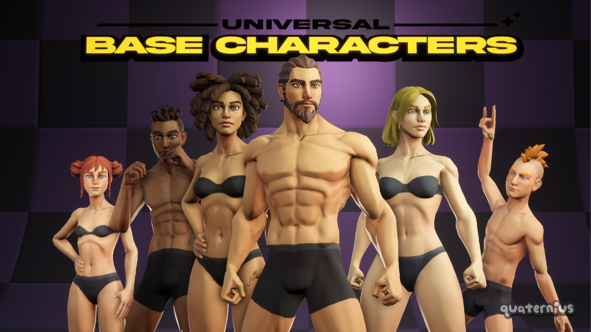

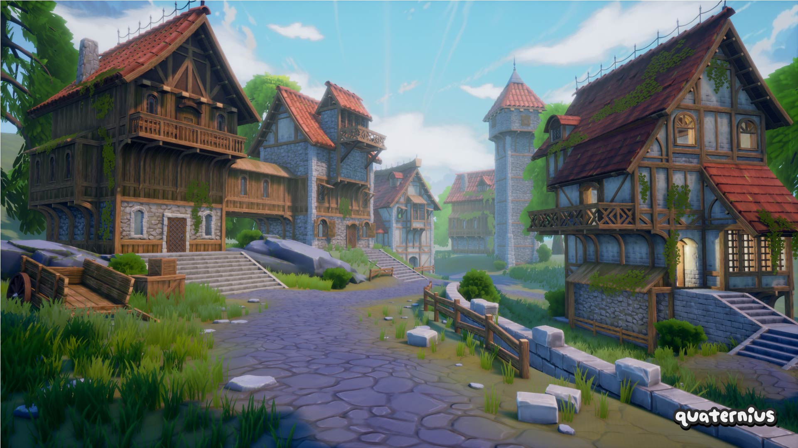

## 6. Audio library (`audio/`)

The [`audio/`](audio/) folder contains 297 CC0 Ogg files: 10 medieval music
tracks, 6 lived-in settlement ambience beds, and 281 interaction, footstep,
impact and UI sounds. Every file is cataloged with source, license, duration,
codec and checksum in [`audio/AUDIO_MANIFEST.csv`](audio/AUDIO_MANIFEST.csv).

The location layers are intended to make the world feel occupied: indistinct
market voices, tavern chatter, a village morning, active smithy and hearth.
See [`audio/README.md`](audio/README.md) for the recommended district mix and
track-to-scene map.

**In game**, everything is configured in [`data/audio.json`](data/audio.json):
- **Music.**
  - The menu plays the inn theme.
  - By day the village plays a rotating set of tracks with short pauses between them; at night it plays the inn theme.
  - Opening the Court panel (**K**) crossfades to the feast music.
- **Ambience.** Beds fade in around their places as the camera's focus nears them, and fade out as you zoom away:
  - the market crowd on the square during market hours
  - tavern chatter and the hearth
  - the smithy at work
  - a village-morning bed that fades at dusk
- **Foley.** When the camera is close, nearby villagers make sounds:
  - footsteps on grass or cobbles
  - work sounds by job: axes, hammers, pots, soft field work
- **Interface and court sounds.**
  - Every button clicks, and tabs turn a page.
  - Gifts jingle coins; recruits accepting or refusing get their own cue.
  - Knighting draws a blade, and dismissal shuts a door.
  - Appraising someone chimes, and exceptional talent rings out.
- **Volume.** Four buses (Music, Ambience, Effects, Interface) have sliders in the main menu (**Sound**) and the pause menu. The levels are saved in `user://settings.cfg`.

## 7. How the art works

* **Buildings** are prefabs assembled from the Quaternius village kit by recipe
  ([`data/building_kit.json`](data/building_kit.json)), merged into one mesh per
  shared material, with distance-culled details and box collisions.
  `godot --path . res://tools/prefab_gallery.tscn -- out_dir` renders every prefab.
* **Villagers** are Quaternius base characters. Body, hair, beard and skin come
  from each character's data, and in-place animation clips follow their activity
  and job ([`data/animations.json`](data/animations.json)).
  * They wear real clothes from the Quaternius outfit sampler, picked by job and
    rank in [`data/outfits.json`](data/outfits.json). The Peasant and Ranger sets
    each come in two colorways, plus hoods and shoulder armor.
  * Each villager's pieces are merged into one shared mesh per look.
  * Portrait prompts describe the same clothes.
* **Nature** comes from the Quaternius Stylized Nature MegaKit
  ([`data/nature.json`](data/nature.json)).
  * Broadleaf, pine and birch trees stand on the layout's tree spots, each with its
    own leaf tint. A few great oaks and dead trees grow out in the woods.
  * Grass, flowers, bushes, pebbles and mushrooms are scattered off the paths, and
    kit rocks replace the old blobs.
  * Everything sways in the wind and is drawn as batched MultiMeshes.
  * Before/after: [`docs/screenshots/nature_before_after.jpg`](docs/screenshots/nature_before_after.jpg).
* **Props** come from the Quaternius Fantasy Props MegaKit
  ([`data/props.json`](data/props.json)).
  * Market stalls carry fruit, coins, pots or crockery.
  * Benches, barrels, crates, training dummies and the workshop cart use kit models.
  * Buildings are dressed by trade: the smith's anvil, workbench and weapon stand; the
    tavern's outdoor table with mugs and its barrel rack; sacks at the bakery and mill;
    crates at farms and the storehouse; a woodworker's bench.
  * Everything merges into one mesh per area and material.
  * Showcase: [`docs/screenshots/props_showcase.jpg`](docs/screenshots/props_showcase.jpg).
* **Card portraits** show an AI painting when one exists for that villager, and
  a live 3D portrait otherwise. Paint them locally with ComfyUI +
  FLUX.2 [klein]: see [`ai-art/README.md`](ai-art/README.md).
* Missing art (additional outfits, windmill, kingdom and harbor pieces) is
  listed with sources and prices in [`docs/ART_PLAN.md`](docs/ART_PLAN.md).

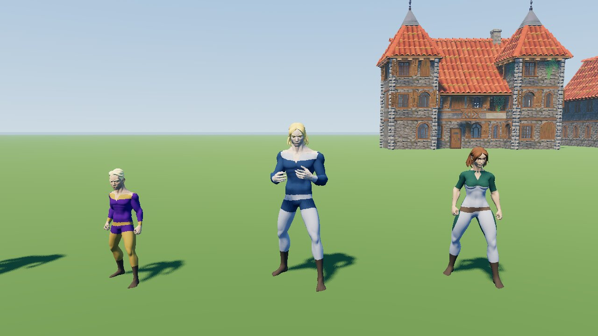

Before/after: [`docs/screenshots/outfits_before_after.jpg`](docs/screenshots/outfits_before_after.jpg).
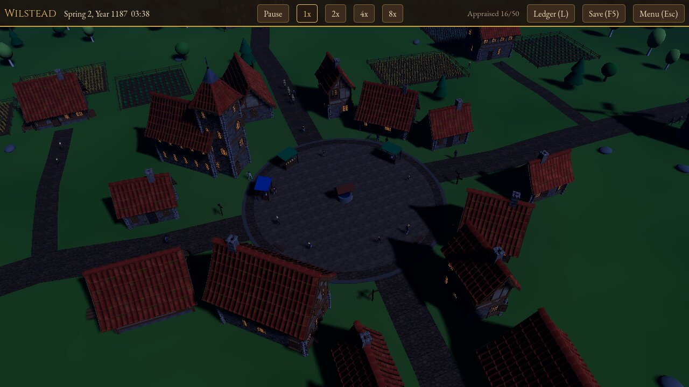

### One consistent look from any source (experimental)

`StyleUnifier` (`scripts/world/style_unifier.gd` + `shaders/unified_toon.gdshader`)
repaints any model, whether from asset packs, AI generators like Higgsfield,
or the built-in placeholders, toward one master palette in
`data/art_style.json`, with shared toon lighting. Call `StyleUnifier.apply(node)`
on an imported model. Edit the palette to restyle everything at once. It is not
switched on in the game yet.

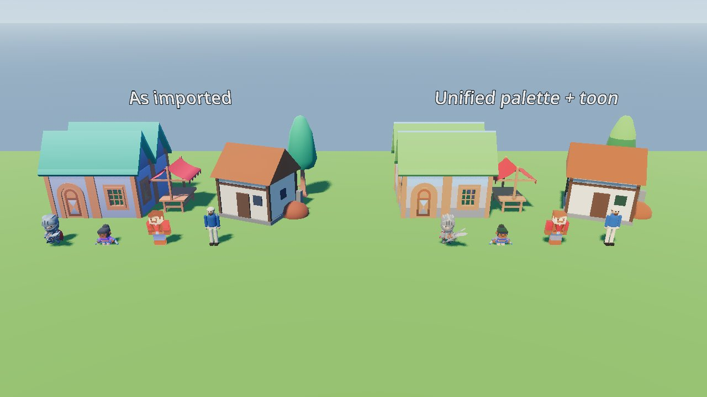

To re-render that comparison: `godot --path . res://tools/style_demo.tscn -- out.png`
(needs the reference packs, which are hidden from Godot with `.gdignore`).

## 8. Tests & tools

```bash
tools/run_tests.sh                       # Headless tests (generation, determinism, rank odds,
                                         # court, territory, save/load, art pipeline, audio,
                                         # live world)
godot --headless --path . --script res://tools/print_village.gd -- 12345   # census of a seed
# Screenshots (needs a display): court | art | menus | build
godot --path . res://tools/capture.tscn -- 12345 /tmp/shots build
```

Saves live in `~/Library/Application Support/Godot/app_userdata/Sovereign's Eye/saves/`
as readable JSON.

## 9. Known limitations (Phase 3, step 2)

* The village stops growing at 110 people for now. The town charters in step 3
  (Hamlet → Village → Market Town → Town) will raise that limit.
* People don't age, have children, move away or die yet, so a village only ever
  grows.
* Only five building types can be ordered. Taverns, chapels and markets come with
  the charters in step 3. Farms don't gain levels; only cottages do.
* With 100+ villagers the overview reaches about 2,300 draw calls. That's fine on
  desktop; phones haven't been tested.
* Placing or finishing a building rebuilds the ground, grass and props
  (about 0.1 s, one hitch per click).
* There is no demolition yet. You can cancel a site (full refund before work
  starts, half after).

* Art gaps: the free outfit sampler has only Peasant and Ranger sets, so nobles wear
  fine leather and there are no gowns, robes or plate armor yet.
* Crops don't grow or change with the seasons yet, and field fences don't block
  walking (see [3D/props/farm-field](3D/props/farm-field/README.md)). Hats and hand
  tools aren't shown on villagers yet. Home yards are set dressing: nobody sits on the
  bench or feeds the hens yet (see [3D/props/home-yard](3D/props/home-yard/README.md)). See [docs/ART_PLAN.md](docs/ART_PLAN.md) and
  [3D/BACKLOG.md](3D/BACKLOG.md).
* From the farthest zoom, kit trees read smaller and darker than the old round
  blobs. Their size and tints are tunable in `data/nature.json`.
* NPCs walk along roads and can clip through each other or props; there is
  no navmesh yet.
* Retainers train every day, but people do not age, marry or have children yet.
* You can appraise everyone. Appraisal levels and hidden information are
  supported in code (`Appraisal.appraise(c, level)`) but not used yet.
* You play the ruling house's heir, marked by a gold crest, but there is no
  character creator or succession system yet.
