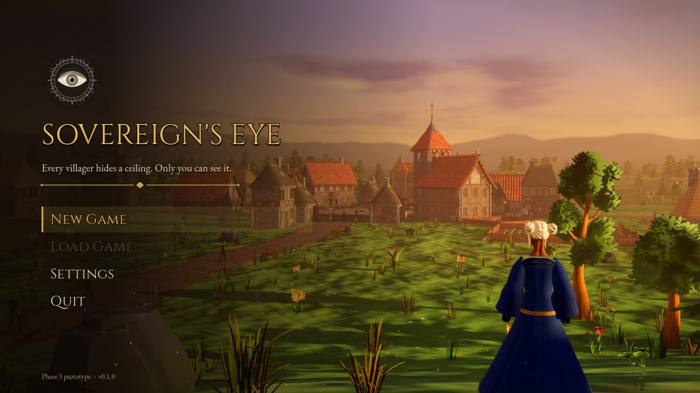

# Title screen art

The title screen (`scripts/ui/main_menu.gd`) uses two images from this folder,
and falls back to a warm gradient and the game's icon when they are not here:

| File | What | Size | Notes |
| --- | --- | --- | --- |
| `key_art.jpg` | The key art behind the menu | 2560 × 1440 (16:9), JPEG quality 90 | Covers the screen without stretching and drifts in slowly. The left side is darkened for the menu column, so the subject stays in the right two-thirds. On narrower or upright screens the crop moves to keep `ART_FOCUS` in view (the chapel and the heir); on phones the menu sits over the darkened top with the scene showing below it |
| `emblem.png` | The emblem above the title | 512 × 512, PNG with transparency | Shown at 112 px, with mipmaps so it stays crisp that small |



## How they're made

Both are drawn by the game itself, from its own village and the Sovereign's
Eye, with [`tools/key_art.gd`](../../../tools/key_art.gd):

```
godot --path . --resolution 2560x1440 res://tools/key_art.tscn            # both, into this folder
godot --path . --resolution 1280x720 res://tools/key_art.tscn -- 9 DIR preview   # the candidate views, to choose from
godot --path . --resolution 1280x720 res://tools/key_art.tscn -- 9 res://assets/ui/menu/ emblem   # the emblem only
godot --headless --path . --import
```

It needs a display (xvfb works) and draws the key art at the window's size.

- **The key art.** The village of seed 9 (Stonestead) a little before sunset,
  seen from the hills to its south.
  - **The heir** stands on the rise in the right foreground, seen from
    behind, looking down over the village.
  - **The village:** the road leads in to the square and the chapel tower,
    with villagers walking home along it.
  - **Dressed for the picture, never the game:** a sky with clouds lit by
    the low sun (`tools/key_art_sky.gdshader`), haze and light in the air,
    and hills running on past the map's edge into the distance. The trees in
    the line of sight and the grass under the lens are left out.
- **The emblem.** The Eye as a reveal shows it at its fullest (`EyeEmblem`),
  gold on royal blue, ringed by its legend OCVLVS PRINCIPIS OMNIA VIDET.

To change the picture, edit `HOUR`, `VIEWS` and `KEY_VIEW` in the tool and
render the previews first.

## Rights

Both images are renders of the game's own assets and are released, like the
game's own 3D families, under CC0 1.0. The village kit and characters are
Quaternius' (CC0 1.0), the props and buildings the game made itself (CC0 1.0).
See [3D/SOURCES.md](../../../3D/SOURCES.md).

## Painted art instead

The art can be replaced by painted key art at any time: drop a `key_art.jpg`
(2560 × 1440) and an `emblem.png` (512, transparent) here; nothing else
changes. Briefs for an image generator, written for Higgsfield (GPT Image
2.5, high quality, 4K for the key art, 2K with a transparent background for
the emblem, then downscaled):

**Key art** (16:9):

> Painterly key art for a medieval village-building strategy game's title screen, wide cinematic landscape, no text. Late golden-hour light over a small twelfth-century English village in a green valley: a grey stone chapel with a square bell tower, a red clay-tile pyramid roof and a small iron cross on top, a few thatched cottages and timber-framed houses with red tile roofs, a cobbled market square with a stone well, colourful heraldic banners on poles, patchwork fields edged with wattle fences, haystacks, a dirt road winding through, a dark forest edge and soft blue hills behind. On the right, in the foreground on a grassy rise, a young noble heir stands seen from behind at three-quarters, in a long deep royal-blue cloak, looking down over the village; a faint warm golden light glints at the edge of their eye. Warm low sun from the right, long shadows, gentle haze, a few birds. The left third of the frame is calm and darker: open dusky sky and shadowed meadow, uncluttered, to leave room for a menu. Rich oil-painting brushwork, slightly stylized storybook realism, warm greens, honey gold and deep blue palette, high detail, no text, no logo, no watermark, no border.

**Emblem** (1:1, transparent background):

> A heraldic game emblem, front view, centered, isolated on a fully transparent background. A gilded open human eye with a deep blue iris and a tiny gold glint, set in the middle of a radiant sunburst of fine gold rays, all on a heater shield of dark navy blue enamel with a thin raised gold border, a small simple gold crown above the shield. Medieval illuminated-manuscript and goldsmith style, crisp clean edges, subtle bevel and metallic sheen, symmetrical, no text, no letters, no background, no shadow.

Images generated with Higgsfield are used under the Higgsfield account
holder's plan terms; check that plan's commercial-use terms before shipping
them. They are not CC0 like the renders above.
