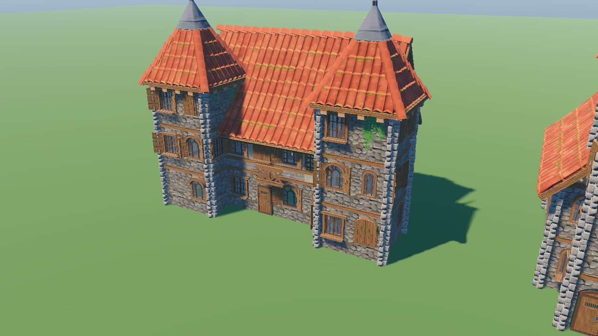

# Sovereign's Eye — 3D art plan (Quaternius direction)

**Target look:** sleek, textured, stylized fantasy (Quaternius). Not voxel, not blocky, not chibi.
Kenney, the blocky set and the KayKit alternatives stay in `3D/` as **reference only**. They are hidden from Godot with `.gdignore` and are never shipped.

This plan was written after inspecting:
- `3D/ASSET_MANIFEST.csv`: 1,404 models; 377 of them Quaternius.
- `3D/VALIDATION.json`: 1,404 / 1,404 valid, no missing dependencies.
- The Quaternius folder READMEs.
- `3D/research/SCALABILITY_ROADMAP.md`.

 

---

## 1. What the game uses now

| Library folder | What we use | Where in code |
|---|---|---|
| `environments/quaternius-medieval-village-standard/models/` (176 modules, 22 shared PNGs; folder kept whole) | Walls (plaster, uneven brick), corners, window walls with frames and shutters, doors, floors, tiled roofs, gable ends, tower roofs, chimneys, vines, balconies, crates, wagon. The brick and cobble textures also pave the roads and square. | `scripts/world/village_kit.gd`, recipes in `data/building_kit.json` |
| `character-tests/quaternius-universal-base-standard/models/` | Male and female bodies; Hair_SimpleParted, Long, Buns, Buzzed, BuzzedFemale; Hair_Beard; the eyebrows built into the bodies | `scripts/characters/human_model.gd`, `shaders/human_*.gdshader` |
| `animations/.../UAL1_Standard.glb` and `UAL2_Standard.glb` (**in-place**) | 84 clips mapped to villager activities | `data/animations.json` |
| `animations/.../*_RM.glb` (root motion) | **Not imported yet** (marked "skip"). Game code moves villagers, so the in-place clips are correct (rule 7). Root motion is reserved for cutscenes and scripted moves (rule 8). | — |

### Buildings: reusable prefabs

**Recipes.** Each building type is a data recipe made of blocks on the kit's 2 m grid:

- cells, stories (3 m each), wall set;
- roof type (tiles with a ridge direction, or a tower roof);
- door position, chimney, balcony, props.

There are 11 types with 1–3 variants each. Footprints in `data/buildings.json` match the recipes, and a test enforces that.

**Assembly.**
- A recipe is assembled **once** into a prefab, and every building of that type and variant reuses the same meshes.
- **Shell:** all walls, roof and window pieces are merged into one mesh with one surface per shared material. That is 5–9 draw calls per building instead of 60–150 loose pieces (rule 3).
- **Details:** shutters, vines and props sit in a second mesh. It has no shadows and is hidden beyond 90 m (rule 6).
- **Shared materials:** every module that uses `MI_Plaster`, `MI_RoundTiles` and so on ends up with the *same* Material object (rule 4).
- **Collision:** one box per block on collision layer 2 (rule 5).
- **Ground fit:** each building sits on the lowest corner of its footprint so no wall floats on a slope.
- **Fallback:** if the kit folder is missing, the old primitive buildings are used automatically, so the game never breaks.

### Villagers

**Body.**
- The body is chosen by gender and scaled by the villager's height and build. Children get proportionally larger heads.
- Hair and beard meshes are bound to the body skeleton by bone name.
- Hair, beard and eyebrows are recolored per villager from their data (auburn, blond, grey and so on).
- Skin tone is recolored the same way.

**Clothing: Quaternius Modular Character Outfits (free sampler).**
- Villagers wear the head of the base body plus real outfit pieces: torso, sleeves with hands, trousers, shoes or boots, and optional hoods and shoulder armor.
- `scripts/characters/outfit_kit.gd` picks a look from `data/outfits.json`, using the occupation's outfit style and headwear:

  | Outfit style | What they wear |
  |---|---|
  | Tunic (farmers, children, apprentices) | Peasant set, sometimes with Ranger trousers or boots |
  | Apron (crafts and trades) | Peasant set |
  | Robe (priests, herbalists, elders) | Peasant set |
  | Armor (soldiers, guards, knights) | Ranger set with shoulder armor |
  | Fine / gown (nobles, steward, merchant) | Ranger set in the brown leather colorway |

  - Hooded jobs (woodcutter, priest, herbalist) get the Ranger hood, which hides the hair.
  - Each set has two colorways. A villager gets the one closest to their primary clothing color, so the AI portrait prompt (which now describes the real clothes) matches the 3D model.
- The pieces share the base rig's bone order. Each look is merged into **one skinned mesh**, with one surface per material and generated LODs, and that mesh is shared by everyone wearing the look. The skeleton switches to the outfits' slightly narrower "Regular" shoulders and hips.
- Hands and head use `shaders/human_skin.gdshader`, which re-tints each texture to the villager's skin tone relative to its own average brightness. Hands and face therefore match.
- Without the pack, the old painted-on clothing (`shaders/human_body.gdshader`) is used automatically.
- Before/after: `docs/screenshots/outfits_before_after.jpg`.

**Animation.**
- Walk, idle, talk and job-specific work clips: farmers harvest, plant and water; woodcutters chop; priests use the spell idle; knights drill with sword combos.
- Each villager picks from a list by id, so the crowd doesn't move in lockstep.
- The pelvis motion is rescaled per body so feet stay on the ground.

**Performance.**
- Each villager costs one material and per-instance colors; no material copies.
- The animation library is shared.
- Body LODs are generated at load.

**Fallback.** If the files are missing, the old primitive bodies are used.

### Ground: meadow shader (no assets needed)
- `shaders/terrain_meadow.gdshader` turns the flat green terrain into a meadow. It adds:
  - sunlit and lush patches
  - grass clumps that catch the light
  - fine grain
  - occasional bare earth
  - drifts of wild flowers
- `scripts/world/ground_wear.gd` bakes a 512 px mask from the layout. The grass wears down along roads, around the square, at doorsteps and along field fences.
- All numbers are in `data/art_style.json` → `terrain`.
- Before/after: `docs/screenshots/ground_before_after.jpg`.
- Works on the Forward+, Mobile and Compatibility renderers.
- Real 3D grass tufts, flowers and rocks come from the Nature MegaKit (next section).

### Nature: Stylized Nature MegaKit (free Standard, 68 models)
- `scripts/world/nature_kit.gd` loads the kit and `VillageBuilder` places it. All numbers are in `data/nature.json`.
- **Trees** stand on the layout's tree spots:
  - broadleaf → CommonTree
  - conifer → Pine
  - birch → the lighter CommonTree shapes
  - Past 75 m, a few broadleaves become a great twisted oak or a dead tree.
- **Leaf tints.** The kit's white leaf maps are tinted per tree, so no two canopies match. Leaf normals are bent away from each canopy's center, so crowns light as soft volumes from the strategy camera.
- **Ground cover** is scattered deterministically from the terrain seed. It stays off trodden ground using the meadow wear mask:
  - meadow grass in patches
  - taller grass along path and wall edges and around tree trunks
  - flower drifts and bushes
  - pebbles along road edges
  - mushrooms under trees
- **Rocks.** Kit rocks replace the old grey blobs.
- **Shader.** `shaders/foliage.gdshader` handles:
  - per-instance tint and wind phase (MultiMesh custom data)
  - vertex ambient occlusion
  - height-weighted wind sway
  - alpha coverage that holds up at distance (leaves don't thin out on small mip levels)
- **Batching.** One MultiMesh per model per 64 m chunk, so the engine can cull and pick LODs per area. Small layers fade out at a set camera distance and don't cast shadows.
  - Phones draw half the ground cover and skip pebbles, mushrooms and the grass around trunks.
  - Measured with the overview camera: about 1,650 draw calls, against about 1,130 with the old primitive trees.
- **Unused kit maps.** Rocks_Desert and Leaves_GiantPine are import-skipped (unused).
- **Before/after:** `docs/screenshots/nature_before_after.jpg`.
- `tools/prefab_gallery.tscn -- <dir> nature` renders every kit model.

### Props: Fantasy Props MegaKit (free Standard, 94 models)
- `scripts/world/prop_kit.gd` composes **sets**: small arrangements of kit models defined in `data/props.json`:
  - a market stall with its goods
  - a smith's anvil with a bucket and chain
  - a tavern table with benches and mugs
- **Layout props** come from sets, picked per prop:
  - stalls: fruit, goods or crockery
  - benches, barrels, crates, dummies and the workshop cart
- **Building dressing** by type is placed relative to the footprint (+Z is the door side). Spots on roads, in fields or inside another building are skipped:
  - smithy: anvil, workbench, weapon stand
  - tavern: outdoor table, barrel rack
  - bakery and mill: sacks
  - storehouse and farmhouse: crates
  - workshop: workbench with tools
  - barracks: weapon rack
  - manor: cauldron
  - cottages: a bucket or barrel
- **Merging.** All props in a 64 m chunk merge into one mesh with one surface per kit material (4 trim materials plus vertex-colored variants). The whole village's props cost a handful of draw calls.
- **Still simple shapes** (no Standard model): well, haystack, lumber pile, signpost, banner pole.
- **No collisions yet.** Props get no collision proxies because nothing collides with them (villagers follow the road graph). Add simple boxes when navmesh pathing arrives.
- `tools/prefab_gallery.tscn -- <dir> props` renders every prop; `tools/capture.tscn -- <seed> <dir> art` includes stall, smithy and tavern close-ups.
- Showcase: `docs/screenshots/props_showcase.jpg`.

### Import settings (committed `.import` files)
- Village and body textures: VRAM compressed with mipmaps, capped at **1024 px**; eyes 256, vines 512. That's plenty for a strategy camera and keeps downloads around 50 MB.
- Hair GLBs discard their duplicated embedded textures. All hair shares the two hair texture sheets extracted from the bodies.
- The root-motion files, `Mannequin_F.glb` and `ASSET_MANIFEST.csv` are set to `importer="skip"`: not imported and not exported.

---

## 2. How the assets fit the game's progression

| Stage | Readiness | What carries it | What it still needs |
|---|---|---|---|
| **Tiny town** (Phase 1, now) | **Playable** | Village kit prefabs, outfit sampler (Peasant/Ranger), Nature MegaKit trees and ground cover, Fantasy Props stalls and trade dressing, 84 clips | Outfit Source for nobles, knights and clergy; well, haystack and signpost models |
| **Large village** | Mostly | Larger recipes plus markets, workshop equipment, furniture, and dressing props | Interiors; crops, population variety |
| **Town / city districts** | Partial | Dense multi-story blocks from the same modules. Prefabs + MultiMesh instancing for repeated houses | Civic landmarks, wealth tiers, signage, plazas; district streaming (§4) |
| **Kingdom / capital** | Missing | Residential/commercial districts only | Palace/keep, monumental walls and gates, towers, barracks, temples, throne room, bridges |
| **Harbor and ships** | Missing | Crates and wagon for early dock dressing only | Docks, piers, cranes, ropes, sails, cargo, ship interiors, several ship classes |

The first acquisition steps are complete: clothing → nature → props. Next are
bodies and hair variety → town landmarks → kingdom → harbor/ships. Each step has
a matching Quaternius pack, so the art never drifts out of one family.

---

## 3. Missing models: flagged, not silently replaced (rule 10)

Prices were checked on Quaternius's itch.io pages on 2026-10-14. All of these packs are CC0.

| Gap (what you see in game today) | Fix | Edition / price | Priority |
|---|---|---|---|
| **Clothing variety.** The free sampler is integrated, but it only has Peasant and Ranger sets. Nobles wear fine leather, priests wear peasant clothes with a hood, and soldiers wear leather with shoulder armor. There are no gowns, robes, plate armor or crowns. | **Modular Character Outfits – Fantasy Source**: 12 outfits from 62 parts. The publisher preview shows a crowned queen in a gown, a noble's coat, plate armor and a mage's robes. | **Standard: integrated**; Source $20 | **1 — buy Source for nobles, knights and clergy** |
| **Body variety.** Only "Superhero" proportions, so children look like small adults | **Universal Base Characters Source**: 6 bodies (Superhero, Regular, Teen × male/female), 20 hairstyles, eye and skin color shaders | $19.99 (we have the free Standard) | 2 |
| **More nature variety.** The free Standard (68 of 116 models) is integrated. It lacks the kit's extra plants, rocks and stylized foliage shaders. | **Stylized Nature MegaKit** Pro/Source | **Standard: integrated**; Pro $9.99; Source $14.99 | 6 — nice to have |
| **Well, haystack, lumber, signpost, bread oven, tavern sign.** The free props (stalls, anvil, benches, barrels, crates, tables, tools) are integrated; these few have no Standard model | **Fantasy Props MegaKit** Pro/Source (200+ props, worn variants, collisions) or custom | **Standard: integrated**; Pro $9.99; Source $14.99 | 5 |
| More village modules (304 vs 176) and ready-made collisions | Medieval Village MegaKit Source | Pro $9.99 / Source $14.99 | 5 |
| **Windmill.** Kit tower plus simple boards in the kit's wood material | Ultimate Fantasy RTS (selected landmarks) or a custom model | free / custom | 6 |
| **Chapel / temple.** Built from village walls and a tower roof | Church/temple pieces: custom, or a future Quaternius kit | — | 6 |
| **Barracks / military.** Plain stone hall, no crenellations or racks | Castle/military pieces in this style | — | 7 |
| **Hats, helmets, crowns.** Not shown in 3D (portraits still describe them) | Outfit pack accessories | (in the outfits pack) | with 1 |
| **Palace, keep, walls, gates, throne room** | Ultimate Modular Ruins (damaged areas), plus a custom or new kit for intact royal architecture | — | kingdom phase |
| **Docks, ships** | Pirate Kit (71 models) as the starting point; review against the village kit first | — | harbor phase |

**Budget.**
- All the free Standard editions: **$0**.
- Every Source edition above: about **$85** one-time.
- Alternatively, Quaternius's Patreon is $10/month for one Source key per month.

**Acquisition status.** The free outfit, nature, and prop samplers are now in
`3D/` and all three are wired in. The next optional purchases are the outfit Source
($20) for nobles, knights and clergy, and the Source body pack for more body and hair
variation.

---

## 4. Scaling plan

**LOD and detail.**
- Building details already cull at 90 m, and body LODs are generated at load.
- Next: a distant **silhouette mesh** per prefab (walls + roof only, merged, roughly 5% of the triangles), swapped in through visibility ranges past about 150 m.
- Villager animation already only runs while the villager is visible. At city scale, far crowds update every Nth frame.

**District streaming (town and capital).**
- The map is split into district chunks, each a scene: road mesh, prefab instances (MultiMesh for repeated houses) and collision boxes.
- Chunks within the camera radius are loaded on a background thread (`ResourceLoader.load_threaded_request`).
- Far chunks show one merged "HLOD" silhouette mesh per district.
- Interiors are separate scenes, loaded only when the camera enters a building.
- Characters always exist as data (already true). Only those near the camera get bodies.

**Ships (rule 9).** Each ship class is five separate scenes:
1. exterior hull;
2. walkable deck with its own navigation;
3. interior (streamed in on boarding);
4. collision proxies;
5. distant silhouette.

A ship is a moving parent node, so crew stay parented to the deck while it sails.

**Grid discipline.** All recipes use the kit's 2 m grid and 3 m stories. New packs must snap to the same grid so buildings from different packs line up.

---

## 5. Where things live

```
3D/                                   asset library (unchanged layout)
  environments/quaternius-medieval-village-standard/   used: village kit
  environments/quaternius-stylized-nature-standard/    used: trees, ground cover, rocks
  props/quaternius-fantasy-props-standard/              used: stalls, trade dressing, furniture
  character-tests/quaternius-universal-base-standard/  used: heads, eyes, hair (bodies = painted fallback)
  characters/quaternius-modular-outfits-fantasy-standard/  used: outfit parts (models/parts; models/outfits are import-skipped duplicates)
  animations/quaternius-universal-animation-library-*  used: in-place clips
  alternatives/, characters/blocky/, castle-kit/, fantasy-town-kit/, previews/, tools/, research/, licenses/
                                       .gdignore'd (reference only, never shipped)
data/building_kit.json                building recipes + list of missing pieces
data/animations.json                  activity -> clip mapping
scripts/world/village_kit.gd          prefab assembly, shared materials, paving, night glow
data/outfits.json                     occupation outfit style -> outfit pieces, colorways
scripts/characters/human_model.gd     Quaternius villagers (head, hair, animation)
scripts/characters/outfit_kit.gd      outfit looks, merged per-look meshes, skeleton proportions
shaders/human_skin.gdshader           skin tone for heads and the outfits' hands
shaders/human_body.gdshader           skin tone + painted clothing (fallback without the outfit pack)
shaders/human_hair.gdshader           hair/beard/eyebrow color
data/nature.json                      tree models per layout kind, tints, wind, scatter layers
data/props.json                       prop sets, layout prop -> sets, building dressing
scripts/world/prop_kit.gd             prop sets, merged per-chunk prop meshes
scripts/world/nature_kit.gd           nature models, foliage materials, chunked MultiMeshes
shaders/foliage.gdshader              tint, vertex AO, wind sway, distance-safe leaf alpha
shaders/terrain_meadow.gdshader       meadow ground (scripts/world/ground_wear.gd bakes its path mask)
tools/prefab_gallery.tscn             renders every prefab, a villager lineup, or every nature model to PNG
tests/test_art_pipeline.gd            footprints, prefab merging, bodies, outfits, ground wear, nature placement
```
